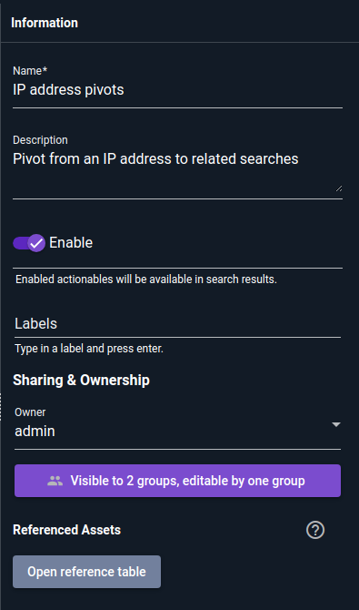
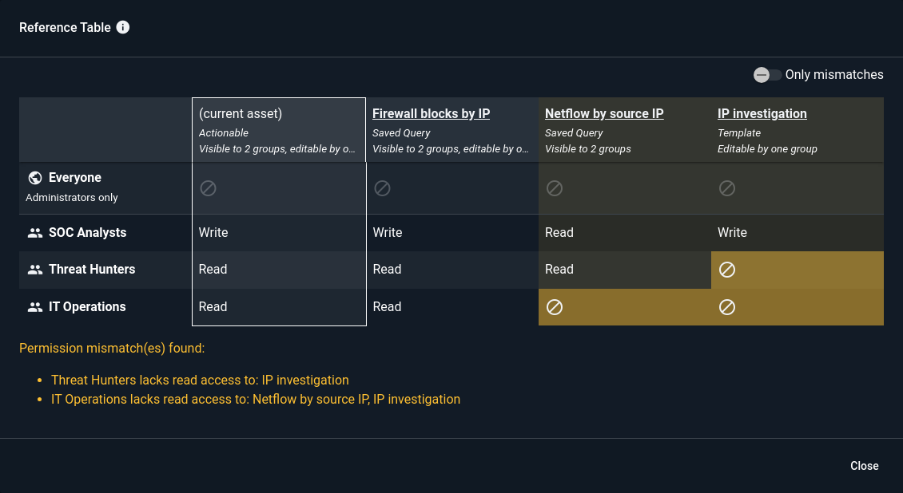
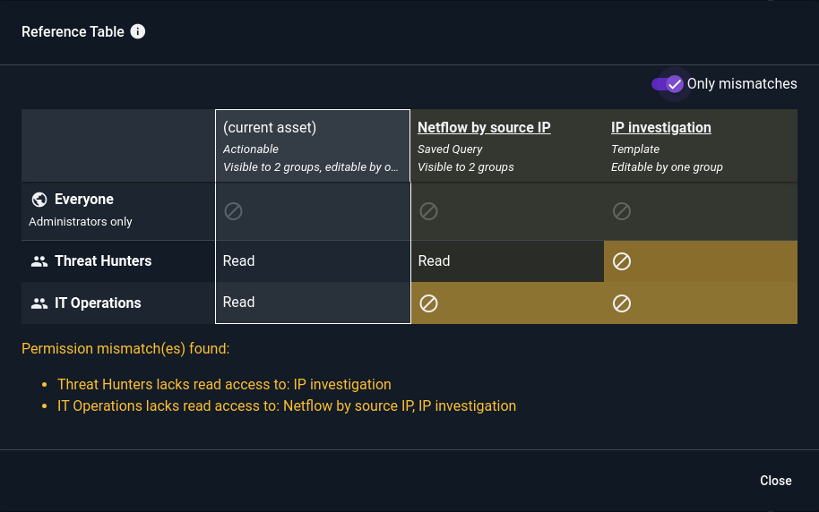
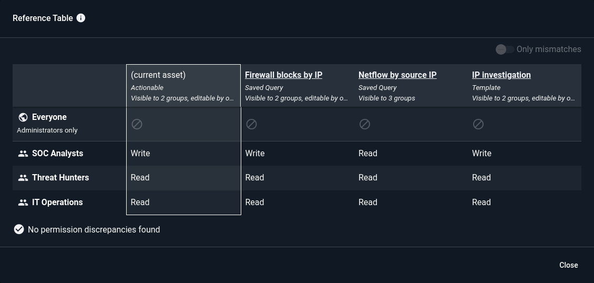

# Reference Table

Many Gravwell assets depend on other assets. An actionable can run a saved query or launch a template. A dashboard tile can be backed by a scheduled search. A playbook can embed images stored as user files. Each of these assets has its own sharing settings, and they don't have to match.

When they don't match, people can see an asset but can't use all of it. If you share an actionable with a group but not the template it launches, members of that group will see the actionable's menu item, and the action will fail when they click it.

The Reference Table shows the sharing settings of an asset next to the sharing settings of every asset it references, so you can find and fix these gaps before they reach your users.

## Where to Find It

The Reference Table is available on the editing page of the following assets. In each case, look for the **Referenced Assets** heading and click **Open reference table**:

| Asset | Where the button is | Referenced assets shown |
|-------|---------------------|-------------------------|
| [Actionables](/gui/actionables/actionables) | Information panel, below Sharing & Ownership | Saved queries, templates, and dashboards used by the actionable's actions |
| [Dashboards](/gui/dashboards/dashboards) | Dashboard settings, below Sharing & Ownership | Saved queries, scheduled searches, and templates used by the dashboard's tiles |
| [Scheduled Searches](/scripting/scheduledsearch) | Information panel, below Sharing & Ownership | The saved query the search runs, if it uses one from the Query Library |
| [Alerts](/alerts/alerts) | Information panel, below Sharing & Ownership | The alert's dispatchers and consumers |
| [Flows](/flows/editor) | Flow settings, below the sharing settings | Saved queries and secrets used by the flow's nodes |
| [Playbooks](/gui/playbooks/playbooks) | Information panel, below Sharing & Ownership | The cover image, banner image, and any files embedded in the playbook body |

If the asset doesn't reference anything yet, the button is disabled and shows a "No references" tooltip.

The list of references follows your edits as you make them. For example, if you add a "Run a saved query" action to an actionable, that saved query appears in the Reference Table right away, before you save the actionable.

## Reading the Table

The example above is for an actionable named "IP address pivots". It has three actions: two run saved queries and one launches a template.

**Columns.** The first data column, outlined and labeled **(current asset)**, is the asset you are editing. Each remaining column is one referenced asset, sorted by asset type and then by name. Under each name you'll see the asset type and a summary of its sharing, such as "Visible to 2 groups". Click a referenced asset's name to open it in a new browser tab.

**Rows.** Each row is a way that access can be granted:

* **Everyone** shows global sharing. The note "Administrators only" is a reminder that only administrators can share an asset with everyone.
* Each group row shows the access that group has.

**Cells.** A cell shows **Write**, **Read**, or a no-access icon (a circle with a line through it). Write access includes read access.

The values in the current asset's column come from the form you're editing, not from the saved asset. If you change the asset's sharing and then open the Reference Table, it reflects your unsaved changes.

## Permission Mismatches

A *mismatch* happens when a group (or everyone) has access to the current asset but has no access at all to a referenced asset. Members of that group can open the current asset but can't use the part of it that depends on the referenced asset.

The table highlights mismatches in two ways:

* Every column for a referenced asset with a mismatch is tinted.
* Each cell where the access is missing is highlighted more strongly, so you can see which groups need access.

Below the table, a list describes each mismatch in words. In the example above:

* **Threat Hunters lacks read access to: IP investigation.** Threat Hunters can read the actionable, but can't read the "IP investigation" template, so the "Investigate IP" action won't work for them.
* **IT Operations lacks read access to: Netflow by source IP, IP investigation.** IT Operations can read the actionable, but can't read either of those assets.

Note that "Netflow by source IP" gives SOC Analysts **Read** access, while the actionable gives them **Write** access. This is not a mismatch. The table flags a reference only when it grants a group *no* access.

Groups that have no access to the current asset are never flagged, because they can't open the current asset anyway.

### Showing Only Mismatches

With many references or many groups, the table can get wide. Turn on the **Only mismatches** toggle to hide every referenced asset and every group that has no mismatch:

The toggle is disabled when there are no mismatches. If you fix the last mismatch while the toggle is on, it turns itself off.

## Fixing Mismatches

The Reference Table is read-only. To fix a mismatch, change the sharing on one of the two assets.

**To give the group access to the referenced asset:**

1. Click the referenced asset's name in the table header. It opens in a new browser tab.
1. In that tab, change the asset's sharing to include the missing group, and save it.
1. Go back to the original tab. The Reference Table updates automatically after the save; you don't need to close and reopen it.

**To remove the group's access to the current asset**, close the Reference Table, change the sharing settings in the form, and open the table again. Remember to save the current asset afterwards.

Choose based on who should have access. If IT Operations shouldn't see netflow data at all, removing their access to the actionable is better than sharing the netflow query with them.

When everything matches, the table says **No permission discrepancies found**:

## Example: Sharing an Actionable with a New Team

Suppose your SOC Analysts group owns an actionable that pivots from an IP address to two saved queries and an investigation template. You want to share it with the Threat Hunters group.

1. Open the actionable and, in the Information panel, add Threat Hunters with read access under Sharing & Ownership.
1. Click **Open reference table**. The Threat Hunters row is now in the table. Any referenced asset that isn't shared with Threat Hunters is highlighted, and the list below the table names it.
1. Click the name of each highlighted asset, add Threat Hunters to its sharing in the new tab, and save it.
1. Return to the actionable's tab. When the table shows "No permission discrepancies found", close it and save the actionable.

Threat Hunters can now use every action in the menu.

## Limited Views

What you see in the Reference Table depends on your own permissions:

* **You can't read a type of referenced asset.** If you don't have the capability to read an asset type (for example, `TemplateRead` for templates), references of that type are left out of the table. See [Capability Based Access Controls](/cbac/cbac).
* **You can't list groups.** If you don't have the `ListGroups` capability, the table shows only the groups that have access to the current asset, and names them "Unknown Group (ID: *n*)". Mismatches are still detected and highlighted, and the list below the table describes each one as "Unknown group (ID: *n*) lacks access to one or more assets".

If you suspect the table is incomplete, ask an administrator to check the asset.
