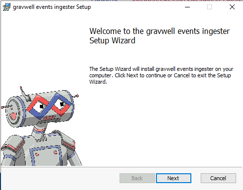
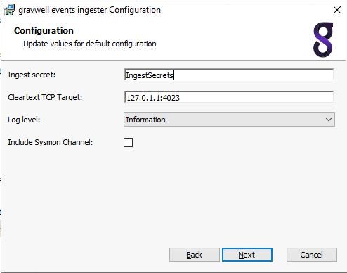
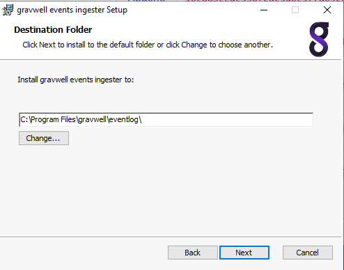
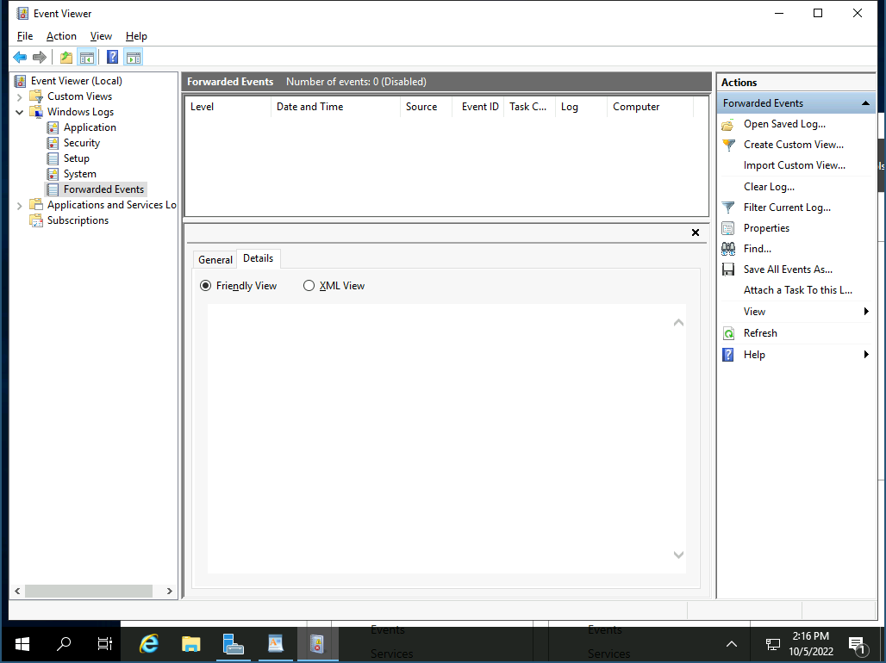

# Windows Event

:::{csv-table}
:align: left
:width: 45%
:widths: 15, 25
**Integration Details**
    Ingester, [Windows Event Ingester](/ingesters/winevent)
    Kit, [Windows Kit](https://github.com/gravwell/kits/tree/main/windows)
:::

## Windows Event Configuration

A well-defined collection strategy and data management are key to achieving data omniscience, especially with logs as cumbersome as those formatted in XML, and thus it is recommended to consider the following:

*Plan your collection strategy accordingly for your environment*

Consider the following to create your use cases:
* Ingestion Strategy
    * **Local vs Remote:** Will the Gravwell Windows Event ingester be deployed locally on each target system, or will you use a Windows Event Collection (WEC) server?
    * **Scale:** Identify the total number of target systems to monitor and if multiple collectors are required to manage load or simplify collection across diverse subnets and DMZs.
    * **Network Trust:** Is a Federator required to securely traverse untrusted networks or restricted segments?
* Resource & Change Management
    * **Hardware Allocation:** Ensure available infrastructure (CPU, RAM, and Storage) meets the requirements of your desired setup.
    * **Agility:** Consider if a configuration change is needed, how quickly/accurately can it be changed across your environment?

### [Option 1] Deploy Locally (to Individual Windows Systems)

Run the .msi installation wizard to install the Gravwell events service. On first installation, the installation wizard will prompt to configure the indexer endpoint and ingest secret. Subsequent installations and/or upgrades will identify a resident configuration file and will not prompt.





```{note}
The Log Level selection is for internal logging only; it does not affect which Windows events are captured by the ingester. Setting the level to Information will cause the ingester to emit log events when it starts, stops, and attaches to event Channels.
```



The ingester is configured with the `config.cfg` file located at `%PROGRAMDATA%\gravwell\eventlog\config.cfg`. The configuration file follows the same form as other Gravwell ingesters with a `[Global]` section configuring the indexer connections and multiple `EventChannel` definitions.

To modify the indexer connection or specify multiple indexers, change the connection IP address to the IP of your Gravwell server and set the Ingest-Secret value. This example shows configuring an encrypted transport:

```ini
Ingest-Secret=YourSecretGoesHere
Encrypted-Backend-Target=ip.addr.goes.here:port
```

Once configured, this file can be copied to any other Windows system from which you would like to collect events.

For silent installation or troubleshooting steps: [Windows Event Ingester](/ingesters/winevent)

### [Option 2] Windows Event Forwarding

The Gravwell Windows Event ingester can be combined with Windows Event Forwarding (WEF) to simplify deployments and reduce the number of endpoints the ingester must be installed on. Windows Event Forwarding is an integrated Windows service that forwards events to a central collection point using integrated Windows functionality. More information on WEF can be found on [several](https://learn.microsoft.com/en-us/windows/security/operating-system-security/device-management/use-windows-event-forwarding-to-assist-in-intrusion-detection) [Microsoft](https://learn.microsoft.com/en-us/archive/technet-wiki/33895.windows-event-forwarding-survival-guide) [resources](https://learn.microsoft.com/en-us/defender-for-identity/configure-event-forwarding).

Configuring Windows Event Forwarding is beyond the scope of this document, but actually collecting the forwarded events is very simple.

First you will need to install the Gravwell Windows Event ingester on the Windows system that will be receiving the forwarded events. Then you will want to validate the name of the channel that is configured to receive the forwarded events on the collection box. Typically that is `ForwardedEvents`.



```{note}
Forwarded events will still contain the correct `Channel` in their logs.
```

### [Option 3] Deploy in an AD Domain Environment with a WEC Server

```{note}
It is recommended that collector servers be placed in a central location relative to their source systems (i.e., the same forest and network as the source systems) as well as their destination (i.e., the Gravwell indexer).
```

#### 1) Create the Collector GPO
* Set the Wecsvc (Windows Event Collector) and WinRM (Windows Remote Management) services to start automatically
* For WinRM client, set the following:
    * Allow Basic authentication: Disabled
    * Allow unencrypted traffic: Disabled
    * Disallow Digest authentication: Enabled
        * **Consider setting "Trusted Hosts" and/or only allowing Kerberos authentication**
    * Desired audit policy (unless already configured)
* For WinRM service, set the following:
    * Allow Basic authentication: Disabled
    * Allow unencrypted traffic: Disabled
    * Disallow WinRM from storing RunAs credentials: Enabled
        * **Consider disabling "Allow remote server management through WinRM", only allowing Kerberos authentication, and/or setting "Specify channel binding token hardening level" (when using HTTPS)**

#### 2) Create the Source GPO
* Set the WinRM (Windows Remote Management) service to start automatically
* Point the sources at the collector: under Computer Configuration > Administrative Templates > Windows Components > Event Forwarding, enable "Configure target Subscription Manager" and add the collector, for example `Server=http://COLLECTOR_FQDN:5985/wsman/SubscriptionManager/WEC,Refresh=60` (the policy's Explain tab gives the full syntax). Without this setting, sources forward nothing.
* Add the NETWORK SERVICE account to the Event Log Readers group on each source, for example with Group Policy Preferences (Local Users and Groups). The forwarder runs as NETWORK SERVICE and cannot read the Security log or other secured channels without it. On a domain controller this is the domain's built-in Event Log Readers group.
* For WinRM client, set the following:
    * Allow Basic authentication: Disabled
    * Allow unencrypted traffic: Disabled
    * Disallow Digest authentication: Enabled
        * **Consider setting "Trusted Hosts" and/or only allowing Kerberos authentication**
* For WinRM service, set the following:
    * Allow Basic authentication: Disabled
    * Allow unencrypted traffic: Disabled
    * Disallow WinRM from storing RunAs credentials: Enabled
        * **Consider disabling "Allow remote server management through WinRM" if remote management of these computers should be disabled and/or only allowing Kerberos authentication as this is the most secure option available for authentication**

#### 3) Confirm the GPOs Applied

After the GPOs are pushed and the servers and clients have restarted, run this in an administrator PowerShell on the collector and on a source system:

```powershell
gpresult /r /scope computer
```

The collector or source GPO should be listed under "Applied Group Policy Objects". If it is missing or listed as filtered out, check in Group Policy Management that the GPO is linked to the computer's OU and that no WMI filter excludes it.

#### 4) Create the Subscriptions

Copy the subscription XML files for the level of event collection you want to the collector (the programs under Additional Resources publish sets of them), then create a subscription from each file:

```powershell
wecutil cs "PATH_TO_XML"
```

```{note}
A subscription sends events in one of two formats: RenderedText (the Windows default), which adds the Event Viewer message text to each event, or Events, the plain event XML that a local installation of the ingester also sends. Gravwell and the Windows Kit extract the same fields and return the same results from either, so keep whichever format you already use. Events is smaller to store and lets one collector handle more events; RenderedText keeps the message text for free-text searches. To switch a subscription to Events, run `wecutil ss "SUBSCRIPTION_NAME" /cf:Events`.
```

#### 5) Check the Subscriptions

List the subscriptions with `wecutil es`, or open Event Viewer and select Subscriptions in the left pane.

#### 6) Size the Forwarded Events Log

In Event Viewer, open the properties of the Forwarded Events log and check that:

* The maximum log size suits your event volume, for example 4194240 KB (4 GB).
* The retention setting is the one you want.

#### 7) Wait for Events

Once each source system updates group policy, events appear in the Forwarded Events log on the collector.

## Gravwell Configuration

### Gravwell Storage Well Configuration

Set up the well configuration in your Gravwell indexers.

**Sample well config:**  
Create or edit: `/opt/gravwell/etc/gravwell.conf.d/windowsevent-well.conf`
```ini
[Storage-Well "windowsevent"]
    Location=/opt/gravwell/storage/windowsevent
    Tags=windows_*
```

```{note}
The `sysmon` tag in the sample configuration below is stored in the well from the [Sysmon](/integrations/host/sysmon) guide (`Tags=sysmon*`). If you have not created that well, create it before you add the `sysmon` channel.
```

### Tags

Send each event channel to its own tag. The [Windows Kit](https://github.com/gravwell/kits/tree/main/windows) reads Security and System events from `windows_security` and `windows_system`; use these names:

* `windows_security`: the Security channel
* `windows_system`: the System channel
* `windows_application`: the Application channel
* `sysmon`: Sysmon, as in the [Sysmon](/integrations/host/sysmon) guide

The Windows tags match the storage well above (`Tags=windows_*`); `sysmon` goes to the Sysmon guide's well (`Tags=sysmon*`). If you already collect Windows events under other tag names, either keep them and set the Windows kit's macros to your tag names, or change `Tag-Name` in your configuration; events already stored keep their old tag.

### Gravwell Ingester Configuration: Windows Event
**Sample Windows Event config:**  
Create or edit: `%PROGRAMDATA%\gravwell\eventlog\config.cfg`

#### [Option 1] Deploy Locally (to Individual Windows Systems)
```ini
[EventChannel "system"]
    Tag-Name=windows_system
    Channel=System

[EventChannel "application"]
    Tag-Name=windows_application
    Channel=Application

[EventChannel "security"]
    Tag-Name=windows_security
    Channel=Security

[EventChannel "sysmon"]
    Tag-Name=sysmon
    Channel="Microsoft-Windows-Sysmon/Operational"
    Max-Reachback=24h # reachback must be expressed in hours (h), minutes (m), or seconds (s)
```

Each `EventChannel` can also be narrowed to particular providers, event IDs or levels (`Provider`, `EventID`, `Level`); see [Windows Event Ingester](/ingesters/winevent). A narrowed channel drops every other event from it, including events a kit may read, so start with the full channel.

#### [Option 2] Windows Event Forwarding
All forwarded events arrive on one channel, `ForwardedEvents`. Each event still names its original channel, so the `regexrouter` preprocessor sends it to the same tag it would get from a local install:
```ini
[EventChannel "WEF Events"]
    Tag-Name=windows_forwarded
    Channel=ForwardedEvents
    Preprocessor=winchannel

[Preprocessor "winchannel"]
    Type=regexrouter
    Drop-Misses=false
    Regex="<Channel>(?P<channel>[^<]+)</Channel>"
    Route-Extraction=channel
    Route=System:windows_system
    Route=Application:windows_application
    Route=Security:windows_security
    Route=Microsoft-Windows-Sysmon/Operational:sysmon
```

Events from any other channel keep the `windows_forwarded` tag.

#### [Option 3] Deploy in an AD Domain Environment with a WEC Server
Events arrive on the WEC server via the same `ForwardedEvents` channel as [Option 2], so the same `[EventChannel "WEF Events"]` and `[Preprocessor "winchannel"]` stanzas shown above apply here.

```{note}
Remember to restart the Gravwell Windows Event service via standard Windows service management to apply the new config, for example `Restart-Service 'GravwellEvents Service'` in an administrator PowerShell.
```

After the restart, search `tag=windows_* count by TAG` in Gravwell: each channel you configured should show a count. `windows_forwarded` appears only for forwarded events from channels the preprocessor doesn't route.

## Additional Resources
* [Microsoft WEC/WEF documentation](https://learn.microsoft.com/en-us/windows/security/operating-system-security/device-management/use-windows-event-forwarding-to-assist-in-intrusion-detection)
* [Windows Event Collection server setup](https://learn.microsoft.com/en-us/windows/win32/wec/setting-up-a-source-initiated-subscription)
* [NSA WEC/WEF program](https://github.com/nsacyber/Event-Forwarding-Guidance/blob/master/README.md)
* [Palantir WEC/WEF program](https://github.com/palantir/windows-event-forwarding)
* [ASD WEC/WEF program](https://www.cyber.gov.au/resources-business-and-government/maintaining-devices-and-systems/system-hardening-and-administration/system-monitoring/windows-event-logging-and-forwarding)
