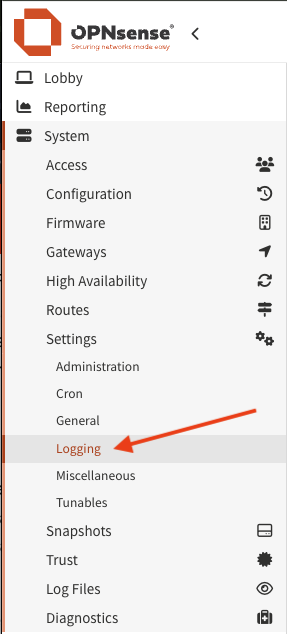
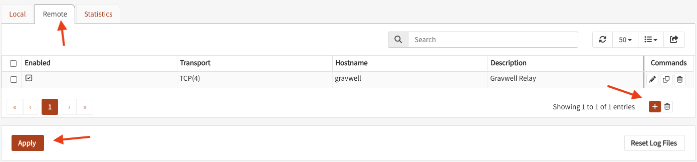
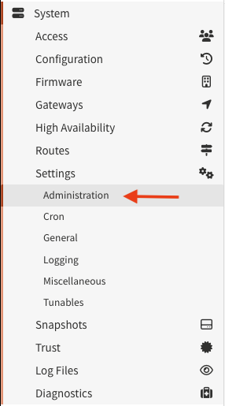

# OPNsense

:::{csv-table}
:align: left
:width: 45%
:widths: 15, 25
**Integration Details**
    Ingester, [Simple Relay](/ingesters/simple_relay)
:::

This guide sends the system logs of an OPNsense firewall to Gravwell. They record which connections each firewall rule passed, blocked or translated, DHCP leases, web GUI logins and configuration changes with the user who made them. OPNsense sends them to Simple Relay over syslog, with no additional installation. Gravwell stores them under the `opnsense` tag.

The steps in this guide were tested on OPNsense 25.7.11 and 26.7.8.

## OPNsense Configuration

Add the Simple Relay listener first (see "Gravwell Ingester Configuration: Simple Relay" below), so OPNsense can connect as soon as you apply the destination.

### Remote Logging

In the OPNsense web interface, go to **System** > **Settings** > **Logging**, open the **Remote** tab and click **+** below the list of destinations.





Set:

* **Enabled**: Checked.
* **Transport**: `TCP(4)`, or `TCP(6)` if you reach Simple Relay over IPv6.
* **Applications**: Leave as **Nothing selected**. An empty list sends every application, including ones that plugins add later. A list sends only the applications selected.
* **Levels**: Leave as **Nothing selected**. A selected level sends only messages at exactly that level, not that level and above. Firewall rule decisions are logged at the informational level.
* **Facilities**: Leave as **Nothing selected**. Applications log to different facilities, and some use more than one, so a facility list drops part of their messages.
* **Hostname**: The address of your Simple Relay.
* **Port**: `15170`, the port of the Simple Relay listener below.
* **RFC5424**: Checked. Without it, OPNsense sends timestamps with no year and no UTC offset, and Gravwell reads them as UTC, so entries from a firewall that is not set to UTC are stored hours off. RFC 5424 timestamps include the offset.
* **Suppress duplicate messages** (shown only in newer OPNsense versions): Unchecked. It replaces repeated messages with a summary line.
* **Description**: Use an identifiable name, for example `Gravwell Relay`.

Click **Save**, then **Apply**.

```{note}
Firewall rule decisions are usually most of the volume. OPNsense logs packets matched by its default block and default pass rules unless you turn that off, and packets matched by any rule with logging enabled. To change what the firewall logs, use **Firewall** > **Settings** > **Advanced** (Logging section) and the logging option of each rule, not the filters above, so the firewall's other logs keep arriving.
```

### Web GUI Access Log

The web GUI access log records each request to the OPNsense web GUI and API, with the client address, the page or API path and the result. It is the only record of successful API calls made with an API key and of configuration backup downloads. It is off by default, and this guide recommends turning it on.

Go to **System** > **Settings** > **Administration**, and under **Access log** check **Enable access log**. Click **Save**. The web GUI reloads.



## Gravwell Configuration

### Gravwell Storage Well Configuration

Set up the well configuration in your Gravwell indexers.

**Sample well config:**  
Create or edit: `/opt/gravwell/etc/gravwell.conf.d/opnsense-well.conf`
```ini
[Storage-Well "opnsense"]
    Location=/opt/gravwell/storage/opnsense
    Tags=opnsense
```

If the tag already has data in another well, leave it in its current well and skip this sample. Gravwell does not move stored entries when a tag is assigned to a different well, and entries already stored under the tag stop being searchable. See "Tag Restrictions and Gotchas" in [Advanced Gravwell Configuration](/configuration/configuration).

### Gravwell Ingester Configuration: Simple Relay

This guide assumes Simple Relay is already installed and configured as described in [Simple Relay](/ingesters/simple_relay). Add the following to a new overlay file.

**Sample OPNsense Simple Relay config:**  
Create or edit: `/opt/gravwell/etc/simple_relay.conf.d/opnsense.conf`
```ini
[Listener "opnsense"]
    Bind-String="tcp://0.0.0.0:15170"
    Reader-Type=rfc5424
    Tag-Name=opnsense
```

This listener accepts unencrypted TCP. Simple Relay also supports TLS listeners (see "Bind-String" in [Simple Relay](/ingesters/simple_relay)), and OPNsense can send over TLS, but this guide does not cover that setup.

```{note}
Remember to restart the service to apply the new config:
`sudo systemctl restart gravwell_simple_relay.service`
```

To confirm data is arriving, run `tag=opnsense count`. Gravwell reports an unknown tag until the first entry arrives.

## Additional Resources
* [OPNsense: Settings, Logging](https://docs.opnsense.org/manual/settingsmenu.html#logging)
* [Simple Relay](/ingesters/simple_relay)
