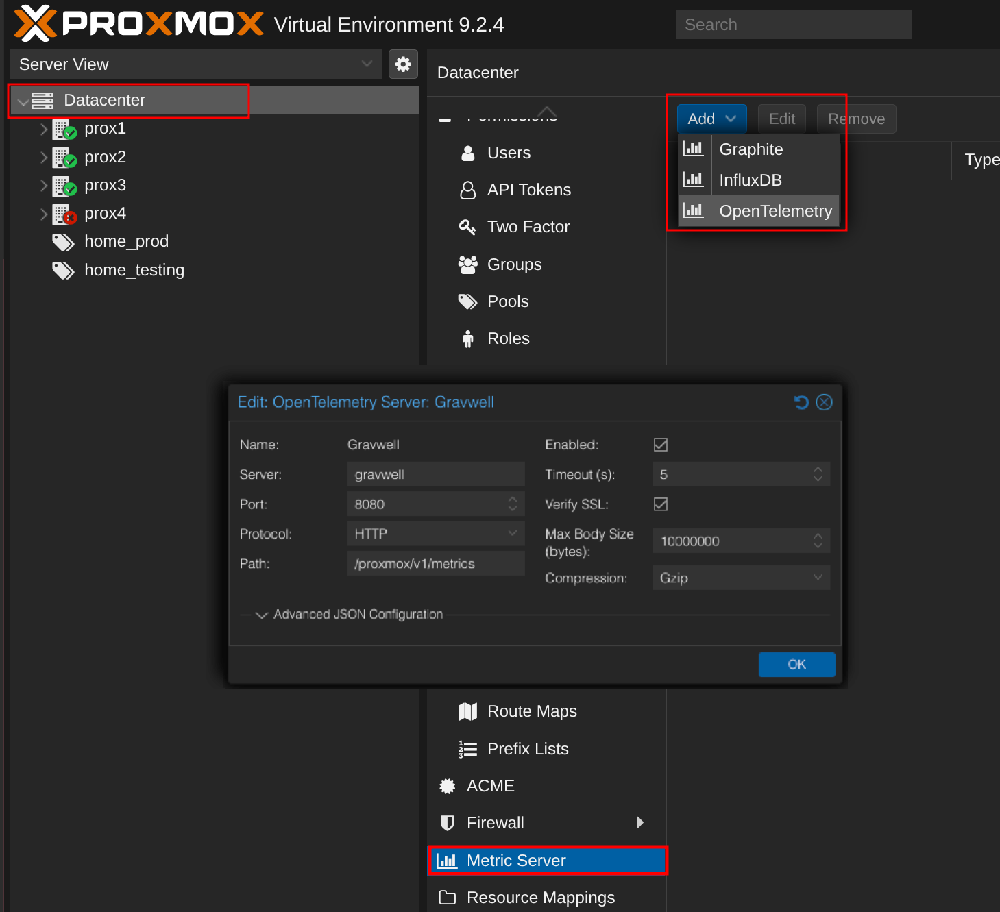

# Proxmox VE

:::{csv-table}
:align: left
:width: 45%
:widths: 15, 25
**Integration Details**
    Ingester, [HTTP Ingester](/ingesters/http) <br /> [Simple Relay](/ingesters/simple_relay)
:::

This guide sends metrics and system logs from Proxmox Virtual Environment (Proxmox VE) nodes to Gravwell. The two options collect different data, so you can use either one or both:

* **[Option 1] OpenTelemetry metrics (Proxmox VE 9.0 and later):** Proxmox VE sends metrics about each node, virtual machine, container and storage to the HTTP Ingester. This method requires no additional installation and is useful for monitoring system, storage and network usage. Gravwell stores them under the `proxmox-metrics` tag.
* **[Option 2] System logs:** each node's system log, which includes Proxmox VE actions such as VM power-on and restart, forwarded to Simple Relay. This method requires installing `rsyslog` on each node. Gravwell stores them under the `proxmox-syslog` tag.

The steps in this guide were tested on Proxmox VE 9.2.24. Option 2 was also tested on Proxmox VE 8.4.

## Proxmox Configuration

### [Option 1] Exporting Proxmox Metrics via OpenTelemetry

The OpenTelemetry metric server is available in Proxmox VE 9.0 and later. Add the HTTP Ingester listener first (see "Gravwell Ingester Configuration: HTTP Ingester" below): Proxmox VE tests the connection when you save the metric server, and the save fails until the listener exists.

In the Proxmox web interface, go to **Datacenter** > **Metric Server** > **Add** > **OpenTelemetry** to send metrics to the HTTP Ingester, and set:

* **Name**: Use an identifiable name.
* **Server**: Set to the address of your HTTP Ingester.
* **Port**: Set to the port your HTTP Ingester listens on (its `Bind` setting, see [HTTP Ingester Setup](/integrations/generic/http_ingester)).
* **Protocol**: Set to the protocol used by your HTTP Ingester. Proxmox VE defaults to `https`; choose `http` if your HTTP Ingester does not use TLS.
* **Path**: Set to the `URL` value in your HTTP Ingester listener (`/proxmox/v1/metrics` in the sample below).



Proxmox VE sends every metric every 10 seconds, and Gravwell stores each data point as one entry, so the volume grows with the number of virtual machines, containers and storages. For example, a node with 45 VMs, 22 containers and 4 storages sends about 3,300 data points every 10 seconds. That is about 29 million entries and about 1.3 GB on disk per day. Set the well's retention with this in mind.

### [Option 2] Forwarding Proxmox System Logs to Simple Relay

Proxmox VE writes its logs to the systemd journal. `rsyslog` forwards them to Gravwell Simple Relay, one entry per log message. Fresh installs of Proxmox VE 8.0 and later do not include `rsyslog`; nodes upgraded from earlier releases usually still have it. Run the following as `root` on each Proxmox VE node; every node sends its own logs.

1. Install `rsyslog`. If it is already installed, this changes nothing:

    ```bash
    apt update && apt install rsyslog
    ```

2. Check for existing forwarding rules. Run this before creating the file in the next step:

    ```bash
    grep -snE '^[^#]*(@@?[^ ]|omfwd)' /etc/rsyslog.conf /etc/rsyslog.d/*.conf
    ```

    No output means nothing is forwarded today. A line that sends to your Gravwell host (for example `*.* @gravwell.example.com:514`) would make the node send every message twice; remove or comment it out. Leave forwards to other destinations alone. For a multi-line `action(...)` block, the matching line is `type="omfwd"`; its `target` is in the same block.

    Before you edit a file, back it up. Use a new backup name each time:

    ```bash
    cp /etc/rsyslog.conf /etc/rsyslog.conf.bak-$(date +%Y%m%d-%H%M%S)
    ```

    Replace `/etc/rsyslog.conf` with the file the check printed.

3. Create `/etc/rsyslog.d/40-gravwell.conf` with the following, replacing `SIMPLE-RELAY-HOST` with the address of your Simple Relay:

    ```text
    # Forward all syslog messages to Gravwell Simple Relay over TCP, RFC 5424 format.
    # Messages queue on disk (up to 1 GB) while Simple Relay is unreachable.
    *.* action(
        type="omfwd"
        target="SIMPLE-RELAY-HOST"
        port="15160"
        protocol="tcp"
        template="RSYSLOG_SyslogProtocol23Format"
        action.resumeRetryCount="-1"
        queue.type="LinkedList"
        queue.filename="gravwell_fwd"
        queue.maxDiskSpace="1g"
        queue.saveOnShutdown="on"
    )
    ```

    `RSYSLOG_SyslogProtocol23Format` sends an RFC 5424 timestamp that includes the node's UTC offset, so the listener needs no timezone setting, whatever timezone the node or Simple Relay host uses. Keep this template: rsyslog's default forwarding format has no offset, and Simple Relay would read it in its own host's timezone.

    Keep the `40-` prefix. `rsyslog` reads the files in `/etc/rsyslog.d` in name order, and some packages add files that stop their messages after writing them locally. For example, the `frr` package (the routing suite used by Proxmox VE SDN) adds `45-frr.conf`. A file read after it would not forward FRR messages.

4. Check the configuration. The output ends with `End of config validation run. Bye.` and shows no error lines:

    ```bash
    rsyslogd -N1
    ```

5. Restart `rsyslog` to apply the configuration:

    ```bash
    systemctl restart rsyslog
    ```

6. Send a test message:

    ```bash
    logger -t gravwell-test "Gravwell forwarding test"
    ```

    Search for it in Gravwell with `tag=proxmox-syslog grep gravwell-test | table TIMESTAMP DATA`. TIMESTAMP is shown in UTC (or your Gravwell display timezone) and must match the time in the message header, which carries the node's offset.

`rsyslog` forwards new messages only; it does not send the journal history from before it started. While Simple Relay is unreachable, messages queue on disk under `/var/spool/rsyslog` and are sent when it is back, including across an `rsyslog` restart. `rsyslog` also writes the usual local log files, such as `/var/log/syslog`, on the node.

```{note}
A message being sent at the moment Simple Relay stops can be lost. This is a limit of syslog over TCP.
```

If you previously followed an earlier version of this guide that used `systemd-journal-upload`, stop it so the node does not send its logs twice:

```bash
systemctl disable --now systemd-journal-upload.service
```

To stop forwarding, remove the file and restart `rsyslog`:

```bash
rm /etc/rsyslog.d/40-gravwell.conf
systemctl restart rsyslog
```

If you removed a forward in step 2, restore it from your backup before the restart.

## Gravwell Configuration

### Gravwell Storage Well Configuration

Set up the well configuration in your Gravwell indexers.

**Sample well config:**  
Create or edit: `/opt/gravwell/etc/gravwell.conf.d/proxmox-well.conf`
```ini
[Storage-Well "proxmox"]
    Location=/opt/gravwell/storage/proxmox
    Tags=proxmox-syslog
    Tags=proxmox-metrics
```

If either tag already has data in another well, leave that tag in its current well and remove its line from this sample. Gravwell does not move stored entries when a tag is assigned to a different well, and entries already stored under the tag stop being searchable. See "Tag Restrictions and Gotchas" in [Advanced Gravwell Configuration](/configuration/configuration). To check before adding the sample, run `tag=proxmox-syslog count` and `tag=proxmox-metrics count` over a timeframe that covers all your stored data (for example a custom duration of several years). A non-zero count means the tag already has data; an error that the tag does not match any known tags means it has none.

### Gravwell Ingester Configuration: HTTP Ingester

Used by Option 1. This guide assumes the HTTP Ingester is already installed and configured as described in [HTTP Ingester Setup](/integrations/generic/http_ingester). Add the following to a new overlay file; you do not need a separate HTTP Ingester for this integration.

**Sample Proxmox HTTP config:**  
Create or edit: `/opt/gravwell/etc/gravwell_http_ingester.conf.d/proxmox.conf`
```ini
[OpenTelemetry-Metrics-Listener "proxmox"]
    URL="/proxmox/v1/metrics"        # OTLP metrics endpoint with a Proxmox-specific prefix
    Tag-Name="proxmox-metrics"       # Tag for ingested metrics
    Ignore-Timestamps=false          # Use timestamps from OTLP data
    Encode-As-JSON=true              # Encode metrics as JSON and include in the entry DATA, (doubles storage requirements)
#    Preprocessor="otel-processor"   # Optional preprocessor
```

```{note}
Remember to restart the service to apply the new config:
`sudo systemctl restart gravwell_http_ingester.service`
```

### Gravwell Ingester Configuration: Simple Relay

Used by Option 2. This guide assumes Simple Relay is already installed and configured as described in [Simple Relay](/ingesters/simple_relay). Add the following to a new overlay file.

**Sample Proxmox Simple Relay config:**  
Create or edit: `/opt/gravwell/etc/simple_relay.conf.d/proxmox.conf`
```ini
[Listener "proxmox"]
    Bind-String="tcp://0.0.0.0:15160"
    Reader-Type=rfc5424
    Tag-Name=proxmox-syslog
```

This listener accepts unencrypted TCP. Simple Relay also supports TLS listeners (see "Bind-String" in [Simple Relay](/ingesters/simple_relay)), and `rsyslog` can forward over TLS, but this guide does not cover that setup.

```{note}
Remember to restart the service to apply the new config:
`sudo systemctl restart gravwell_simple_relay.service`
```

To confirm data is arriving, run `tag=proxmox-syslog count` (Option 2) or `tag=proxmox-metrics count` (Option 1). Gravwell reports an unknown tag until the first entry arrives.

## Additional Resources
* [Proxmox VE: External Metric Server](https://pve.proxmox.com/pve-docs/pve-admin-guide.html#external_metric_server)
* [rsyslog: omfwd (Forwarding Output Module)](https://www.rsyslog.com/doc/configuration/modules/omfwd.html)
* [HTTP Ingester](/ingesters/http)
* [Simple Relay](/ingesters/simple_relay)
