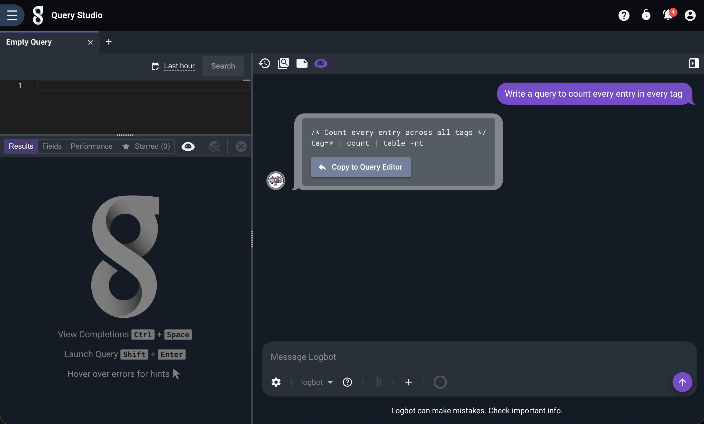
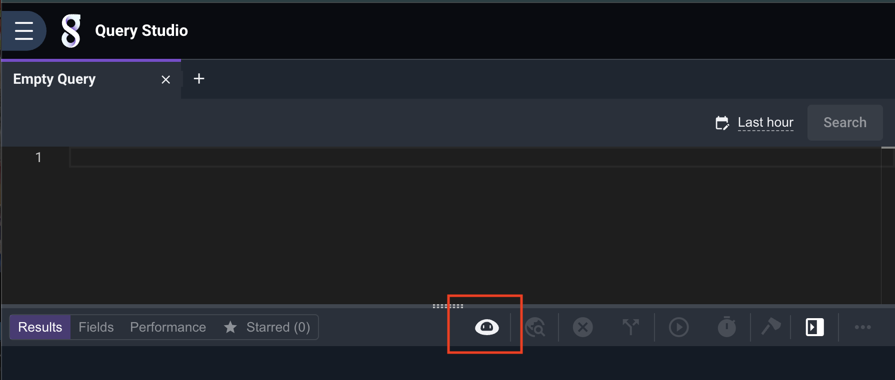
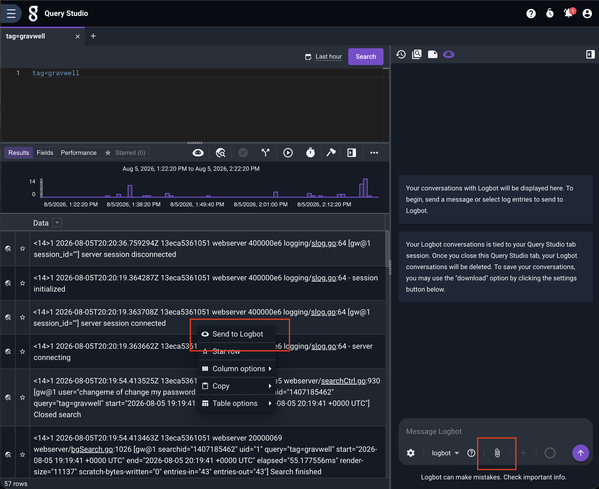
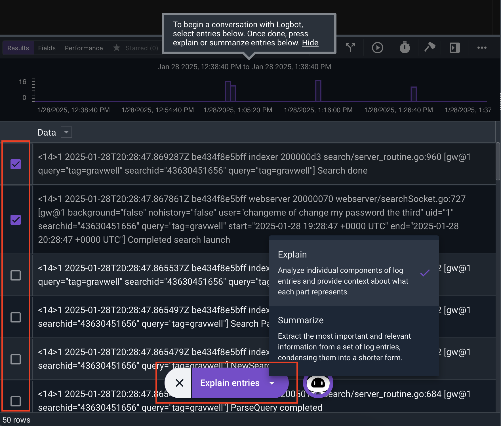
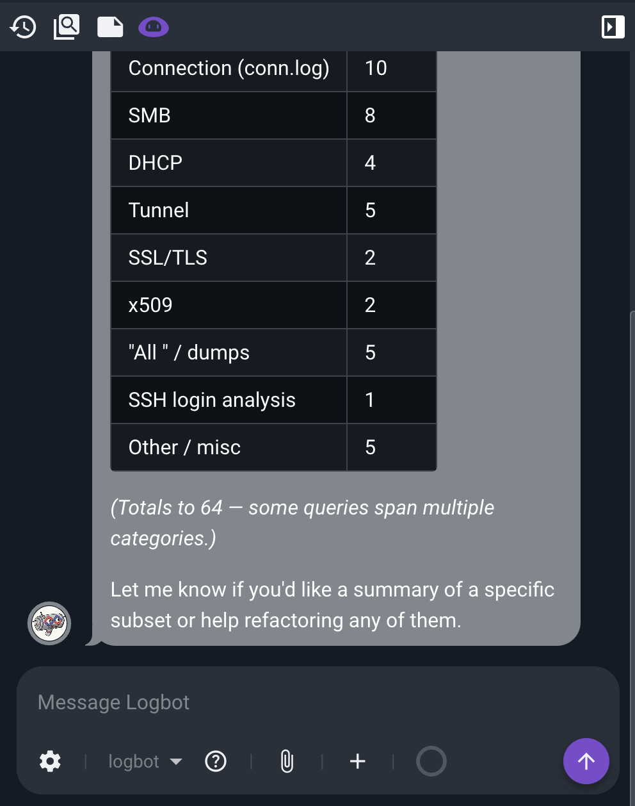
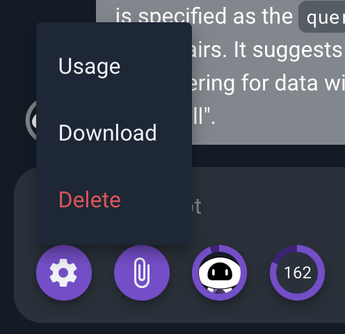
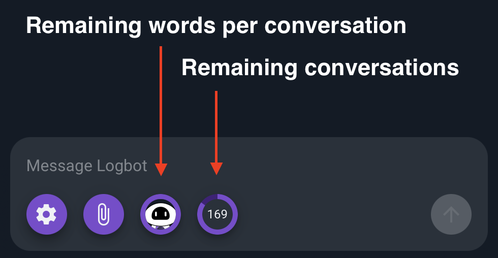
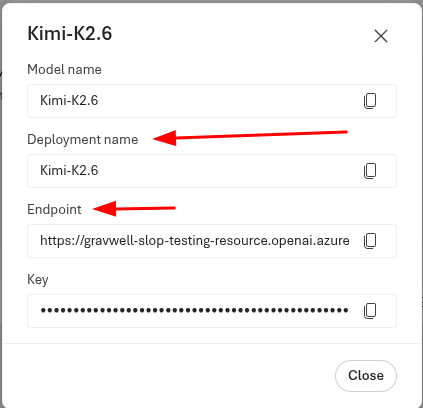
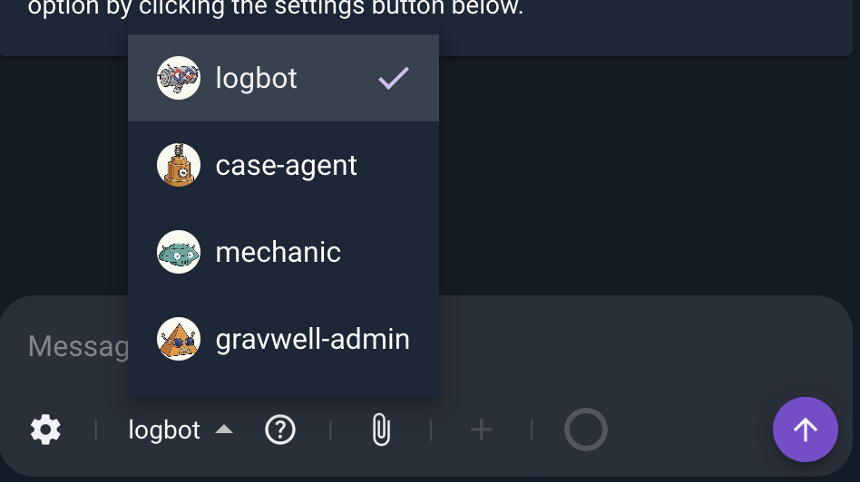
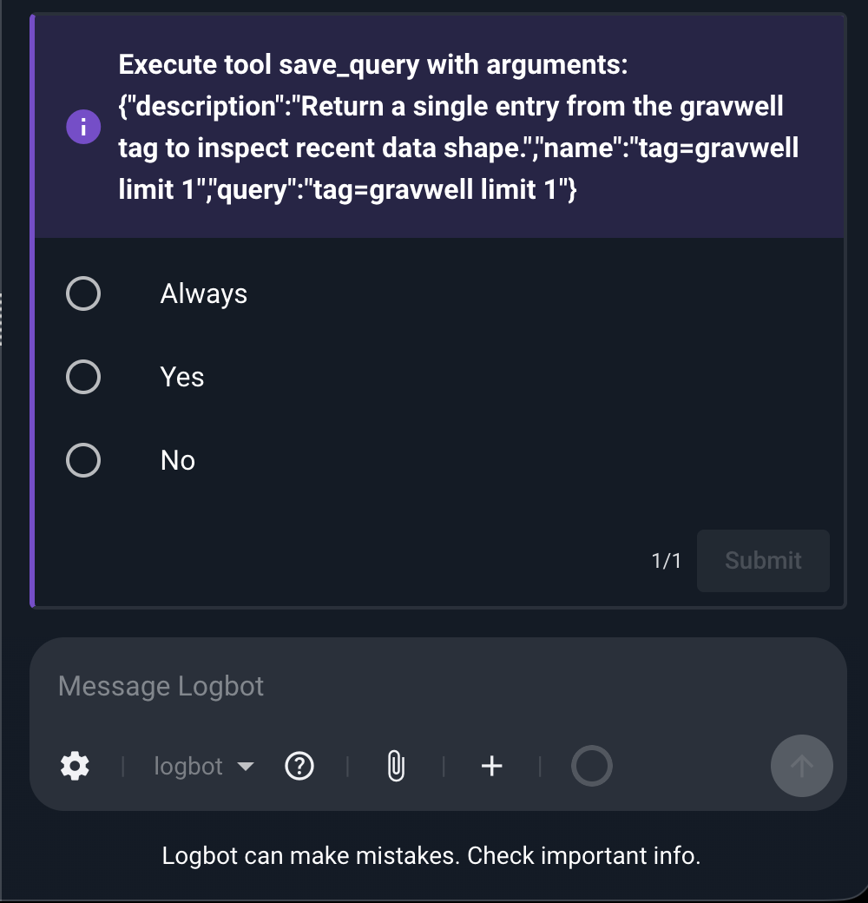

# Logbot AI

```{note}
Logbot AI is a beta feature and can make mistakes. Always check important information before relying on output from Logbot.
```



## Introduction

Logbot AI is a Large Language Model (LLM) powered chat assistant that can be prompted to explain or summarize entries in a query, write Gravwell queries, and interact with Gravwell. 

Logbot AI is available through the Query Studio interface. When Logbot AI is enabled, the chat interface can be accessed from within the right side pane in Query Studio. After a query has been executed, Logbot AI can be sent log entries.

Logbot is the default *agent*. Other agents — each with its own specialization — can be selected in chat or run unattended from a flow; see [AI Agents](ai-agents).

## Logbot AI Overview

```{note}
Logbot AI can only be sent log entries associated with text and raw renderer search results.
```

When available and enabled, Logbot AI is accessible via the button in Query Studio. You can immediately begin talking to Logbot or launch a search and send entries to your conversation.



Entries can be right clicked to choose "Send to Logbot" or the "attach entries" button in the conversation view can be used for the same purpose.



You'll then have the option to ask Logbot to either "explain" or "summarize" the selected entries.



Logbot AI will begin streaming information as a conversation. This conversation is interactive, and you can ask Logbot AI additional questions. Logbot AI maintains the context of the current conversation when asking it additional questions, up to the word limit (see below).



The conversation can be erased or downloaded, and additional entries can be attached to the conversation using the menu buttons at the bottom of the conversation window.



Once a conversation is erased, Logbot AI will lose any context about the conversation. This means that new conversations will not be able to reference information from previous ones.

## API Limitations

Your license affects the priority and amount of interactions allowed with Logbot AI. Two components make up Logbot AI's API limitations: words per conversation and number of conversations.

During a conversation with Logbot AI, the entire conversation is used as state for the conversation. The number of words in a conversation is limited for performance reasons. Once this limit is reached, Logbot AI will not interact anymore until a new conversation is started.

The number of conversations allowed per month is limited by your license.

During a conversation, the Logbot AI UI shows your remaining words in the conversation, as well as the remaining conversations in the month.



## Limiting access to AI features

Because search entries may contain sensitive data, administrators may wish to limit access to the AI feature. There are two ways to do this:

- **Per user**: Capability Based Access Control ([CBAC](/cbac/cbac)) allows administrators to disable AI access to specific users or groups.
- **Per system**: Enable may be set to false in the AI section of your instance's gravwell.conf to disable the AI feature for all users.

(remote-ai-services)=
## Remote AI Services

When Gravwell's Artificial Intelligence (AI) feature is enabled and any user converses with the AI, their messages and any attached search entries are sent to a remote service for processing. Gravwell will send requests to the remote system specified in its [system configuration](#ai-server-url). The service is either Gravwell-hosted (`https://api.gravwell.ai/`) or a third-party OpenAI-compatible endpoint.

### Gravwell-hosted AI services

If your [system is configured](#ai-server-url) to use `https://api.gravwell.ai/`, your system is using a Gravwell-hosted AI service.

When engaging with Logbot or other Gravwell AI services, you should be cognizant of the following points which may affect data privacy:

- Gravwell AI services run in Gravwell infrastructure on Gravwell GPUs (no third parties). Gravwell infrastructure is on-prem and SOC2 compliant (our servers are in cages in shared datacenters in the continental US)
- Gravwell AI is NOT trained using any customer interactions or data and will not be in the future
- Interactions with Gravwell AI services may be stored on Gravwell infrastructure in memory or logs until rotation/cleanup. Any deletion requests (e.g. GDPR) should be submitted to [privacy@gravwell.io](mailto:privacy@gravwell.io) or as directed by any contract you may have with Gravwell
- Gravwell humans in charge of AI services may review interactions to improve the AI services and/or prevent abuse

### Configuring a third party LLM service

Instead of using the Gravwell-hosted AI service, you can configure Gravwell to use any OpenAI-compatible API endpoint (such as OpenAI, [Anthropic](#anthropic-setup), or a self-hosted model). This is done by setting the following parameters in the `[AI]` section of your `gravwell.conf`:

| Parameter | Description |
|-----------|-------------|
| `AI-Server-URL` | The URL of the OpenAI-compatible API endpoint. |
| `Third-Party-Provider` | Must be set to `true` to enable third-party mode. This disables license-based authentication and performs an alternate health check. |
| `Model` | The model name to use for chat completions (e.g. `gpt-4o`). Required when `Third-Party-Provider` is true. |
| `Max-AI-Tokens` | The maximum number of completion tokens Gravwell will request per response. Defaults to `131072`. Must not exceed the configured model's output token limit — see [Setting Max-AI-Tokens](#setting-max-ai-tokens). |
| `Include-Header` | Additional HTTP headers for requests to the AI server, typically used for authentication. Can be specified multiple times for multiple headers. |
| `System-Prompt-File` | Optional path to a file containing a custom system prompt for all Logbot conversations. |

Below is an example configuration that connects to OpenAI's API:

```
[AI]
	Enable=true
	AI-Server-URL="https://api.openai.com"
	Third-Party-Provider=true
	Model="gpt-4o"
	Max-AI-Tokens=16384
	Include-Header="Authorization: Bearer <your-api-key>"
```

```{note}
When using a third-party provider, Gravwell does not enforce conversation or word limits via the license — those limits are governed by the third-party service. Be aware that all messages and attached search entries will be sent to the configured third-party endpoint.
```

```{note}
When using a third-party provider, Gravwell will attempt to perform a model existence request as a health check to ensure the specified endpoint is responding and can service requests for the configured mode.  The health check performs a `GET` request against the specified AI-Server-URL + `/v1/models/` + Model.

For example, the above configuration would perform a health check as a `GET` request against `https://api.openai.com/v1/models/gpt-4o`.

Many model providers support a small fragment of the OpenAI spec and may not be compatible with Gravwell. If Logbot is reporting failures at startup, validate OpenAI API compatibility.
```

(setting-max-ai-tokens)=
#### Setting Max-AI-Tokens

[`Max-AI-Tokens`](max-ai-tokens) sets the maximum number of completion tokens Gravwell requests from the model, and defaults to `131072`. Models differ in how many output tokens they accept, and if `Max-AI-Tokens` is higher than the configured model's limit the provider rejects the request and Logbot reports an error like:

```
503 error: LLM returned status 400: {"error":{"code":"invalid_request_error","message":"max_tokens: 131072 > 128000, which is the maximum allowed number of output tokens for claude-sonnet-5","type":"invalid_request_error","param":null}}
```

When configuring a third-party provider, set `Max-AI-Tokens` to a value at or below the maximum output tokens documented for your model. Consult your provider's documentation for the current limit, as these values change with each model release. For example, to use Anthropic's Claude Sonnet 5, which at the time of writing allows at most 128000 output tokens:

```
[AI]
	Enable=true
	AI-Server-URL="https://api.anthropic.com"
	Third-Party-Provider=true
	Model="claude-sonnet-5"
	Max-AI-Tokens=64000
	Include-Header="Authorization: Bearer <your-api-key>"
```

```{note}
`Max-AI-Tokens` is an upper bound on a single response, not a target: it does not cause the model to generate longer responses, but a value set too low can truncate long answers.
```

(anthropic-setup)=
#### Configuring Anthropic Claude

Gravwell connects to Anthropic's Claude API through its [OpenAI-compatible endpoint](https://platform.claude.com/docs/en/api/openai-sdk).
Anthropic API keys are created in the [Claude Console](https://platform.claude.com) and act within a *workspace*. Requests made with a key
that is not scoped to a single workspace **must** include an `anthropic-workspace-id` header, otherwise Logbot requests will fail. The
steps below create a workspace-scoped key so no extra header is needed.

Before you begin, you need:

- A Claude Console organization with billing set up. The API rejects requests from organizations without available credit.
- The organization admin role to create workspaces and service accounts. Creating API keys requires the Workspace Developer role or higher in the target workspace.

##### Step 1: Choose a workspace

Every Console organization has a **Default Workspace**, which works for Logbot. A dedicated workspace is recommended: it separates Logbot
usage in Console usage reports and lets you set [spend and rate limits](https://platform.claude.com/docs/en/manage-claude/workspaces#workspace-limits)
for Logbot traffic. Spend limits cannot be set on the Default Workspace.

To create a workspace, open the Console [Workspaces](https://platform.claude.com/settings/workspaces) page, click **Create workspace**, enter a name
such as `gravwell-logbot`, and click **Create workspace**.

##### Step 2: Choose the account that owns the key

Each new Anthropic API key is linked to a user or a service account and stops working when that account is removed:

- A **personal key** acts as you, and stops working if you leave the organization.
- A **service account key** acts as a non-human service account and is unaffected by staff changes. This is the recommended choice for a Gravwell deployment.

To create a service account, an organization admin opens the Console [Service accounts](https://platform.claude.com/settings/service-accounts) page
and creates one. Service accounts are members of the Default Workspace automatically; to use another workspace, select **Add to workspace** in the
service account's menu and choose the workspace from step 1.

##### Step 3: Create the API key

1. Open the Console [API keys](https://platform.claude.com/settings/keys) page and click **Create key**.
2. Enter a name for the key, such as `gravwell-logbot`.
3. Set **Linked account** to the service account from step 2, or to yourself for a personal key.
4. Scope the key to the workspace from step 1. A key scoped to a single workspace needs no additional Gravwell configuration.
5. Select an expiration. When the key expires, Logbot requests fail until a new key is configured, so choose **Never** if you
rotate keys on your own schedule, or plan the rotation ahead of the expiration date.
6. Create the key, then copy it and store it securely. Anthropic API keys begin with `sk-ant-api`.

##### Step 4: Configure Gravwell

Add the key to the `[AI]` section of `gravwell.conf` on each webserver:

```
[AI]
	Enable=true
	AI-Server-URL="https://api.anthropic.com"
	Third-Party-Provider=true
	Model="claude-sonnet-5-5"
	Max-AI-Tokens=64000
	Include-Header="Authorization: Bearer <your-anthropic-api-key>"
```

- `AI-Server-URL` is the base URL without `/v1`. Gravwell appends `/v1/chat/completions` and `/v1/models/<Model>` to it.
- `Model` must be a Claude API model ID such as `claude-sonnet-5-5` or `claude-opus-5-5`. See Anthropic's [models overview](https://platform.claude.com/docs/en/about-claude/models/overview) for current IDs.
- `Max-AI-Tokens` must not exceed the model's maximum output tokens. See [Setting Max-AI-Tokens](#setting-max-ai-tokens).

If the key is **not** scoped to a single workspace, add a second `Include-Header` with the workspace ID. Workspace IDs begin with `wrkspc_`
and are listed in the **ID** column of the Console [Workspaces](https://platform.claude.com/settings/workspaces) page.

```
	Include-Header="anthropic-workspace-id: wrkspc_<your-workspace-id>"
```

Restart the webserver (`systemctl restart gravwell_webserver.service`) to apply the change.

##### Verifying the key

If Logbot's health check fails, you can run the following commands on the webserver to debug your API token.
Use the `Model` and `Max-AI-Tokens` values from your configuration, and add `-H "anthropic-workspace-id: wrkspc_<your-workspace-id>"`
to both commands if you configured that header.

```bash
# Health check: look up the configured model
curl -sS https://api.anthropic.com/v1/models/claude-sonnet-5-5 \
  -H "Authorization: Bearer <your-anthropic-api-key>"

# Chat completion
curl -sS https://api.anthropic.com/v1/chat/completions \
  -H "Authorization: Bearer <your-anthropic-api-key>" \
  -H "Content-Type: application/json" \
  -d '{
    "model": "claude-sonnet-5-5",
    "max_tokens": 64000,
    "messages": [{"role": "user", "content": "Hello"}]
  }'
```

The first command returns a description of the model and the second returns a short reply. An error response identifies the problem:

| Error | Cause and fix |
|-------|---------------|
| `This API key is not scoped to a workspace...` | The key can act in more than one workspace. Create a key scoped to a single workspace, or add `Include-Header="anthropic-workspace-id: wrkspc_<your-workspace-id>"`. |
| `anthropic-workspace-id header must be a valid workspace ID.` | The workspace ID is malformed. Copy it, including the `wrkspc_` prefix, from the Workspaces page. |
| ``Workspace `<id>` not found.`` | The workspace does not exist, or the key's linked account is not a member of it. Add the service account to the workspace on the Service accounts page. |
| `authentication_error` | The key is incorrect, expired, disabled, or deleted, or its linked account was removed from the organization. Check the key's status on the API keys page and create a new key if needed. |
| `max_tokens: ... which is the maximum allowed number of output tokens` | `Max-AI-Tokens` exceeds the model's output limit. See [Setting Max-AI-Tokens](#setting-max-ai-tokens). |

#### Gotchas With Third-Party LLM Services

The Microsoft Azure OpenAI endpoints have slightly different URL paths and usage of the `model` parameter.  If you are using Azure OpenAI, you will need to set the `AI-Server-URL` to the base URL of your Azure OpenAI resource and remove the `/v1` that is included in the URL (e.g. `https://<your-resource-name>.openai.azure.com/openai`).  When setting a model in the Gravwell `[AI]` configuration block the `Model` parameter is the deployment name NOT the model name.



```
[AI]
	Enable=true
	AI-Server-URL="https://gravwell-slop-testing-resource.openai.azure.com/openai"
	Third-Party-Provider=true
	Model="Kimi-K2-Test-Deployment"
	Include-Header="Authorization: Bearer <your-azure-openai-api-key>"
```

(ai-agents)=
## AI Agents

An agent is a purpose-built AI configuration: a system prompt, the set of Gravwell tools it is allowed to use, and — for multi-stage agents — a graph of steps to run. Gravwell supplies the LLM and the tools; the agent supplies the specialization.

Every instance with AI enabled has the built-in `logbot` agent, the general purpose assistant described above. Gravwell AI services are currently in beta. The **AI Agent Preview** [kit](/kits/kits) installs six ready-to-use agents: three conversational ones for investigation, administration, and troubleshooting, and three automated ones for alert triage, deployment audit, and a daily activity summary.

### Choosing an agent

Chat sessions include an agent selector. Simply pick the agent best suited for your prompt. 



Only conversational agents can be selected in chat. Multi-stage agents fan work out across several steps and cannot pause to interact with you, so they run unattended and are invoked from a flow instead — see the [Logbot flow node](/flows/nodes/logbot).

### Tools and approval

An agent works by calling tools against your Gravwell instance — listing tags, sampling entries, validating and running queries, reading alerts, and using playbooks. It decides which tools to call on its own and can chain many calls together to work through a single request. These are the same tools exposed by the [MCP server](mcp-tools).

Read-only tools run without interruption. Any tool that would change something — saving a query, creating a macro, updating an alert — pauses the conversation and asks for your approval first. You can approve the individual call, or accept every call to that tool for the rest of the conversation.



Tool access is bounded by [CBAC](/cbac/cbac): an agent can only use tools the user driving it is permitted to use, and an agent definition can narrow that further. 

```{warning}
An agent run from a flow is an automation and cannot ask for approval, so **every** tool it calls executes without prompting. Only give write tools to an agent you intend to make changes unattended.
```

## MCP Server

Gravwell exposes a [Model Context Protocol](https://modelcontextprotocol.io/) (MCP) server that allows external AI-powered tools to interact with your Gravwell instance. The MCP server is available at the `/api/mcp` endpoint on your webserver and uses the Streamable HTTP transport.

MCP tools are gated by [CBAC](/cbac/cbac) and any applied token permissions — users will only see tools they have permission to use.

(mcp-tools)=
### Available MCP Tools

The following tools are available via the MCP server:

A `list_` tool returns the name, description, and ID of every object the user can see; the matching `get_` tool takes that ID and returns the whole object.

| Tool | Description |
|------|-------------|
| `whoami` | Get information about the authenticated user |
| `list_users` | List users |
| `get_user` | Get a user by ID |
| `list_groups` | List groups |
| `get_group` | Get a group by ID |
| `mail_config` | Get the system mail configuration |
| `parse_query` | Parse and validate a Gravwell query string |
| `execute_query` | Execute a Gravwell query and return results |
| `save_query` | Save a query to the query library |
| `update_query` | Update an existing saved query |
| `list_queries` | List saved queries from the query library |
| `get_query` | Get a saved query including its query text |
| `search_history` | Get the user's search history |
| `list_tags` | List all tags available to the user |
| `sample_tag_entries` | Retrieve the last 10 entries from a tag |
| `ping_indexers` | Ping all indexers to check connectivity |
| `system_description` | Get hardware/OS descriptions for webserver and indexers |
| `system_stats` | Get live system statistics |
| `indexer_stats` | Get indexer storage statistics |
| `ingester_stats` | Get ingester connection and throughput statistics |
| `well_stats` | Get detailed well data for all indexers |
| `storage_overview` | Get a storage summary for all indexers |
| `list_resources` | List resources visible to the user |
| `load_skill` | Load a skill by name into the conversation context |
| `list_knowledge_bases` | List available knowledge bases |
| `knowledge_base_list_keys` | List all keys in a knowledge base |
| `knowledge_base_search` | Search a knowledge base using BM25 keyword search |
| `knowledge_base_get_data` | Retrieve data at a specific key in a knowledge base |
| `list_extractors` | List auto-extraction definitions |
| `get_extractor` | Get an auto-extraction definition including its full parameters |
| `create_extractor` | Create a new auto-extraction definition |
| `update_extractor` | Update an existing auto-extraction definition |
| `list_macros` | List search macros |
| `get_macro` | Get a search macro including its expansion |
| `create_macro` | Create a new search macro |
| `update_macro` | Update an existing search macro |
| `list_alerts` | List alert definitions |
| `get_alert` | Get an alert definition including its dispatchers and consumers |
| `create_alert` | Create a new alert definition |
| `update_alert` | Update an existing alert definition |
| `list_scheduled_searches` | List scheduled search automations |
| `get_scheduled_search` | Get a scheduled search including its query, schedule, and run state |
| `create_scheduled_search` | Create a new scheduled search automation |
| `update_scheduled_search` | Update an existing scheduled search |
| `list_flows` | List flow automations |
| `get_flow` | Get a flow including its definition and last run results |
| `list_playbooks` | List playbooks |
| `get_playbook` | Get a playbook by UUID including its body |
| `create_playbook` | Create a new playbook |
| `update_playbook` | Update an existing playbook |

(external-mcp-integrations)=
### Connecting External AI Tools via MCP

The MCP server can be used with any MCP-compatible client. Authentication is performed using a Gravwell API token or session cookie. Below are example configurations for Github Copilot CLI and Claude Code CLI.

#### GitHub Copilot CLI

Add the following to your `.github/copilot/mcp.json` file (or workspace `.vscode/mcp.json`):

```json
{
  "mcpServers": {
    "gravwell": {
      "type": "http",
      "url": "https://your-gravwell-instance/api/mcp",
      "headers": {
        "Gravwell-Token": "<your-gravwell-api-token>"
      }
    }
  }
}
```

#### Claude Code CLI

Add the following to your `.claude.json` file:

```json
{
  "mcpServers": {
    "gravwell": {
      "type": "http",
      "url": "https://your-gravwell-instance/api/mcp",
      "headers": {
        "Gravwell-Token": "<your-gravwell-api-token>"
      }
    }
  }
}
```

```{note}
API tokens can be generated in the Gravwell [Tokens API](/tokens/tokens).
```
