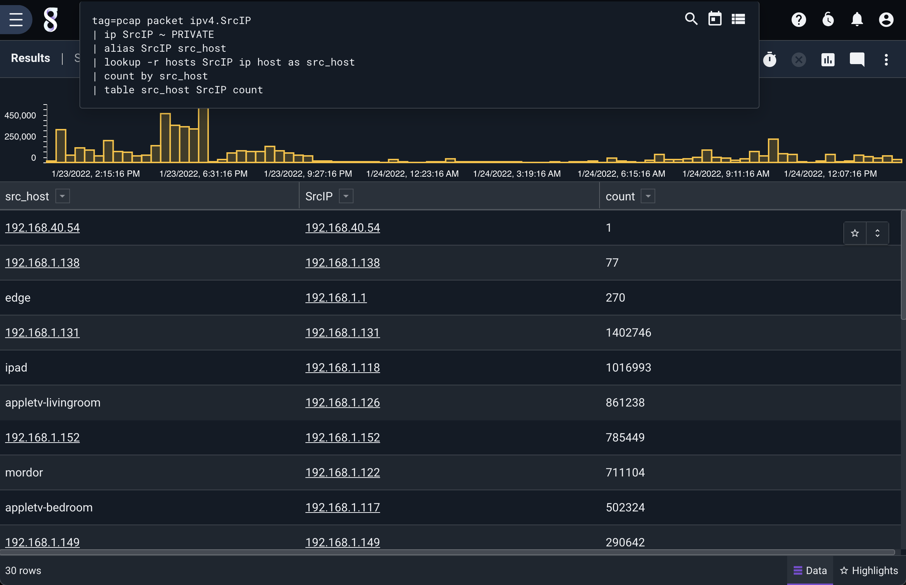

# Alias

The alias module copies existing enumerated values to new names. Changing the copy does not change the original. This is useful for pre-populating the output of the `lookup` module, so entries with no match keep the original value:

```gravwell
tag=pcap packet ipv4.SrcIP
| ip SrcIP ~ PRIVATE
| alias SrcIP src_host
| lookup -r hosts SrcIP ip hostname as src_host
| count by src_host
| table src_host SrcIP count
```



The alias module takes one or more *pairs* of arguments: a source and a destination. In the example above, `SrcIP` is copied to `src_host`. When `lookup` finds a hostname, it overwrites `src_host`; `SrcIP` is unchanged. When there is no match, `src_host` still holds the IP address.

To make several aliases at once, list more pairs: `alias foo bar X Y` copies `foo` to `bar` and `X` to `Y`. If an entry doesn't have a source enumerated value, that pair is skipped and the entry passes through.
