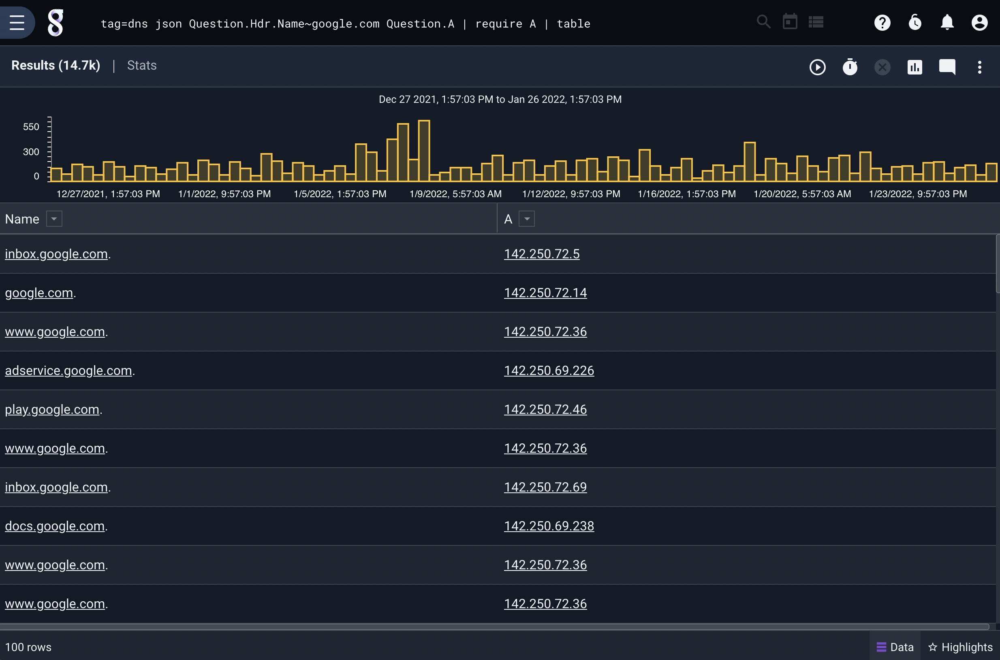
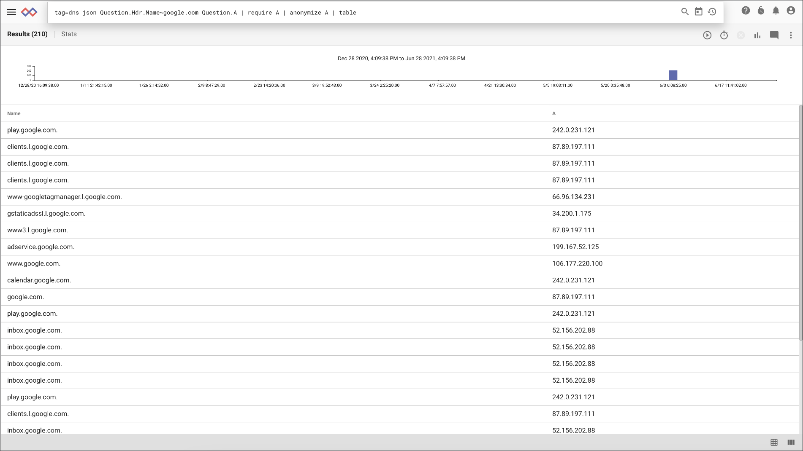
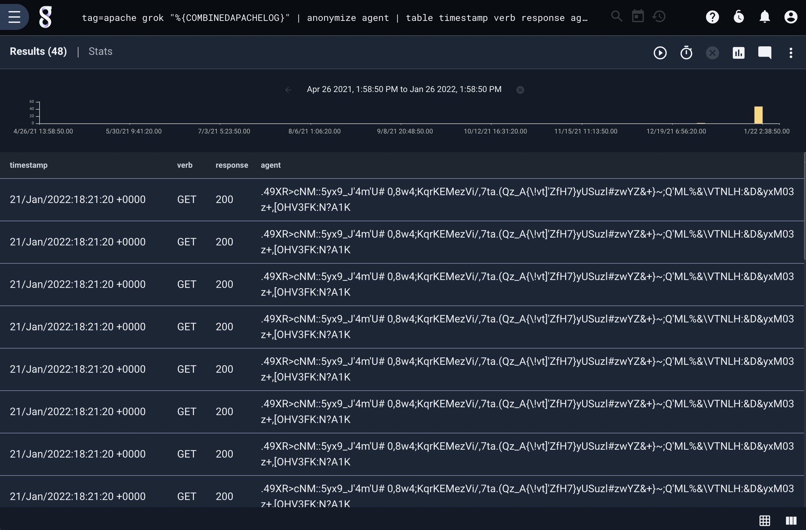

# Anonymize

The `anonymize` module replaces the contents of enumerated values with random values. For example, to replace the IP addresses in a dataset with random addresses:

```gravwell
tag=data json IP Message | ip IP | anonymize IP | table
```

The [ip](/search/ip/ip) module converts the extracted string to an IP first; without it, `anonymize` would treat the value as a string.

Each distinct value is mapped to a random replacement, and the same value gets the same replacement wherever it appears in the search, including in other enumerated values listed in the same invocation. The mapping is different each time the search runs.

The replacement has the same type as the original:

* Strings and byte arrays become `anonymized_<random number>`.
* IP addresses become random IPv4 addresses, including IPv6 inputs.
* MAC addresses become random MAC addresses.
* Integers become random non-negative integers, and floating point numbers become random values between 0 and 1.
* Locations become random latitude/longitude pairs.

Values of other types are left unchanged.

You can add a filter (`==`, `!=`, `~`, or `!~`) after an enumerated value to anonymize only matching values. Values that don't match are left as-is; entries are never dropped. For example, to anonymize the `user` field only when it is `root`:

```gravwell
tag=syslog regex "user=(?P<user>\S+)" | anonymize user == root | table
```

When a filter or `-prefix` is given, values of every type are replaced with a string, as described for strings above.

## Supported Options

* `-prefix <prefix>`: prefix for replacement strings, which take the form `<prefix>_<random number>`. Defaults to `anonymized`.

## Example

This query extracts request/response pairs from DNS logs:

```gravwell
tag=dns json Question.Hdr.Name~google.com Question.A | require A | table
```



Converting `A` to an IP and adding the `anonymize` module replaces the addresses with random IPs:

```gravwell
tag=dns json Question.Hdr.Name~google.com Question.A | require A | ip A | anonymize A | table
```



The `anonymize` module can also anonymize text. This query extracts fields from web server logs and anonymizes the user agent:

```gravwell
tag=apache grok "%{COMBINEDAPACHELOG}" | anonymize agent | table timestamp verb response agent
```


