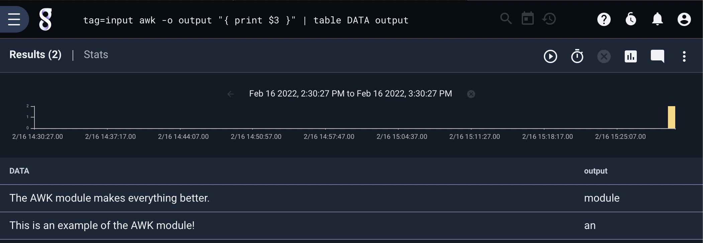
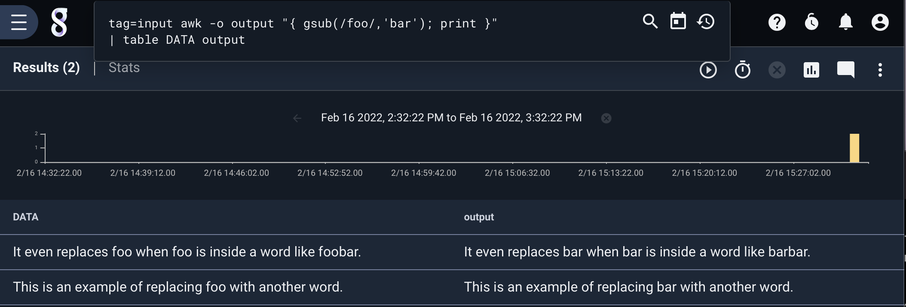
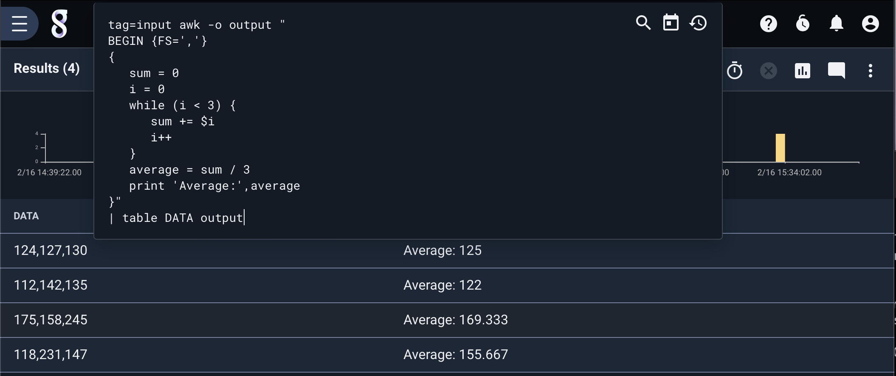

# Awk

The `awk` module runs an AWK program against each entry. It is built on [GoAWK](https://github.com/benhoyt/goawk), which implements the [POSIX AWK specification](https://pubs.opengroup.org/onlinepubs/9699919799/utilities/awk.html) plus a few extensions, such as single-quoted strings. This page doesn't teach the AWK language; see the specification for that.

The module passes each entry's data (or the enumerated value given with `-e`) to the program as its input. Everything the program prints, including the newline `print` adds, becomes the output. The module never drops entries; if the program prints nothing or fails at runtime, the output is empty or holds whatever was printed before the error.

The program runs separately for each entry, so `BEGIN` and `END` blocks run once per entry and variables don't carry over from one entry to the next. Commands such as `system()`, file reads, and file writes are disabled.

## Supported Options

* `-e <name>`: Read input from an enumerated value instead of the entry data. Entries without that enumerated value pass through unchanged.
* `-o <name>`: Write the output to an enumerated value. By default, the output overwrites the input: the `-e` enumerated value if set, otherwise the entry data.

## Examples

### Printing tokens

Print the third whitespace-separated field of each entry:

```gravwell
tag=input awk -o output "{ print $3 }" | table DATA output
```



### Global find and replace

Replace every instance of "foo" with "bar":

```gravwell
tag=input awk -o output "{ gsub(/foo/,'bar'); print }" | table DATA output
```



### Taking the average of numeric CSV records

Average the three comma-separated numbers in each entry:

```gravwell
tag=input awk -o output "
BEGIN {FS=','}
{
   sum = 0
   i = 1
   while (i <= 3) {
      sum += $i
      i++
   }
   average = sum / 3
   print 'Average:',average
}"
| table DATA output
```


