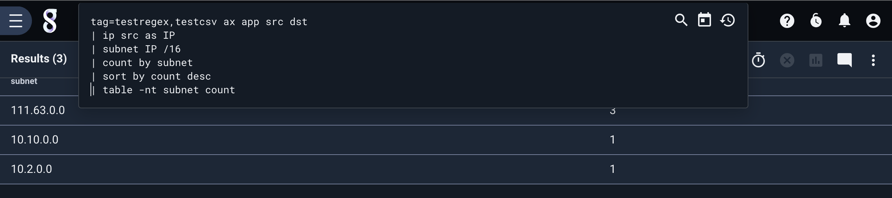
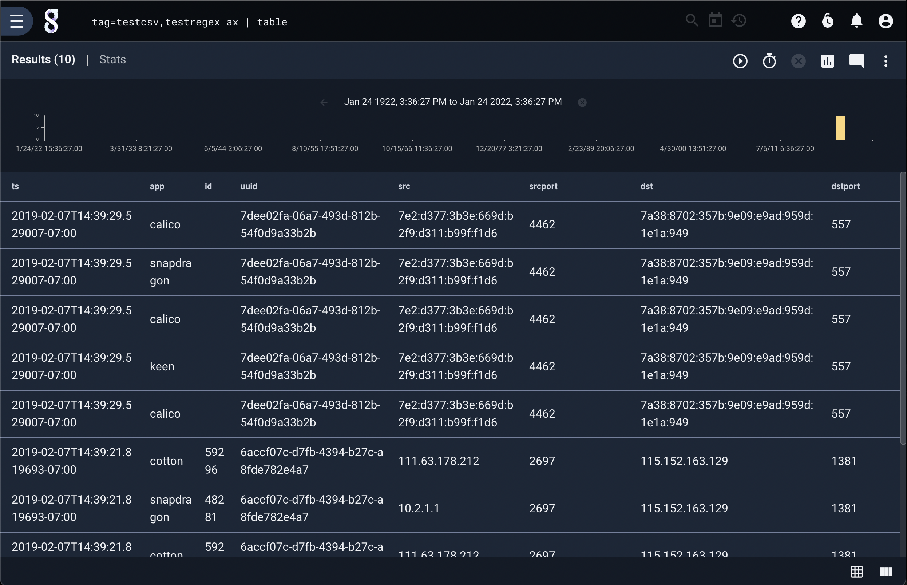
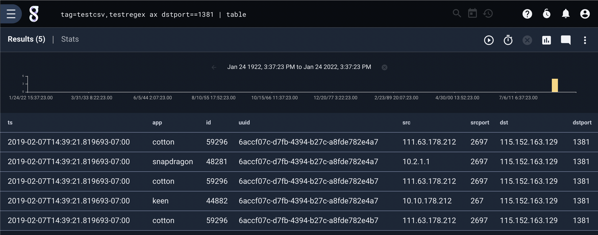

# AX

The ax module extracts fields using auto-extractor definitions, which tell it which extraction module and settings to use for each tag. This keeps queries short when data isn't self-describing or structured, and lets one query extract the same fields from tags in different formats.

Auto-extractors can use these extraction modules:

* [CEF](/search/cef/cef)
* [CSV](/search/csv/csv)
* [fields](/search/fields/fields)
* [intrinsic](/search/intrinsic/intrinsic)
* [ipfix](/search/ipfix/ipfix)
* [json](/search/json/json)
* [KV](/search/kv/kv)
* [netflow](/search/netflow/netflow)
* [regex](/search/regex/regex)
* [slice](/search/slice/slice)
* [syslog](/search/syslog/syslog)
* [winlog](/search/winlog/winlog)
* [XML](/search/xml/xml)

For details on writing auto-extractor definitions, see the [autoextractor section](/configuration/autoextractors).

Entries whose tag has no auto-extractor are dropped.

## Filtering

The ax module supports inline filtering on extracted fields. The filter is passed to the underlying extraction module, which applies it with its own filtering rules. ax accepts these operators:

| Operator | Name | Description |
|----------|------|-------------|
| == | Equal | Field must be equal
| != | Not equal | Field must not be equal
| ~ | Subset | Field contains the value
| !~ | Not Subset | Field does NOT contain the value

ax rejects the numeric comparison operators (`<`, `<=`, `>`, `>=`), even for extraction modules such as slice that support them when called directly. To compare numbers, run the extraction module directly or filter later in the query.

```{note}
Not every extraction module supports every operator. If multiple tags extract fields with the same name, only operators that all of their extraction modules support can be used.
```

## Invoking AX

One ax invocation can process several tags, each with its own extraction module. For example, if tag "foo" holds CSV data and tag "bar" holds unstructured text, ax can extract fields from both at once. Here are entries in those two formats:

```
2019-02-07T14:39:21.819693-07:00,cotton,59296,6accf07c-d7fb-4394-b27c-a8fde782e4a7,111.63.178.212,2697,115.152.163.129,1381
2019-02-07T14:39:29.529007-07:00 [calico] <7dee02fa-06a7-493d-812b-54f0d9a33b2b> 7e2:d377:3b3e:669d:b2f9:d311:b99f:f1d6 4462 7a38:8702:357b:9e09:e9ad:959d:1e1a:949 557
```

Assume the CSV data is tagged "testcsv" and the unstructured data is tagged "testregex". The formats differ, but they share several fields. These auto-extractor definitions handle each format:

```
[[extraction]]
	name="regex"
	module="regex"
	tag="testregex"
	params='(?P<ts>\S+)\s\[(?P<app>\S+)\]\s<(?P<uuid>\S+)>\s(?P<src>\S+)\s(?P<srcport>\d+)\s(?P<dst>\S+)\s(?P<dstport>\d+)'

[[extraction]]
	name="csv"
	module="csv"
	tag="testcsv"
	params="ts, app, id, uuid, src, srcport, dst, dstport"
```

Query both tags and name the shared fields to get a single view:

```gravwell
tag=testregex,testcsv ax app src dst | ip src as IP | subnet IP /16 | count by subnet | sort by count desc | table -nt subnet count
```



Arguments are optional. With no arguments, ax extracts every field the auto-extractors define:

```gravwell
tag=testregex,testcsv ax | table
```



Add a filter to keep only matching entries:

```gravwell
tag=testregex,testcsv ax dstport==1381 | table app src dst
```


