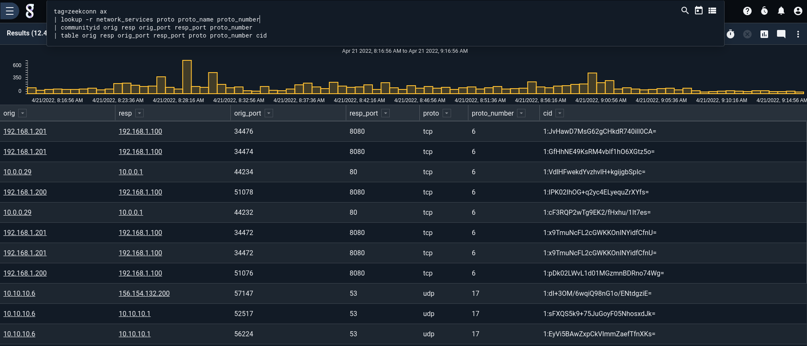
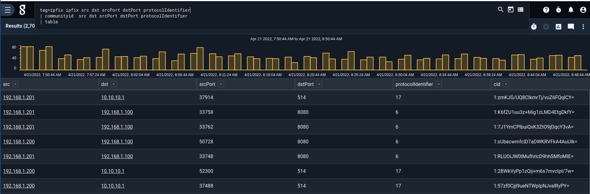
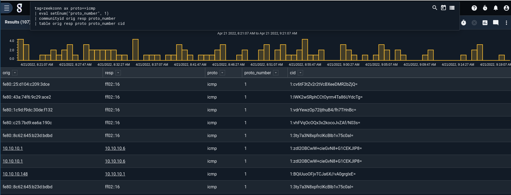

# Zeek Community ID

The `communityid` module computes a Zeek Community ID: a hash of a connection's endpoints and protocol that is the same no matter which tool recorded the flow. Use it to link network flows across different data types. See the [Zeek webpage](https://zeek.org/2019/07/31/an-update-on-community-id/) and the [Zeek Github Repository](https://github.com/corelight/zeek-community-id) for the specification.

The module takes two IP addresses, two optional ports, and a protocol number, and writes the result to an enumerated value named `cid`. Use `as` to pick a different name.

```gravwell
tag=netflow netflow Src SrcPort Dst DstPort Protocol
| communityid Src Dst SrcPort DstPort Protocol
| table
```

Arguments are ordered `<IP A> <IP B> <Port A> <Port B> <Protocol Number>`. The algorithm sorts the two endpoints itself, so it doesn't matter which side is the source. However, it is **critical** that Port A belongs to IP A and Port B to IP B.

Both ports may be left out: `<IP A> <IP B> <Protocol Number>`. Including one port but not the other is invalid. Missing ports are treated as zero. For ICMP and ICMPv6, pass the ICMP type and code in place of the ports.

Entries missing either IP address pass through without a `cid`. A missing or non-numeric protocol is treated as protocol 0.

```{note}
The `communityid` module requires the protocol *number*. It will not resolve a protocol name.
```

## Supported Options

* `-seed <n>`: Seed value for the hash, from 0 to 65535. Defaults to 0. Use the same seed as the tool whose Community IDs you want to match.

## Examples

### Zeek Conn Logs

Zeek conn logs record the protocol by name, so this example uses the `network_services` resource from the Gravwell Network Enrichment kit to look up the number. It uses the autoextractors from the Gravwell Zeek kit to parse the TSV logs.

```gravwell
tag=zeekconn ax
| lookup -r network_services proto proto_name proto_number
| communityid orig resp orig_port resp_port proto_number
| table orig resp orig_port resp_port proto proto_number cid
```



### IPFIX

IPFIX records carry the IP, port, and protocol number directly, so no lookup is needed.

```gravwell
tag=ipfix ipfix src dst srcPort dstPort protocolIdentifier
| communityid  src dst srcPort dstPort protocolIdentifier
| table
```



### ICMP Example

This example computes a community ID without ports, using ICMP traffic from Zeek conn logs. Instead of a lookup, it sets `proto_number` to 1 (ICMP) with `enrich`.


```gravwell
tag=zeekconn ax proto==icmp
| enrich proto_number 1
| communityid orig resp proto_number
| table orig resp proto proto_number cid
```


