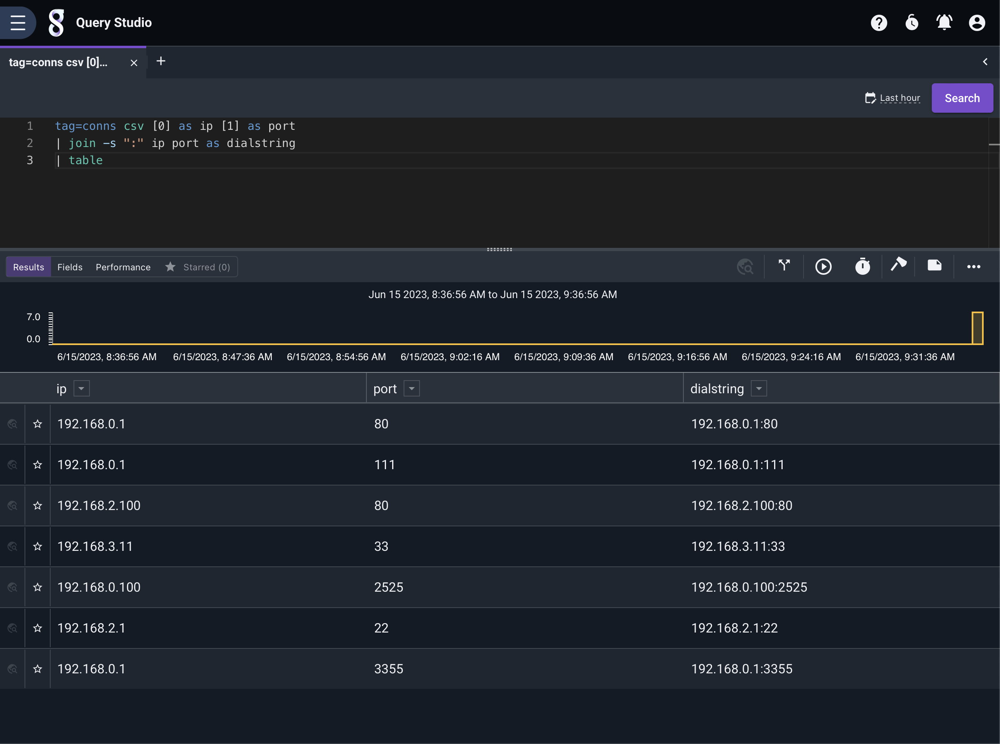

# Concat

The `concat` module joins two or more enumerated values into a single enumerated value. Values are joined in the order listed, and missing enumerated values are skipped.

The type of the first value present determines the result:

* String or other non-byte-slice types: every value is converted to a string, and the result is a string.
* Byte slice: following byte slice and string values are appended, and the result stays a byte slice. Other types, such as numbers or IP addresses, cannot be appended to a byte slice and are skipped.

This search extracts the destination IP and port from netflow records and joins them with a colon as a separator, placing the result in an enumerated value named `dialstring`:

```gravwell
tag=netflow netflow Dst DstPort | concat -s : Dst DstPort as dialstring | table Dst DstPort dialstring
```

Name the output enumerated value with `as`, for example `concat foo bar as output`. Without `as`, the result overwrites the first listed enumerated value.

## Supported Options

* `-s <separator>`: Insert the separator between each joined value. Defaults to no separator.
* `-t <name>`: Deprecated. Same as `as <name>`; cannot be combined with `as`.

## Example

```gravwell
tag=conns csv [0] as ip [1] as port
| concat -s ":" ip port as dialstring
| table
```

