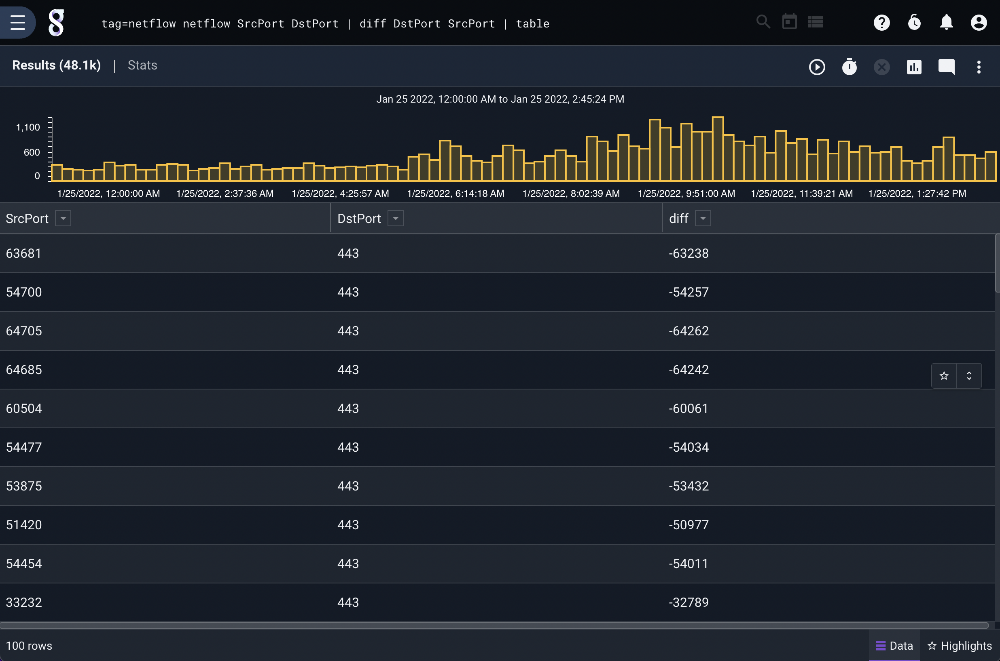
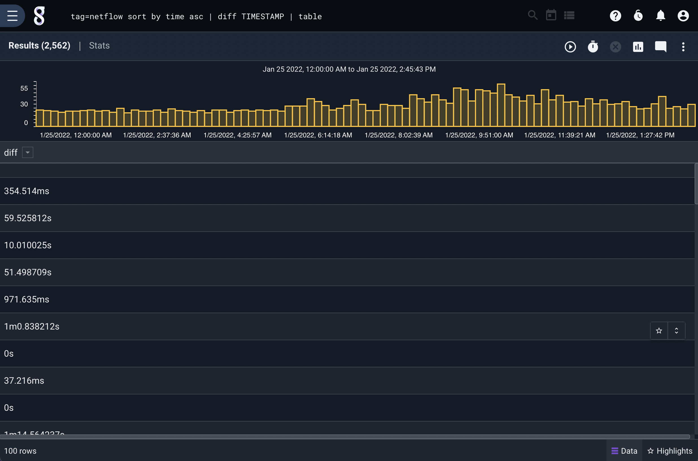
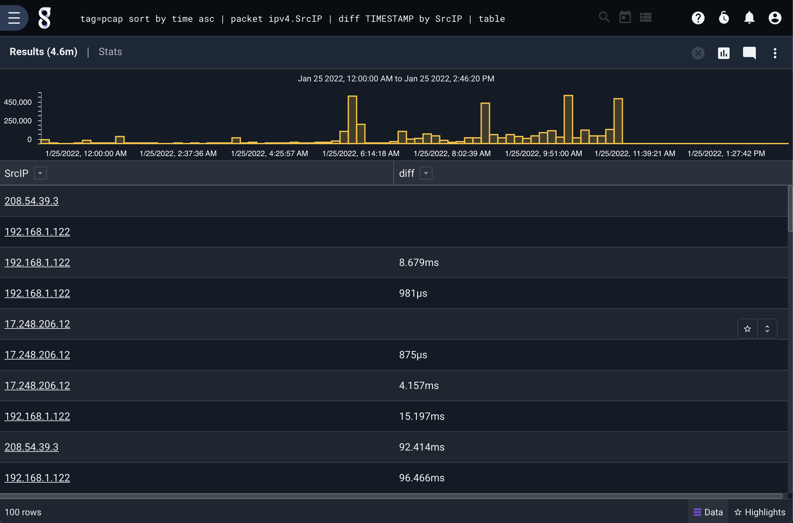

# Diff

The diff module subtracts one enumerated value from another. It has two modes:

1. Normal mode: subtract one enumerated value from another on the same entry.
2. Temporal mode: subtract an enumerated value on the *previous* entry from the same enumerated value on the current entry.

The module works with integers, floating point numbers, timestamps, and durations. Strings are parsed as numbers first. If a value is missing or can't be converted, the entry passes through without a result. In temporal mode, the first entry has no previous value, so it gets no result either.

## Examples

To subtract one value from another, give both enumerated value names; the second is subtracted from the first. This sets an enumerated value named `diff` to `DstPort - SrcPort`:

```gravwell
tag=netflow netflow SrcPort DstPort | diff DstPort SrcPort | table
```



(Not particularly useful, but it shows how the module works.)

Give a single enumerated value name to use temporal mode. This query compares each entry's `TIMESTAMP` with the previous entry's to show how often netflow records arrive:

```gravwell
tag=netflow sort by time asc | diff TIMESTAMP | table
```



## Output options

By default, the result is stored in an enumerated value named `diff`. Change the name with the `as` keyword:

```
diff foo bar as foobarDiff
```

## Keying

In temporal mode, `by` keeps a separate previous value for each combination of key values, so each entry is compared with the previous entry that has the same keys. This query extracts the source IP address from packets and shows how long it has been since each IP was last seen:

```gravwell
tag=pcap sort by time asc | packet ipv4.SrcIP | diff TIMESTAMP by SrcIP | table
```

