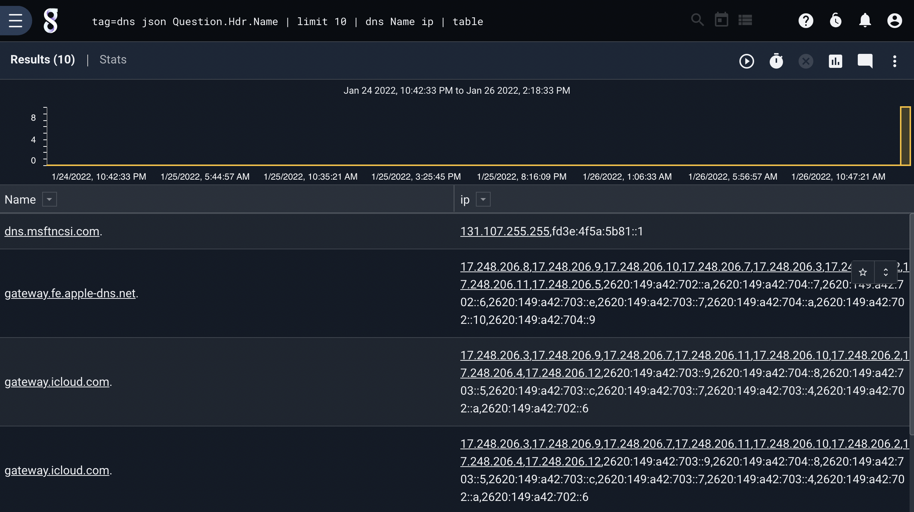
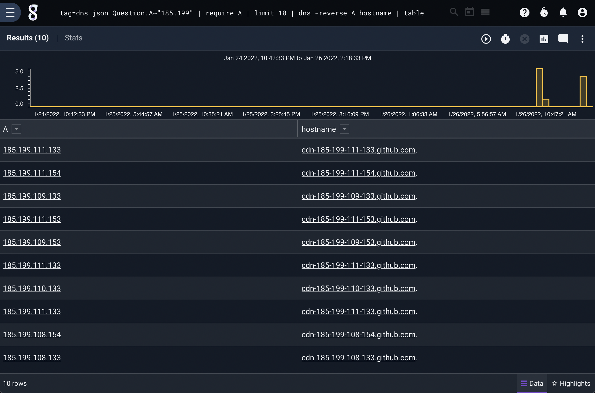

# DNS

```{note}
The `dns` module can generate a large amount of traffic to your DNS resolver. Resolvers may block you if you send too many requests in a short time.
```

```{note}
The `dns` module will be disabled if the global configuration `Disable-Network-Script-Functions` is set to true.
```

The `dns` module resolves hostnames to IP addresses and stores the result in an enumerated value. With `-reverse`, it resolves IP addresses to hostnames instead. To avoid bursts of DNS queries, the module performs at most 512 lookups by default; change the limit with `-l`. Results are cached, so repeated values do not count against the limit. Failed lookups are not cached.

The module takes one or more pairs of enumerated values: the value to look up, followed by the name of the enumerated value to write the result to. For example, to look up the EV `Computer` and put the resulting IP in an EV named `ip`:

```gravwell
tag=windows winlog Computer | dns Computer ip | table
```

A lookup can return multiple results. A forward lookup that returns a single address produces an IP; multiple addresses produce a comma-separated string. A reverse lookup always produces a string, with multiple hostnames separated by commas. If a lookup fails, or the lookup limit has been reached, the entry passes through without the output enumerated value.

## Supported Options

* `-reverse`: treat the enumerated values as IP addresses and perform reverse lookups.
* `-l <n>`: maximum number of lookups to perform. Defaults to 512.

## Examples

Extract hostnames from DNS logs and look up each one:

```gravwell
tag=dns json Question.Hdr.Name | limit 10 | dns Name ip | table
```



Extract IP addresses and look up their hostnames with `-reverse`:

```gravwell
tag=dns json Question.A~"185.199" | require A | limit 10 | dns -reverse A hostname | table
```


