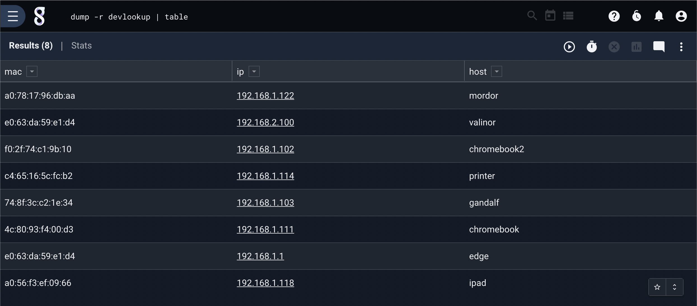
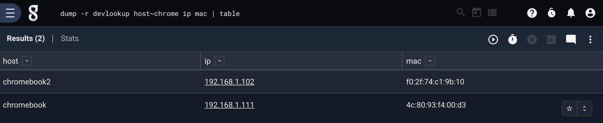
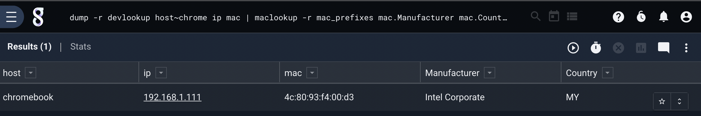

# Dump

The `dump` module injects the rows of a CSV or lookup table resource into the query pipeline as search entries, one entry per row, with each column as an enumerated value. This is useful for dashboards that work with data imported from a static source or aggregated by scheduled queries.

Without the `-p` flag, a dump query normally doesn't search stored data on the indexers. Use `-p` to inject the rows alongside stored data.

## Supported Options

* `-r <resource>`: Required. The name or UUID of the resource to dump. The current user must have read access to it.
* `-p`: Also search stored data on the indexers, passing those entries through alongside the injected rows. Can't be combined with `-t`.
* `-t <column>`: Use this column as the timestamp of each injected entry. If you name columns to extract, the timestamp column must be one of them. Rows whose timestamp can't be parsed, or that fall outside the query's time range, are dropped. Without `-t`, every row gets the same timestamp. Can't be combined with `-p`.
* `-tz <timezone>`: The timezone for timestamps parsed with `-t`, in [tz database format](https://en.wikipedia.org/wiki/List_of_tz_database_time_zones), such as `America/Denver`, `UTC`, or `Atlantic/Reykjavik`. Defaults to the local timezone.
* `-f <format>`: The format for timestamps parsed with `-t`, written as the reference time `Mon Jan 2 15:04:05 MST 2006` in the style of the [Go time library](https://golang.org/pkg/time/#pkg-constants). Without `-f`, the timestamp format is detected automatically.

## Filtering and Column Inclusion

The `dump` module extracts every column if no columns are named, or if every named column has a filter. For example, `dump -r hosts hostname` extracts only `hostname`, while `dump -r hosts hostname == "ad.example.com"` extracts all columns because the only named column has a filter. `dump -r hosts hostname == "ad.example.com" IP` extracts only `hostname` and `IP`.

### Supported Filter Operators

The `dump` module can filter on equality and substring matching. A row that fails any filter is not injected into the pipeline. A missing value is compared as an empty string.

| Operator | Name | Description |
|----------|------|-------------|
| == | Equal | Field must be equal
| != | Not equal | Field must not be equal
| ~ | Subset | Field contains the value
| !~ | Not Subset | Field does NOT contain the value


### Filtering Examples

Retrieve all columns from the `hosts` resource where `hostname` is not `ad.example.com`:
```
dump -r hosts hostname != "ad.example.com"
```

Retrieve only the `hostname`, `IP`, and `MAC` columns from the `hosts` resource where `hostname` contains `example.com`:
```
dump -r hosts hostname ~ "example.com" IP MAC
```

Retrieve all columns from the `hosts` resource where `hostname` is not empty and `org` is `finance`:
```
dump -r hosts hostname != "" org=="finance"
```

## Example Queries

Dump an entire resource and show it in a table:

```
dump -r devlookup | table
```




Dump all columns of rows where the `host` column contains `chrome` (filters are case-sensitive):

```
dump -r devlookup host ~ chrome | table
```



Process the dumped entries with other modules:

```
dump -r devlookup host ~ chrome | maclookup -r mac_prefixes MAC.Manufacturer MAC.Country | table
```


