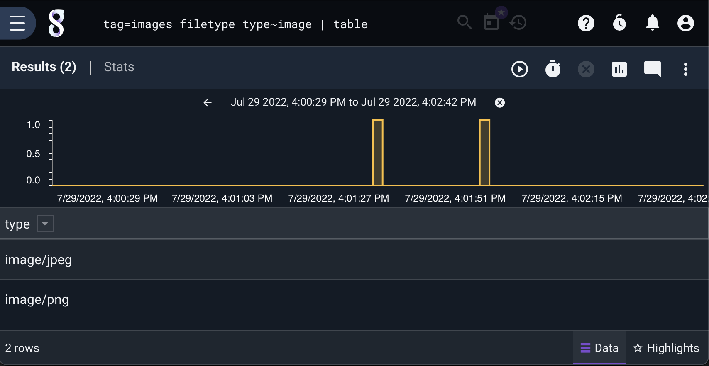

# Filetype

The `filetype` module identifies the file type of binary data, such as an entry that contains a raw JPEG, and stores its MIME type in a named enumerated value. The data must be in its native format; the module matches on the leading "magic" bytes.

## Supported Options

* `-e <arg>`: Read the data from the named enumerated value instead of the DATA field. Entries without that enumerated value are dropped.
* `-s`: Drop entries whose type cannot be identified.

## Usage

`filetype` takes one argument: the name of the enumerated value to populate with the MIME type. If the type cannot be identified, the enumerated value is not created and the entry is passed through unchanged, unless `-s` is set.

`filetype` supports inline filtering on the MIME type with the standard string filter operators. Entries whose identified type fails the filter are dropped. Entries whose type cannot be identified are not filtered; use `-s` to drop them as well.

The supported filter operators are:

| Operator | Name |
|----------|------|
| == | Equal |
| != | Not equal |
| ~ | Subset |
| !~ | Not subset |

## Supported Types

### Images 

* jpg - image/jpeg
* png - image/png
* gif - image/gif
* webp - image/webp
* cr2 - image/x-canon-cr2
* tif - image/tiff
* jp2 - image/jp2
* bmp - image/bmp
* heif - image/heif
* jxr - image/vnd.ms-photo
* psd - image/vnd.adobe.photoshop
* ico - image/vnd.microsoft.icon
* dwg - image/vnd.dwg

### Video

* mp4 - video/mp4
* m4v - video/x-m4v
* mkv - video/x-matroska
* webm - video/webm
* mov - video/quicktime
* avi - video/x-msvideo
* wmv - video/x-ms-wmv
* mpg - video/mpeg
* flv - video/x-flv
* 3gp - video/3gpp

### Audio

* mid - audio/midi
* mp3 - audio/mpeg
* m4a - audio/m4a
* ogg - audio/ogg
* flac - audio/x-flac
* wav - audio/x-wav
* amr - audio/amr
* aac - audio/aac
* aiff - audio/x-aiff

### Archive

* epub - application/epub+zip
* zip - application/zip
* tar - application/x-tar
* rar - application/vnd.rar
* gz - application/gzip
* bz2 - application/x-bzip2
* 7z - application/x-7z-compressed
* xz - application/x-xz
* zst - application/zstd
* pdf - application/pdf
* exe - application/vnd.microsoft.portable-executable
* swf - application/x-shockwave-flash
* rtf - application/rtf
* iso - application/x-iso9660-image
* eot - application/octet-stream
* ps - application/postscript
* sqlite - application/vnd.sqlite3
* nes - application/x-nintendo-nes-rom
* crx - application/x-google-chrome-extension
* cab - application/vnd.ms-cab-compressed
* deb - application/vnd.debian.binary-package
* ar - application/x-unix-archive
* Z - application/x-compress
* lz - application/x-lzip
* rpm - application/x-rpm
* elf - application/x-executable
* dcm - application/dicom
* macho - application/x-mach-binary

### Documents

* doc - application/msword
* docx - application/vnd.openxmlformats-officedocument.wordprocessingml.document
* xls - application/vnd.ms-excel
* xlsx - application/vnd.openxmlformats-officedocument.spreadsheetml.sheet
* ppt - application/vnd.ms-powerpoint
* pptx - application/vnd.openxmlformats-officedocument.presentationml.presentation

### Font

* woff - application/font-woff
* woff2 - application/font-woff
* ttf - application/font-sfnt
* otf - application/font-sfnt

### Application

* wasm - application/wasm
* dex - application/vnd.android.dex
* dey - application/vnd.android.dey

## Example

This example lists the MIME types of entries in the "images" tag and drops entries identified as anything other than an image:

```gravwell
tag=images filetype type~image | table
```


