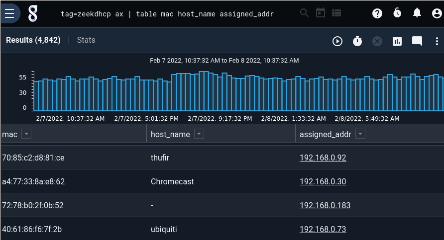
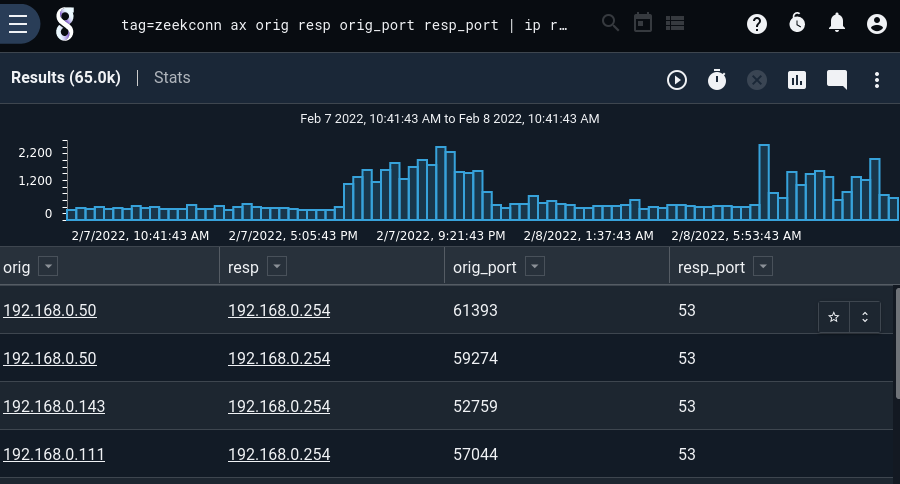
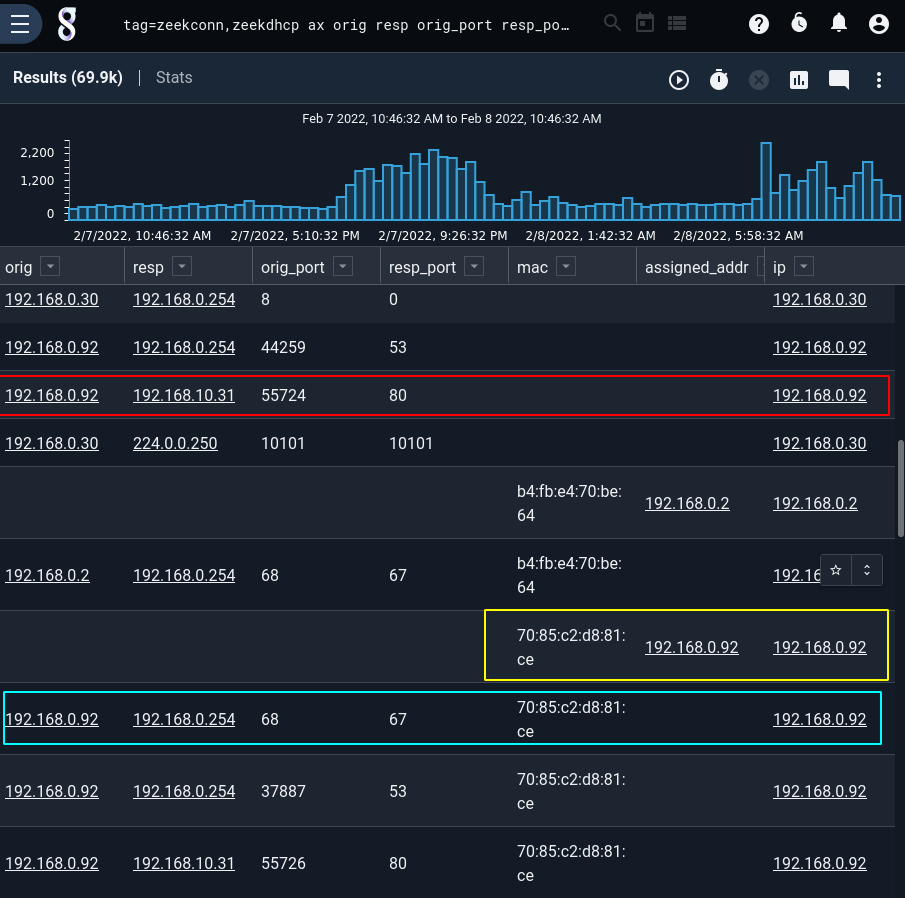
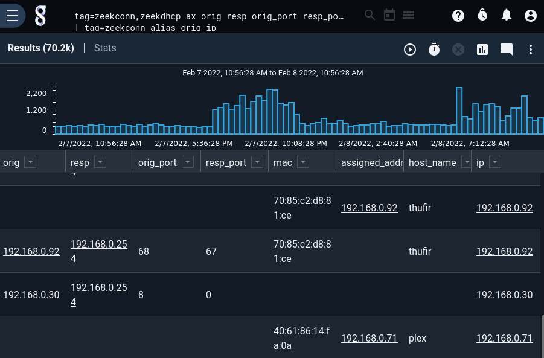
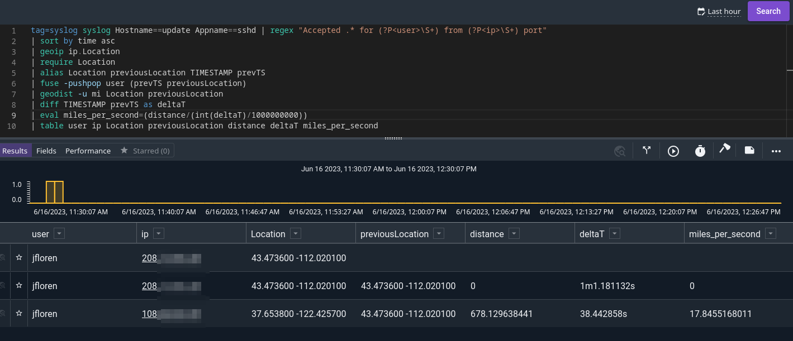

# Fuse

The fuse module does basic data fusion in the pipeline, without [compound queries](/search/search), multiple queries, or [`eval`](/search/eval/eval) code. It takes one or more "key" enumerated values, plus one or more "data" enumerated values. For each entry, it does one of the following:

* *Store*: If any of the data enumerated values exist on the entry, it stores their contents in an in-memory lookup table, keyed off the contents of the key enumerated values. Data enumerated values missing from the entry are stored as empty and are not loaded later.
* *Load*: If none of the data enumerated values are set, it checks the lookup table using the key enumerated values. If values are stored for that key, it copies them into the current entry.

Entries missing any key enumerated value pass through unchanged. Fuse tracks only the most recently seen set of data enumerated values for each key.

For instance, you might combine DHCP logs with Netflow records to attach MAC addresses to the Netflow. Once fuse sees a DHCP log associating the MAC address "00:11:22:33:44:55" with the IP address 10.0.0.1, it attaches an enumerated value containing 00:11:22:33:44:55 to each later Netflow record with IP address 10.0.0.1. Because fuse is order-dependent, Netflow records that arrive *before* the DHCP log do *not* get the MAC address.

You can think of fuse like a simpler version of [lookup](/search/lookup/lookup), where the lookup table is built on the fly in the pipeline rather than ahead of time.

## Supported Options

* `-maxtracked <n>`: Sets the maximum number of unique keys to track. The query aborts if this is exceeded. Defaults to 1000000.
* `-maxsize <n>`: Sets the maximum amount of stored data, in megabytes. The query aborts if this is exceeded. Defaults to 1024 MB or 15% of system memory, whichever is larger.
* `-pushpop`: Enables "push-pop" mode. In this mode, fuse *always* stores the current values of the data enumerated values and *always* replaces them with the previously stored values for that key. If nothing is stored yet for the key, the data enumerated values are removed from the entry. See below for a detailed example.

## Syntax

Fuse takes its arguments in a few forms. With one key enumerated value and one data enumerated value, the syntax is:

	fuse key data

To specify more than one key enumerated value, group the names inside square brackets:

	fuse [key1 key2] data

To specify more than one data enumerated value, group the names inside parentheses:

	fuse key (data1 data2)

These options can be combined:

	fuse [key1 key2] (data1 data2)

This mirrors the bracket and parenthesis syntax of [the lookup module](/search/lookup/lookup).

## Example: Zeek connection & DHCP fusion

This example uses Zeek DHCP logs to attach a MAC address to Zeek *connection* logs.

In the `zeekdhcp` tag, we're interested in the `mac` and `assigned_addr` fields:

	tag=zeekdhcp ax | table mac host_name assigned_addr



From `zeekconn` we extract the orig and resp IP addresses, plus port numbers:

	tag=zeekconn ax orig resp orig_port resp_port | ip resp~PRIVATE orig~PRIVATE | table



Now we use the fuse module to enrich:

```gravwell
tag=zeekconn,zeekdhcp ax orig resp orig_port resp_port mac assigned_addr 
| tag=zeekconn alias orig ip 
| tag=zeekdhcp alias assigned_addr ip 
| tag=zeekconn ip resp~PRIVATE orig~PRIVATE 
| sort by time asc 
| fuse ip mac 
| table
```

Breaking down the query:

* The ax module extracts all desired fields. AX ignores fields that aren't defined for a given tag, so we can extract `orig`, `resp`, `orig_port`, and `resp_port` from the zeekconn tag and `mac` and `assigned_addr` from the zeekdhcp tag in one step.
* We alias `orig` on the zeekconn tag and `assigned_addr` on the zeekdhcp tag to the same name, `ip`. This is the key enumerated value for fuse.
* To keep the results short, the `ip` module filters down to conn logs between two private IP addresses.
* Fuse depends on entry order, so `sort by time asc` makes sure entries arrive oldest first.
* The fuse module uses `ip` as the key enumerated value and `mac` as the data enumerated value.
* The table renderer displays the results.

In the results below, the connection log outlined in red has no MAC address, because fuse has no MAC value stored yet for ip = 192.168.0.92. After the DHCP entry outlined in yellow arrives, the next connection log, outlined in blue, has a MAC address attached for 192.168.0.30.



To include hostnames too, add them to the fuse invocation:

```gravwell
tag=zeekconn,zeekdhcp ax orig resp orig_port resp_port mac assigned_addr host_name
| tag=zeekconn alias orig ip 
| tag=zeekdhcp alias assigned_addr ip 
| tag=zeekconn ip resp~PRIVATE orig~PRIVATE 
| sort by time asc 
| fuse ip (host_name mac)
| table
```



## Example: Push-Pop

Push-pop mode is useful for comparing an enumerated value on the current entry to the same enumerated value on the *previous* entry with the same key. The usual pattern is:

```
alias myEV myPreviousEV | fuse -pushpop keyEV myPreviousEV
```

This copies the current enumerated value with alias, then tells `fuse` to save that copy and overwrite it with the previously saved value.

We can use this pattern to ask how "fast" users are traveling. Did a user log in from California at 9 a.m., then from Germany at 9:30? The query below answers that question for SSH logs.

```
tag=syslog syslog Hostname==update Appname==sshd
| regex "Accepted .* for (?P<user>\S+) from (?P<ip>\S+) port" 
| sort by time asc
| geoip ip.Location
| require Location
| alias Location previousLocation TIMESTAMP prevTS
| fuse -pushpop user (prevTS previousLocation)
| geodist -u mi Location previousLocation
| diff TIMESTAMP prevTS as deltaT
| eval miles_per_second=(distance/(int(deltaT)/1000000000))
| table user ip Location previousLocation distance deltaT miles_per_second
```

The query extracts the username and IP address from SSH logs, then uses the `geoip` module to find locations for those IPs.

Next, it copies the `Location` and `TIMESTAMP` enumerated values, then uses `fuse -pushpop` to replace the copies with the previous values for each username.

The `geodist` module finds the distance between `Location` and `previousLocation`, producing an enumerated value named `distance`.

The `diff` module finds the difference between the current and previous timestamps, calling it `deltaT`.

Finally, `eval` divides the distance by the change in time (`deltaT`, a duration in nanoseconds) to get a speed in miles per second.

The results show that user `jfloren` logged on from two hosts 678 miles apart within a minute. That would take 17 miles per second in person, so the next step is to find out whether he's logging in from remote systems or somebody has his credentials.



On the second entry, `previousLocation` matches the `Location` of the *first* entry; likewise `previousLocation` on the third entry matches the `Location` of the second. This is how push-pop mode works.
