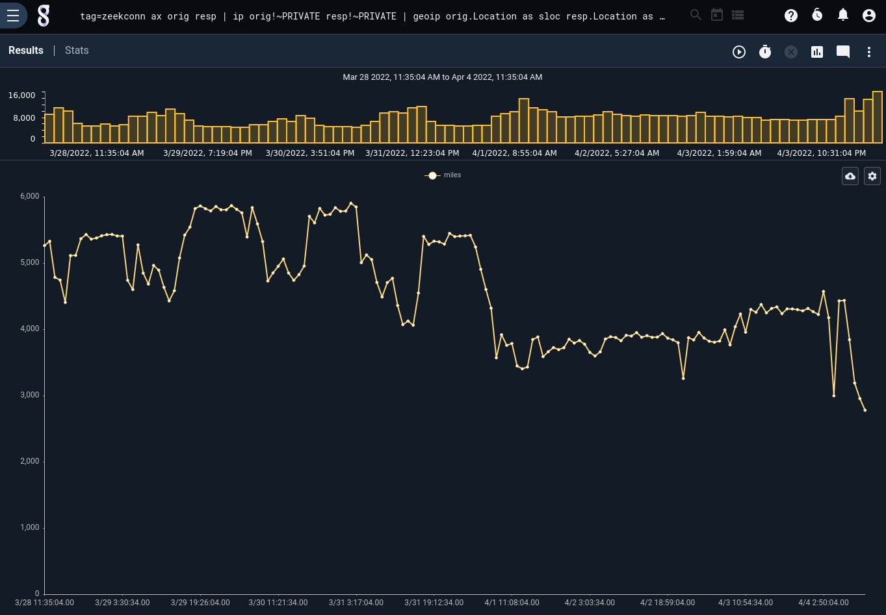

# Geodist module

The geodist module calculates the great-circle (haversine) distance between two location enumerated values, such as those produced by [geoip](/search/geoip/geoip) or [location](/search/location/location). Results are in kilometers unless you choose another unit with `-u`.

## Syntax

```
geodist [-u <unit>] (loc1 loc2 [as output])...
```

Each pair of locations produces one distance. The output is named `distance` unless renamed with `as`; give each pair a unique name when computing more than one distance. If either value in a pair is missing or is not a location, the entry passes through without that distance.

## Supported Options

* `-u <unit>`: distance unit. Valid units are `km` (kilometers, the default), `mi` (miles), `m` (meters), and `nmi` (nautical miles).

## Examples

This query charts the average distance, in miles, between source and destination in Zeek connection logs:

```gravwell
tag=zeekconn ax orig resp | ip orig!~PRIVATE resp!~PRIVATE | geoip orig.Location as sloc resp.Location as dloc | geodist -u mi sloc dloc as distance | stats mean(distance) as miles | chart miles
```


