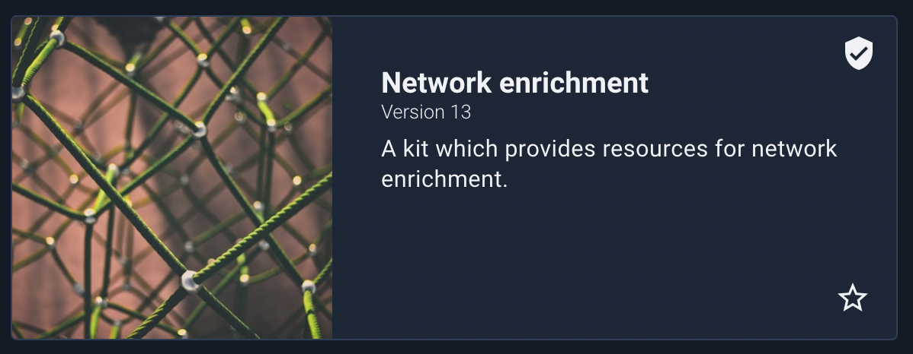
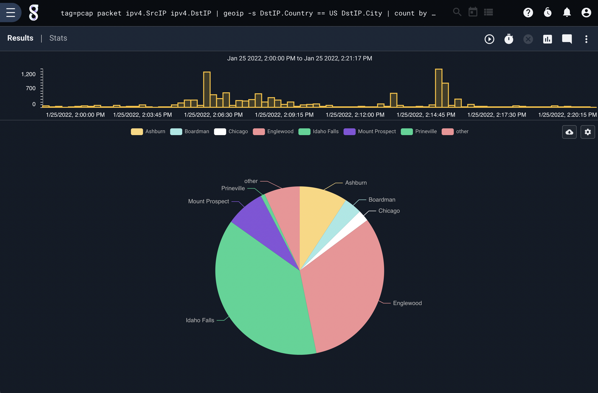
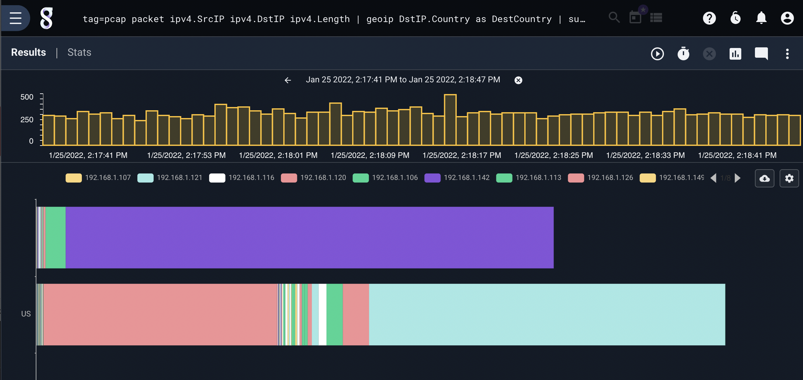
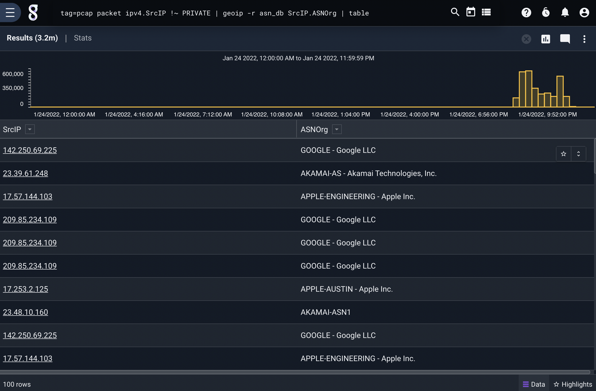

# Geoip

The geoip module looks up IP addresses in [MaxMind](https://maxmind.com/) GeoIP databases. It can extract approximate latitude/longitude, city, country, and continent, as well as the ASN and ASN organization for an IP.

## Setting Up Databases

The geoip module reads MaxMind databases from resources. Install the Network Enrichment kit, which contains MaxMind and ASN databases for use with the geoip module.



## Supported Options

* `-r <resource>`: name or UUID of the resource containing a MaxMind database. Defaults to `maxmind`.
* `-s`: strict mode. If any extraction fails to resolve, the entry is dropped.

## Processing Operators

Each extraction can take a filter, so you can drop entries by country, ISP, ASN, and so on without a separate filtering step. The operators allowed depend on the extracted type. String extractions (ISP, Country, City, etc.) support `==`, `!=`, `~`, and `!~`; numeric extractions (ASN, Lat, Long) support `==`, `!=`, `<`, `>`, `<=`, and `>=`. `Location` takes no filter.

Each extraction is written to an enumerated value named after the extractor (for example, `Country`), or to the name given with `as`. You can specify multiple extractions in one invocation, such as the location of both the source and destination IP of a Netflow record; when two extractions would produce the same name, rename one with `as`.

| Operator | Name | Description
|----------|------|-------------
| == | Equal | Field must be equal
| != | Not equal | Field must not be equal
| < | Less than | Field must be less than
| > | Greater than | Field must be greater than
| <= | Less than or equal | Field must be less than or equal to
| >= | Greater than or equal | Field must be greater than or equal to
| ~ | Contains | Field must contain the value (strings only)
| !~ | Not contains | Field must not contain the value (strings only)

## Data Item Extractors

The following extractions are possible with the standard MaxMind GeoIP database:

| Extractor | Operators | Description | Example 
|-----------|-----------|-------------|----------
| ISP | == != ~ !~ | ISP which owns the IP (only available with MaxMind enterprise database) | SrcIP.ISP != Comcast
| Country | == != ~ !~ | Country code for the IP | DstIP.Country == "US"
| CountryName | == != ~ !~ | Country name for the IP | SrcIP.CountryName != "United States"
| City | == != ~ !~ | City name for the IP | DstIP.City
| Continent | == != ~ !~ | Continent code for the IP | SrcIP.Continent == NA
| ContinentName | == != ~ !~ | Continent name for the IP | DstIP.ContinentName != "North America"
| Location |  | Latitude and Longitude location for IP | SrcIP.Location
| Lat | > < <= >= == != | Latitude for IP | DstIP.Lat < 22.5432
| Long |  > < <= >= == != | Longitude for IP | DstIP.Long > -15.1234

```{note}
`Location`, `Lat`, and `Long` only resolve IPv4 addresses.
```

The following require an ASN database, selected with `-r`:

| Extractor | Operators | Description | Example 
|-----------|-----------|-------------|----------
| ASNOrg | == != ~ !~ | Autonomous system number organization owner for IP | DstIP.ASNOrg != Google
| ASN |  > < <= >= == != | Autonomous system number | DstIP.ASN >= 1024

## Examples

### Filtering on country and requiring that city is resolved

```gravwell
tag=pcap packet ipv4.SrcIP ipv4.DstIP | geoip -s DstIP.Country == US DstIP.City | count by City | chart count by City
```



### Showing Per IP Country Traffic

```gravwell
tag=pcap packet ipv4.SrcIP ipv4.DstIP ipv4.Length  | geoip DstIP.Country as DestCountry | sum Length by SrcIP,DestCountry | stackgraph DestCountry SrcIP sum
```



### Extracting City for Two IPs

```gravwell
tag=pcap packet ipv4.SrcIP ipv4.DstIP | geoip DstIP.City as dest SrcIP.City as src | fdg -b src dest
```

### Extracting ASN Org

```gravwell
tag=pcap packet ipv4.SrcIP !~ PRIVATE | geoip -r asn SrcIP.ASNOrg | table
```


