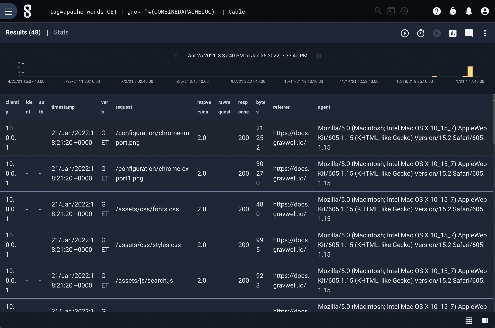
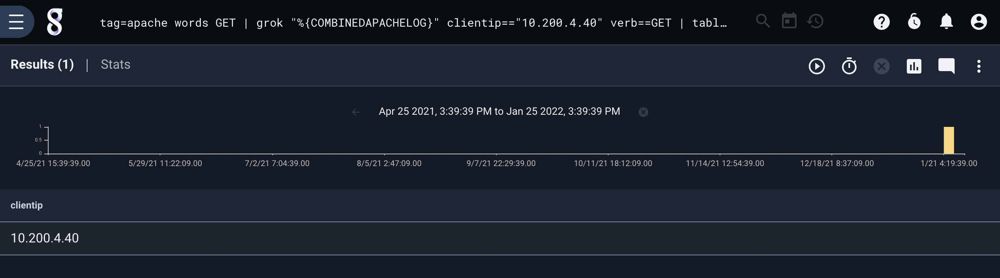
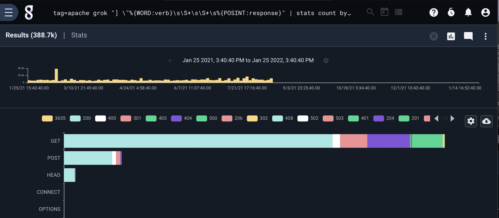

# Grok

The `grok` module extracts data from text using named, reusable regular expressions called patterns. Instead of writing a full regular expression, you reference patterns by name, such as `%{IPV4:clientip}`. Patterns can nest other patterns, so complex definitions are built from simple ones. Grok ships with a base set of patterns, listed below, and can load your own from a [resource](/resources/resources).

Only patterns given a name with the `%{PATTERN:name}` form are extracted as enumerated values. In `%{IPV4} %{WORD:verb}`, the IPv4 address must match but only `verb` is extracted.

Entries that match are passed and entries that do not are dropped. The `-v` flag inverts this.

```{note}
Some patterns are strict and complex, so they can be slow over large numbers of entries. Use modules such as [grep](/search/grep/grep), [regex](/search/regex/regex), and [words](/search/words/words) to pre-filter as much as possible.
```

## Syntax

```
grok [flags] <pattern> [filters]
```

The pattern is unescaped like any other quoted string, so backslash escapes inside double quotes are consumed by the query parser: `"\s"` reaches grok as `s`. Wrap patterns that contain backslashes in backticks instead, as in the second example under Performance.

## Supported Options

* `-e <arg>`: Operate on the specified enumerated value instead of the entry data. Entries without the enumerated value are dropped.
* `-r <resource>`: Load custom patterns from the named resource. Without `-r`, grok loads the resource named `grok` if it exists.
* `-v`: Inverse mode. Pass entries that do *not* match the pattern and drop entries that do. Cannot be combined with `-p` or with filters.
* `-p`: Permissive mode. Pass entries that do not match. Entries that match are still subject to filters.

### Custom Patterns

A pattern resource holds one definition per line: an upper-case name, whitespace, then the pattern. Blank lines and lines starting with `#` are ignored. Custom definitions are added to the built-in set and replace any built-in pattern with the same name.

```
APACHEVERB [A-Z]+
APACHEREQ "%{APACHEVERB:verb} %{NOTSPACE:request}
```

Gravwell publishes a large pattern set on [GitHub](https://raw.githubusercontent.com/gravwell/resources/master/grok/all.grok). Upload it as a resource named `grok` to make its patterns available in every grok query.

### Parse Apache Logs

The `COMBINEDAPACHELOG` pattern from Gravwell's published pattern set strictly parses Apache 2.0 combined access logs. The following query finds Apache logs for "GET" requests and parses them into their components:

```gravwell
tag=apache words GET | grok "%{COMBINEDAPACHELOG}" | table
```



```{note}
This query may take some time over millions of entries, because `COMBINEDAPACHELOG` is complex and strict.
```

### Filtering

Filters can be applied to any named field in the pattern, using `==`, `!=`, `~` (contains), and `!~` (does not contain). An entry that fails any filter is dropped. Naming a field that is not in the pattern is an error.

Building on the previous query, the following returns only GET requests from a particular client IP:

```gravwell
tag=apache words GET | grok "%{COMBINEDAPACHELOG}" clientip=="10.200.4.40" verb==GET | table clientip
```



```{note}
`words GET` uses the index to reduce the number of entries the expensive `COMBINEDAPACHELOG` pattern has to process.
```

## Performance

A grok pattern that extracts and validates every field in a log is complex and slow. If you only need a few fields, a small pattern built from primitives can be dramatically faster.

For example, both of the following queries count response codes for each HTTP method and display them in a stackgraph. The first uses `COMBINEDAPACHELOG`:

```gravwell
tag=apache grok "%{COMBINEDAPACHELOG}" | stats count by verb response | stackgraph verb response count
```

The second uses primitives to extract only the fields it needs:

```gravwell
tag=apache grok `] "%{WORD:verb}\s\S+\s\S+\s%{POSINT:response}` | stats count by verb response | stackgraph verb response count
```

Both queries produce identical results:



Over 10M Apache access logs, the first query took `2m 39s` and the second took `3.46s`, a speedup of more than 45x.

## Pre-defined Patterns

Grok includes the following base patterns. They cover basic data types and are generally strict about what they accept. For patterns that handle entire log formats, see the [published pattern set](https://raw.githubusercontent.com/gravwell/resources/master/grok/all.grok).

| Pattern Name | Substitution Pattern                                                                               |
| ------------ | -------------------------------------------------------------------------------------------------- |
| USERNAME | `[a-zA-Z0-9._-]+` |
| USER | `%{USERNAME}` |
| EMAILLOCALPART | `[a-zA-Z][a-zA-Z0-9_.+-=:]+` |
| HOSTNAME | `\b[0-9A-Za-z][0-9A-Za-z-]{0,62}(?:\.[0-9A-Za-z][0-9A-Za-z-]{0,62})*(\.?\|\b)` |
| EMAILADDRESS | `%{EMAILLOCALPART}@%{HOSTNAME}` |
| HTTPDUSER | `%{EMAILADDRESS}\|%{USER}` |
| INT | `[+-]?(?:[0-9]+)` |
| BASE10NUM | `[+-]?(?:(?:[0-9]+(?:\.[0-9]+)?)\|(?:\.[0-9]+))` |
| NUMBER | `%{BASE10NUM}` |
| BASE16NUM | `[+-]?(?:0x)?(?:[0-9A-Fa-f]+)` |
| BASE16FLOAT | `\b[+-]?(?:0x)?(?:(?:[0-9A-Fa-f]+(?:\.[0-9A-Fa-f]*)?)\|(?:\.[0-9A-Fa-f]+))\b` |
| POSINT | `\b[1-9][0-9]*\b` |
| NONNEGINT | `\b[0-9]+\b` |
| WORD | `\b\w+\b` |
| NOTSPACE | `\S+` |
| SPACE | `\s*` |
| DATA | `.*?` |
| GREEDYDATA | `.*` |
| QUOTEDSTRING | ``` ("(\\.\|[^\\"]+)+")\|""\|('(\\.\|[^\\']+)+')\|''\|(`(\\.\|[^\\`]+)+`)\|`` ``` |
| UUID | `[A-Fa-f0-9]{8}-(?:[A-Fa-f0-9]{4}-){3}[A-Fa-f0-9]{12}` |
| UNIXPATH | `(/([\w_%!$@:.,~-]+\|\\.)*)+` |
| TTY | `/dev/(pts\|tty([pq])?)(\w+)?/?(?:[0-9]+)` |
| WINPATH | `(?:[A-Za-z]+:\|\\)(?:\\[^\\?*]*)+` |
| PATH | `%{UNIXPATH}\|%{WINPATH}` |
| URIPROTO | `[A-Za-z]+(\+[A-Za-z+]+)?` |
| URIHOST | `%{IPORHOST}(?::%{POSINT:port})?` |
| URIPATH | `(?:/[A-Za-z0-9$.+!*'(){},~:;=@#%_\-]*)+` |
| URIPARAM | `\?[A-Za-z0-9$.+!*'\|(){},~@#%&/=:;_?\-\[\]<>]*` |
| URIPATHPARAM | `%{URIPATH}(?:%{URIPARAM})?` |
| URI | `%{URIPROTO}://(?:%{USER}(?::[^@]*)?@)?(?:%{URIHOST})?(?:%{URIPATHPARAM})?` |
| MONTH | `\bJan(?:uary\|uar)?\|Feb(?:ruary\|ruar)?\|M(?:a\|ä)?r(?:ch\|z)?\|Apr(?:il)?\|Ma(?:y\|i)?\|Jun(?:e\|i)?\|Jul(?:y)?\|Aug(?:ust)?\|Sep(?:tember)?\|O(?:c\|k)?t(?:ober)?\|Nov(?:ember)?\|De(?:c\|z)(?:ember)?\b` |
| MONTHNUM | `0?[1-9]\|1[0-2]` |
| MONTHNUM2 | `0[1-9]\|1[0-2]` |
| MONTHDAY | `(?:0[1-9])\|(?:[12][0-9])\|(?:3[01])\|[1-9]` |
| DAY | `Mon(?:day)?\|Tue(?:sday)?\|Wed(?:nesday)?\|Thu(?:rsday)?\|Fri(?:day)?\|Sat(?:urday)?\|Sun(?:day)?` |
| YEAR | `(?:\d\d){1,2}` |
| HOUR | `2[0123]\|[01]?[0-9]` |
| MINUTE | `[0-5][0-9]` |
| SECOND | `(?:[0-5]?[0-9]\|60)(?:[:.,][0-9]+)?` |
| TIME | `%{HOUR}:%{MINUTE}:%{SECOND}` |
| DATE_US | `%{MONTHNUM}[/-]%{MONTHDAY}[/-]%{YEAR}` |
| DATE_EU | `%{MONTHDAY}[./-]%{MONTHNUM}[./-]%{YEAR}` |
| DATE_X | `%{YEAR}/%{MONTHNUM2}/%{MONTHDAY}` |
| ISO8601_TIMEZONE | `Z\|[+-]%{HOUR}(?::?%{MINUTE})` |
| ISO8601_SECOND | `%{SECOND}\|60` |
| TIMESTAMP_ISO8601 | `%{YEAR}-%{MONTHNUM}-%{MONTHDAY}[T ]%{HOUR}:?%{MINUTE}(?::?%{SECOND})?%{ISO8601_TIMEZONE}?` |
| DATE | `%{DATE_US}\|%{DATE_EU}\|%{DATE_X}` |
| DATESTAMP | `%{DATE}[- ]%{TIME}` |
| TZ | `[A-Z]{3}` |
| NUMTZ | `[+-]\d{4}` |
| DATESTAMP_RFC822 | `%{DAY} %{MONTH} %{MONTHDAY} %{YEAR} %{TIME} %{TZ}` |
| DATESTAMP_RFC2822 | `%{DAY}, %{MONTHDAY} %{MONTH} %{YEAR} %{TIME} %{ISO8601_TIMEZONE}` |
| DATESTAMP_OTHER | `%{DAY} %{MONTH} %{MONTHDAY} %{TIME} %{TZ} %{YEAR}` |
| DATESTAMP_EVENTLOG | `%{YEAR}%{MONTHNUM2}%{MONTHDAY}%{HOUR}%{MINUTE}%{SECOND}` |
| HTTPDERROR_DATE | `%{DAY} %{MONTH} %{MONTHDAY} %{TIME} %{YEAR}` |
| ANSIC | `%{DAY} %{MONTH} [_123]\d %{TIME} %{YEAR}"` |
| UNIXDATE | `%{DAY} %{MONTH} [_123]\d %{TIME} %{TZ} %{YEAR}` |
| RUBYDATE | `%{DAY} %{MONTH} [0-3]\d %{TIME} %{NUMTZ} %{YEAR}` |
| RFC822Z | `[0-3]\d %{MONTH} %{YEAR} %{TIME} %{NUMTZ}` |
| RFC850 | `%{DAY}, [0-3]\d-%{MONTH}-%{YEAR} %{TIME} %{TZ}` |
| RFC1123 | `%{DAY}, [0-3]\d %{MONTH} %{YEAR} %{TIME} %{TZ}` |
| RFC1123Z | `%{DAY}, [0-3]\d %{MONTH} %{YEAR} %{TIME} %{NUMTZ}` |
| RFC3339 | `%{YEAR}-[01]\d-[0-3]\dT%{TIME}%{ISO8601_TIMEZONE}` |
| RFC3339NANO | `%{YEAR}-[01]\d-[0-3]\dT%{TIME}\.\d{9}%{ISO8601_TIMEZONE}` |
| KITCHEN | `\d{1,2}:\d{2}(AM\|PM\|am\|pm)` |
| SYSLOGTIMESTAMP | `%{MONTH} +%{MONTHDAY} %{TIME}` |
| LOGLEVEL | `[Aa]lert\|ALERT\|[Tt]race\|TRACE\|[Dd]ebug\|DEBUG\|[Nn]otice\|NOTICE\|[Ii]nfo\|INFO\|[Ww]arn?(?:ing)?\|WARN?(?:ING)?\|[Ee]rr?(?:or)?\|ERR?(?:OR)?\|[Cc]rit?(?:ical)?\|CRIT?(?:ICAL)?\|[Ff]atal\|FATAL\|[Ss]evere\|SEVERE\|EMERG(?:ENCY)?\|[Ee]merg(?:ency)?` |
| QS | `%{QUOTEDSTRING}` |
| NQS | `[^"]*` |
| PROG | `[\x21-\x5a\x5c\x5e-\x7e]+` |
| CISCOMAC | `(?:[A-Fa-f0-9]{4}\.){2}[A-Fa-f0-9]{4}` |
| WINDOWSMAC | `(?:[A-Fa-f0-9]{2}-){5}[A-Fa-f0-9]{2}` |
| COMMONMAC | `(?:[A-Fa-f0-9]{2}:){5}[A-Fa-f0-9]{2}` |
| MAC | `%{CISCOMAC}\|%{WINDOWSMAC}\|%{COMMONMAC}` |
| IPV4 | `(?:(?:25[0-5]\|2[0-4][0-9]\|[01]?[0-9][0-9]?)\.){3}(?:25[0-5]\|2[0-4][0-9]\|[01]?[0-9][0-9]?)` |
| IPV6 | `((([0-9A-Fa-f]{1,4}:){7}([0-9A-Fa-f]{1,4}\|:))\|(([0-9A-Fa-f]{1,4}:){6}(:[0-9A-Fa-f]{1,4}\|((25[0-5]\|2[0-4]\d\|1\d\d\|[1-9]?\d)(\.(25[0-5]\|2[0-4]\d\|1\d\d\|[1-9]?\d)){3})\|:))\|(([0-9A-Fa-f]{1,4}:){5}(((:[0-9A-Fa-f]{1,4}){1,2})\|:((25[0-5]\|2[0-4]\d\|1\d\d\|[1-9]?\d)(\.(25[0-5]\|2[0-4]\d\|1\d\d\|[1-9]?\d)){3})\|:))\|(([0-9A-Fa-f]{1,4}:){4}(((:[0-9A-Fa-f]{1,4}){1,3})\|((:[0-9A-Fa-f]{1,4})?:((25[0-5]\|2[0-4]\d\|1\d\d\|[1-9]?\d)(\.(25[0-5]\|2[0-4]\d\|1\d\d\|[1-9]?\d)){3}))\|:))\|(([0-9A-Fa-f]{1,4}:){3}(((:[0-9A-Fa-f]{1,4}){1,4})\|((:[0-9A-Fa-f]{1,4}){0,2}:((25[0-5]\|2[0-4]\d\|1\d\d\|[1-9]?\d)(\.(25[0-5]\|2[0-4]\d\|1\d\d\|[1-9]?\d)){3}))\|:))\|(([0-9A-Fa-f]{1,4}:){2}(((:[0-9A-Fa-f]{1,4}){1,5})\|((:[0-9A-Fa-f]{1,4}){0,3}:((25[0-5]\|2[0-4]\d\|1\d\d\|[1-9]?\d)(\.(25[0-5]\|2[0-4]\d\|1\d\d\|[1-9]?\d)){3}))\|:))\|(([0-9A-Fa-f]{1,4}:){1}(((:[0-9A-Fa-f]{1,4}){1,6})\|((:[0-9A-Fa-f]{1,4}){0,4}:((25[0-5]\|2[0-4]\d\|1\d\d\|[1-9]?\d)(\.(25[0-5]\|2[0-4]\d\|1\d\d\|[1-9]?\d)){3}))\|:))\|(:(((:[0-9A-Fa-f]{1,4}){1,7})\|((:[0-9A-Fa-f]{1,4}){0,5}:((25[0-5]\|2[0-4]\d\|1\d\d\|[1-9]?\d)(\.(25[0-5]\|2[0-4]\d\|1\d\d\|[1-9]?\d)){3}))\|:)))(%.+)?` |
| IP | `%{IPV6}\|%{IPV4}` |
| IPORHOST | `%{IP}\|%{HOSTNAME}` |
| HOSTPORT | `%{IPORHOST}:%{POSINT}` |
| HTTPDATE | `%{MONTHDAY}/%{MONTH}/%{YEAR}:%{TIME} %{INT}` |
