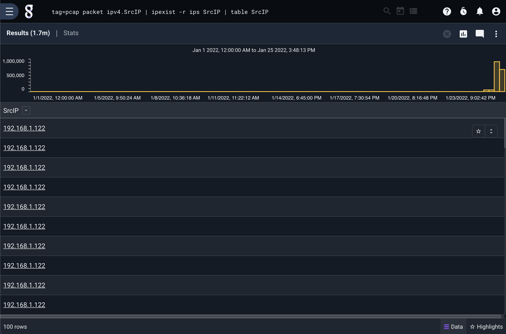
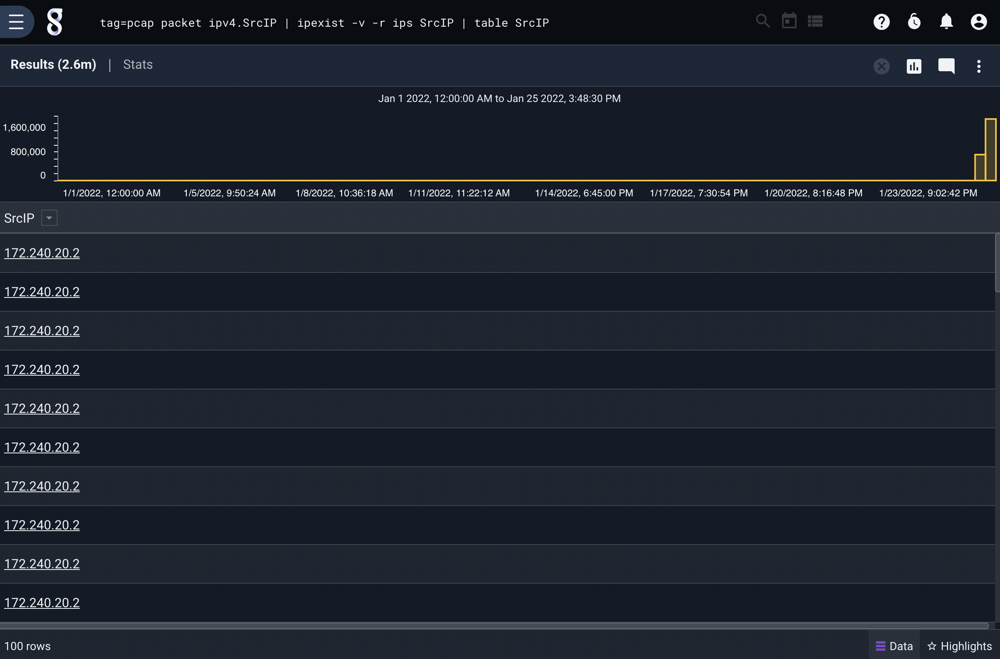

# IPexist

The ipexist module performs fast existence checks of IP addresses against a set stored in a resource. It uses Gravwell's [ipexist library](https://github.com/gravwell/gravwell/tree/master/ipexist) to store and query the set. You give it one or more enumerated values to check; by default, an entry passes only if every one of them is found in the set.

```{note}
The ipexist module only handles IPv4 addresses. An IPv6 address never matches, so without `-v` or `-or` the entry is dropped.
```

Enumerated values that are missing from an entry, or that don't hold an IP address, are skipped. Without `-or`, an entry where none of the listed enumerated values hold an IP passes.

## Supported Options

* `-r <resource>`: name of a resource containing an ipexist-formatted set; see "Creating IP sets" below. Required. Repeat the flag to check against several resources.
* `-v`: invert the result. `ipexist -r ips SrcIP` passes entries whose `SrcIP` is in the set; `ipexist -v -r ips SrcIP` drops them and passes all others.
* `-or`: pass the entry if any of the enumerated values is found, instead of requiring all of them.

## Creating IP sets

IP sets use a compact format, designed for fast lookups, that is implemented in the [ipexist library](https://github.com/gravwell/gravwell/tree/master/ipexist). The library includes a command-line tool, `textinput`, to generate sets. Building it requires git and the Go compiler.

First, clone the opensource Gravwell repository:

	git clone https://github.com/gravwell/gravwell

Then build the tool:

	cd gravwell/ipexist/textinput && go build

Then write the IPv4 addresses for the set to a text file, one per line, in any order:

	10.0.0.2
	192.168.3.77
	10.3.2.1
	8.8.8.8

Then run the textinput tool, giving it the path to the input file and a path for the output:

	./textinput -i /path/to/inputfile -o /path/to/outputfile

Upload the output file as a resource to use it with the ipexist module.

## Example Usage

Assuming packets are captured under the `pcap` tag, this query passes only packets whose source IP is in the `ips` resource:

```gravwell
tag=pcap packet ipv4.SrcIP | ipexist -r ips SrcIP | table SrcIP
```



This query passes entries whose SrcIP **and** DstIP are both in the resource:

```gravwell
tag=pcap packet ipv4.SrcIP ipv4.DstIP | ipexist -r ips SrcIP DstIP | table SrcIP DstIP
```

With `-or`, it passes entries whose SrcIP **or** DstIP is in the resource:

```gravwell
tag=pcap packet ipv4.SrcIP ipv4.DstIP | ipexist -or -r ips SrcIP DstIP | table SrcIP DstIP
```

## Inverting queries

The `-v` flag inverts the query: entries that would normally be dropped are passed, and vice versa.

This query *drops* those entries whose source IP addresses are found in the resource:

```gravwell
tag=pcap packet ipv4.SrcIP | ipexist -v -r ips SrcIP | table SrcIP
```



In the following query, entries whose SrcIP **and** DstIP are both in the resource are *dropped*. In other words, "show me every packet whose source or destination is not in the known list".

```gravwell
tag=pcap packet ipv4.SrcIP ipv4.DstIP | ipexist -v -r ips SrcIP DstIP | table SrcIP DstIP
```

Combining `-v` with `-or` drops any entry where even one of the enumerated values is in the resource. In the example below, only entries whose source IP **and** destination IP are both *absent* from the resource pass.

```gravwell
tag=pcap packet ipv4.SrcIP ipv4.DstIP | ipexist -v -or -r ips SrcIP DstIP | table SrcIP DstIP
```

### Multiple resources

Repeat the `-r` flag to check against several IP sets; each resource name may appear only once. Without `-or`, each IP must be found in **every** resource. With `-or`, an IP found in any resource is a match, so the resources act as one large set.

```gravwell
tag=pcap packet ipv4.SrcIP | ipexist -or -r ips -r externalips SrcIP | table SrcIP
```
