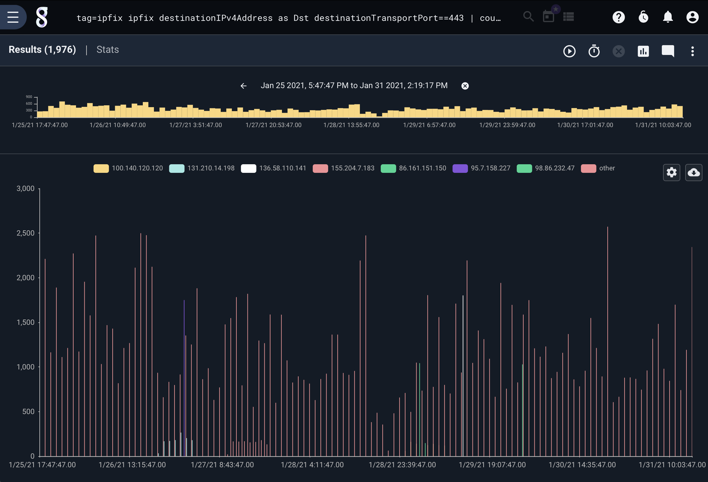
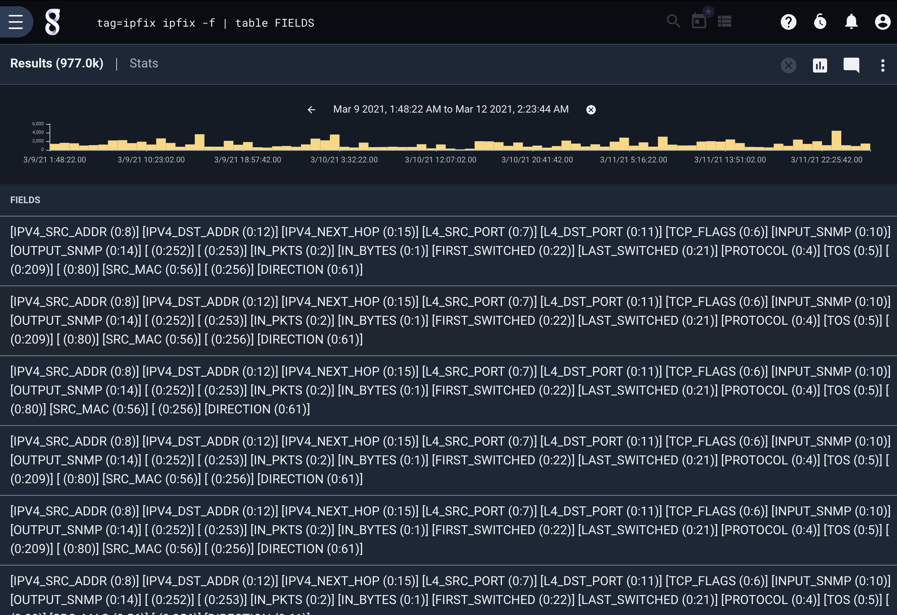

# IPFIX and Netflow V9

The ipfix module extracts and filters fields from raw IPFIX and Netflow v9 messages. Use it to find specific flows, filter on ports, or monitor aggregate flow behavior. Gravwell has a native IPFIX + Netflow ingester which is open source and available at https://github.com/gravwell/ingesters or as an installer in the [quickstart section](/quickstart/downloads).

## A Note About Templates

Gravwell is flexible about entry order. You can run queries from oldest entry to newest, from newest to oldest, or you can sort entries based on some other criteria entirely.

Unfortunately, this flexibility does not interact well with IPFIX and Netflow V9. These protocols define *templates*, which describe the format of data records. Templates are transmitted infrequently; any given IPFIX message is unlikely to contain a template record, but it will have data records referring to previously-defined templates. Without access to the appropriate template, a data record is meaningless. This means that parsing IPFIX messages from newest to oldest (or sorted in some other fashion) cannot work properly **unless** additional steps are taken.

To solve this, the *ingester* repacks every incoming IPFIX/Netflow v9 message with the templates its data records need. This makes each stored message somewhat larger, but messages typically hold tens of data records, so the increase is small. In exchange, every message (entry) can be parsed on its own without any earlier messages.

## Supported Options

* `-e <name>`: Read the IPFIX message from an enumerated value instead of the entry data. Useful when an upstream module has extracted the message.
* `-s`: Strict mode. Every specified extraction *must* succeed, or the entry is dropped. For example, `ipfix protocolIdentifier==1 srcPort` would drop all entries, because ICMP messages (IP protocol 1) will never contain a source port field.
* `-f`: For each data record, write a human-readable list of the fields it contains to an enumerated value named `FIELDS`. Each field is listed by name with its enterprise and field IDs. `-f` cannot be combined with field extractions.

## Processing Operators

Each IPFIX field supports a set of operators that act as fast filters. The field's data type determines which operators it supports. Numeric fields support everything *except* the subset operators. IP address fields support `==`, `!=`, and the subset operators, which take a CIDR subnet or the keywords `PRIVATE` and `MULTICAST`. MAC address fields support only `==` and `!=`.

| Operator | Name | Description |
|----------|------|-------------|
| == | Equal | Field must be equal
| != | Not equal | Field must not be equal
| < | Less than | Field must be less than
| > | Greater than | Field must be greater than
| <= | Less than or equal | Field must be less than or equal to
| >= | Greater than or equal | Field must be greater than or equal to
| ~ | Subset | Field must be a member of
| !~ | Not subset | Field must not be a member of


## Data Items

A single IPFIX (or Netflow v9) message consists of a header and N data records. Unlike Netflow v5, where every field is predefined, IPFIX/NFv9 data records follow templates that the generating device defines and sends in earlier messages. One generator might send source and destination IPs and ports for each flow, while a switch sends only packet counts.

All elements of the IPFIX/NFv9 message *header* can be used for filtering, as can the elements in the data records themselves. When filtering on header data items, the filter applies to *all* records in the message.  Header data items are processed first, and only if the header filters do not drop the frame are the individual records processed.

The ipfix module is an expanding module: it takes in one entry per IPFIX message and emits a new entry *for each data record*, so a single input entry might become 30 output entries.

```{note}
If you specify *only* header items to extract (e.g. `ipfix Version Sequence`), entries are *not* expanded, because there is only one header per IPFIX message. Each incoming entry will result in no more than one outgoing entry. Specifying a mix of header and data items will trigger expansion.
```

### IPFIX Header Data Items

| Field |       Description        | Supported Operators | Example |
|-------|--------------------------|---------------------|---------|
| Version | The Netflow version in use. 10 means IPFIX, 9 means Netflow v9. | > < <= >= == != | Version != 0xa
| Length | IPFIX: the total length of this IPFIX message. Netflow v9: the number of records contained in this message. | > < <= >= == != | Length > 1000
| Sec | Current Unix timestamp of the sensing device | > < <= >= == != | Sec == 1526511023
| Uptime | Number of milliseconds the sensing device has been online (Netflow v9 only) | > < <= >= == != | Uptime > 3516293216
| Sequence | Sequence counter of total messages sent by the sensing device | > < <= >= == != | Sequence == 234
| Domain | The observation domain from which the record originated | > < <= >= == != | Domain == 0x1A

### Data Record Items

IPFIX and Netflow v9 define the fields that can make up a data record. Netflow v9 defines several dozen fields, listed [in RFC3954](https://tools.ietf.org/html/rfc3954#section-8). A Netflow v9 field is defined by a field ID (a positive integer), a data type (e.g. 16-bit unsigned integer, etc.), and a name (e.g. L4_SRC_PORT).

IANA defines a similar set of fields for IPFIX, [listed here](https://www.iana.org/assignments/ipfix/ipfix.xhtml#ipfix-information-elements). IPFIX fields also have a field ID, a type, and a name, but IPFIX adds an _enterprise ID_. Enterprise IDs let vendors define their own fields alongside the predefined ones, which all have enterprise ID 0.

```{attention}
Because IPFIX and Netflow v9 are template-based, any given data record may or may not contain the fields described below. If you attempt to extract e.g. "sourceIPv4PrefixLength" but get empty results, it is possible that your IPFIX records do not contain that field.
```

Some of the most common IPFIX and Netflow v9 fields are listed below. Refer to the documents linked above for a complete list of supported names.


| IPFIX Name | Netflow v9 Name |      Description        | Supported Operators | Example |
|------------|-----------------|-------------------------|---------------------|---------|
| octetDeltaCount | IN_BYTES | The number of octets since the previous report (if any) in incoming packets for this Flow at the Observation Point. The number of octets includes IP header(s) and IP payload | > < <= >= == != | octetDeltaCount == 80
| packetDeltaCount | IN_PKTS | The number of incoming packets since the previous report (if any) for this Flow at the Observation Point. | > < <= >= == != | packetDeltaCount == 80
| deltaFlowCount | FLOWS | The conservative count of Original Flows contributing to this Aggregated Flow; may be distributed via any of the methods expressed by the valueDistributionMethod Information Element. | > < <= >= == != | deltaFlowCount == 80
| protocolIdentifier | PROTOCOL | Protocol number of the flow (TCP = 6, UDP = 17) | > < <= >= == != | protocolIdentifier == 17
| ipClassOfService | TOS | For IPv4 packets, this is the value of the TOS field in the IPv4 packet header.  For IPv6 packets, this is the value of the Traffic Class field in the IPv6 packet header | > < <= >= == != | ipClassOfService != 0
| tcpControlBits | TCP_FLAGS | TCP control bits observed for the packets of this Flow. | > < <= >= == != | tcpControlBits != 0x0004
| sourceTransportPort | L4_SRC_PORT | Source port of the flow.  If the protocol does not have a port the value is zero | > < <= >= == != | sourceTransportPort != 0
| sourceIPv4Address | IPV4_SRC_ADDR| IPv4 source address of the flow. | ~ !~ == != | sourceIPv4Address ~ 10.0.0.0/24 
| sourceIPv4PrefixLength | SRC_MASK | IPv4 source address prefix length. | > < <= >= == != | sourceIPv4PrefixLength < 24
| sourceIPv6Address | IPV6_SRC_ADDR | IPv6 source address of the flow. | ~ !~ == != | sourceIPv6Address == ::1
| sourceIPv6PrefixLength | IPV6_SRC_MASK | IPv6 source address prefix length. | > < <= >= == != | sourceIPv6PrefixLength < 64
| destinationTransportPort | L4_DST_PORT | Destination port of the flow.  If the protocol does not have a port the value is zero | > < <= >= == != | destinationTransportPort != 0
| destinationIPv4Address | IPV4_DST_ADDR | IPv4 destination address of the flow. | ~ !~ == != | destinationIPv4Address ~ 10.0.0.0/24 
| destinationIPv4PrefixLength | DST_MASK | IPv4 destination address prefix length. | > < <= >= == != | destinationIPv4PrefixLength < 24
| destinationIPv6Address | IPV6_DST_ADDR | IPv6 destination address of the flow. | ~ !~ == != | destinationIPv6Address == ::1
| destinationIPv6PrefixLength | IPV6_DST_MASK | IPv6 destination address prefix length. | > < <= >= == != | destinationIPv6PrefixLength < 64

```{note}
In general, you can specify Netflow v9 field names when extracting IPFIX messages and vice versa. However, because data types vary slightly between the two protocols, it is always safest to use IPFIX field names when processing IPFIX and Netflow names when processing Netflow.
```

The module also provides these shortcuts:

| Field |       Description        | Supported Operators | Example |
|-------|--------------------------|---------------------|---------|
| src | The source address for this flow (IPv4 or IPv6) | ~ !~ == != | src == ::1
| dst | The destination address for this flow (IPv4 or IPv6) | ~ !~ == != | dst !~ PRIVATE
| srcPort | The source port for this flow. | > < <= >= == != | srcPort == 80
| dstPort | The destination port for this flow. | > < <= >= == != | dstPort == 80
| ip | Whichever source or destination IP matches the filter. With no filter, the first IP address in the record is used | ~ !~ == != | ip ~ 10.0.0.0/24
| port | Whichever of the source or destination port matches the filter. With no filter, the lower port is used | > < <= >= == != | port == 80
| vlan | The VLAN from either the `vlanId` or `dot1qVlanId` field | > < <= >= == != | vlan == 100
| srcMac | The source MAC address for the flow | == != | srcMac==01:23:45:67:89:00
| dstMac | The destination MAC address for the flow | == != | dstMac==01:23:45:67:89:00
| mac | Whichever source or destination MAC address matches the filter. With no filter, the first MAC address in the record is used | == != | mac==01:23:45:67:89:00
| bytes | Total bytes seen: the sum of `octetDeltaCount` and `postOctetDeltaCount` | > < <= >= == != | bytes <= 10000
| packets | Total packets seen: the sum of `packetDeltaCount` and `postPacketDeltaCount` | > < <= >= == != | packets > 0xffffff 
| flowStart | The start time of the flow as a timestamp, taken from whichever of `flowStartSeconds`, `flowStartMilliseconds`, `flowStartMicroseconds`, or `flowStartNanoseconds` is present | | flowStart
| flowEnd | The end time of the flow as a timestamp, taken from whichever of `flowEndSeconds`, `flowEndMilliseconds`, `flowEndMicroseconds`, or `flowEndNanoseconds` is present | | flowEnd
| flowDuration | The flow duration, taken from `flowDurationMicroseconds` or `flowDurationMilliseconds` if present, otherwise calculated from the flow start and end times | == != < > <= >= | flowDuration > 1m 

#### Filtering on other fields

You can also specify a field by its enterprise ID and field ID separated by a colon, e.g. `0x1ad7:0x15`. Use `as` to give it a more convenient name: `ipfix 0x1ad7:0x15 as foo`. For Netflow v9 fields, use enterprise ID 0, e.g. `ipfix 0:7 as srcport` to extract the source port.

## Examples

### Number of HTTPS flows by destination IP over time

```gravwell
tag=ipfix ipfix destinationIPv4Address as Dst destinationTransportPort==443 | count by Dst | chart count by Dst
```



### Find out which IPs are using port 80

```gravwell
tag=ipfix ipfix port==80 ip ~ PRIVATE | unique ip | table ip
```

### Find the most common protocol in Netflow v9 records

This example filters down to only Netflow v9 records, then extracts the protocol and counts how many flows appeared for each.

```gravwell
tag=v9 ipfix Version==9 PROTOCOL | count by PROTOCOL | table PROTOCOL count
```

### Extract a list of fields in each data record

```gravwell
tag=ipfix ipfix -f | table FIELDS
```


