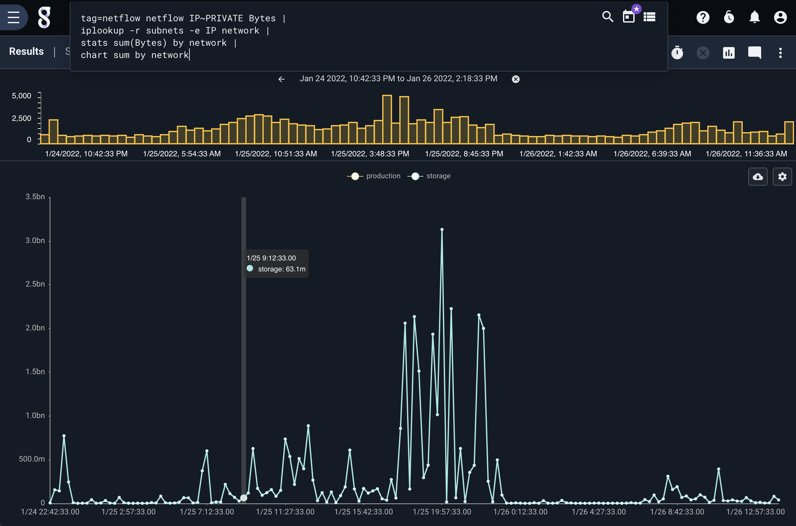

# IPLookup

The `iplookup` module enriches entries by matching an IP address against a list of subnets, so the lookup table does not need an entry for every address. The resource is a CSV with a column of CIDRs; the other columns hold values to attach to matching entries, such as network segment names, organizations, security tiers, or latitude/longitude.

The module stores the subnets in a [radix tree](https://en.wikipedia.org/wiki/Radix_tree). Lookups are fast but not `O(1)`. If your resource contains mostly `/32` CIDRs, a plain [lookup](/search/lookup/lookup) table may be a better choice. The module fully supports IPv6, and very large resources can consume large amounts of memory and CPU. Most reasonable uses of iplookup are very fast, faster even than the [geoip](/search/geoip/geoip) module with the MaxMind database.

A single invocation can attach any number of columns. For example, if your CSV has the columns `CIDR`, `network`, `building`, `lat`, `long`, and `division`, this attaches all of them:

```
iplookup -r <resource> -e IP network building lat long division
```

Each column is written to an enumerated value with the same name. Use `as` to choose a different name. This example attaches the `division` column as an enumerated value named `Business Unit`:

```
iplookup -r <resource> -e IP division as "Business Unit"
```

Each column can also take a filter using `==`, `!=`, `~` (contains), or `!~` (does not contain). Entries whose matched row fails the filter are dropped. For example, to keep only entries in the `research` network:

```
iplookup -r <resource> -e IP network == research
```

## Supported Options
* `-r <resource>`: the lookup resource. Required.
* `-e <ev>`: the enumerated value holding the IP to look up. Required.
* `-s`: strict mode. Drop entries whose IP does not match any subnet in the resource. Without `-s`, unmatched entries pass through without enrichment.
* `-v`: invert the match. Drop entries whose IP matches a subnet in the resource and pass all others. Cannot be combined with enrichments.
* `-cidr <column>`: the resource column containing CIDRs. Defaults to `CIDR`.
* `-ip <column>`: the resource column containing the IP portion of each subnet. Requires `-subnet` and cannot be combined with `-cidr`.
* `-subnet <column>`: the resource column containing the mask portion of each subnet. Requires `-ip` and cannot be combined with `-cidr`.

You must give at least one of `-s`, `-v`, or a column to attach.

## Setting up an iplookup resource

An iplookup resource is a CSV with a header row, where one column contains subnets in standard [CIDR notation](https://en.wikipedia.org/wiki/Classless_Inter-Domain_Routing#CIDR_notation). The column is assumed to be named `CIDR`; use `-cidr` if it has another name. A bare IP address in this column is treated as a `/32` (or `/128` for IPv6). Rows that cannot be parsed are skipped.

Here is an example resource containing both IPv4 and IPv6 definitions:

```
CIDR,network,owner
10.0.0.0/8,storage,Bob
192.168.1.0/24,research,Tim
1.2.3.0/21,corporate,CEO
2001:4860:4860:FE08::/48,corporate ipv6,CEO
```

```{note}
When CIDRs overlap, the most specific one matches. If you define both `192.168.1.0/24` and `192.168.0.0/16`, an address in `192.168.1.0/24` matches that row, and other addresses in `192.168.0.0/16` match the `/16` row. If the same CIDR appears more than once, the last row wins.
```

Here is an example resource with separate IP and subnet columns, used with `-ip ip -subnet netmask`. IPv4 masks can be a prefix length or a dotted netmask; IPv6 masks must be a prefix length. Leading slashes are ignored, and an empty mask means a single address.

```
ip,netmask,network,owner
10.0.0.0,8,storage,Bob
192.168.1.0,255.255.255.0,research,Tim
1.2.3.0,/21,corporate,CEO
2001:4860:4860:FE08::0,48,corporate ipv6,CEO
```

## Example Searches

The iplookup module can act as an allowlist (`-s` flag) or blocklist (`-v` flag), or simply enrich Zeek logs, netflow, pcap, or any other data with an IP address.

### Example subnet categorizing

A common use is grouping traffic by business unit or system tier. iplookup can also geolocate private subnets when you know where each subnet is. This query uses iplookup to total netflow traffic for each segment of a segmented network:

```gravwell
tag=netflow netflow IP~PRIVATE Bytes |
iplookup -r subnets -e IP network |
stats sum(Bytes) by network |
chart sum by network
```



###  Example subnet blacklists

iplookup can check that addresses do not communicate with a set of subnets, which is useful for auditing secure enclaves or firewall rules. For example, in critical infrastructure you might check daily, or alert, that nothing on the IT network talks to the control system subnets.

This query finds flows from `172.17.0.0/16` to any subnet in the `controlsubnets` resource. The `-s` flag keeps only flows whose `Dst` address is in the resource, so any result is a violation.

```gravwell
tag=netflow
netflow Src~172.17.0.0/16 Dst DstPort |
iplookup -s -r controlsubnets -e Dst |
stats count by Src Dst DstPort |
table Src Dst DstPort count
```

The `controlsubnets` resource might be a CSV that looks like the following:

```
CIDR,network
10.0.0.0/24,secure
10.10.10.0/24,insecure
172.20.0.0/24,gravwell
192.168.0.0/16,dracnet
```
