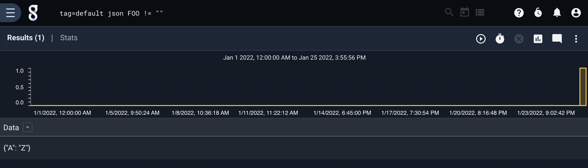
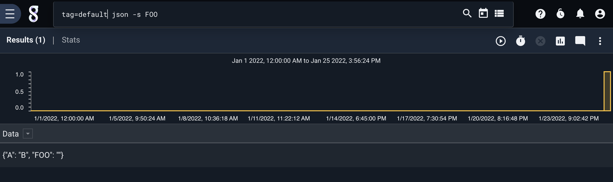
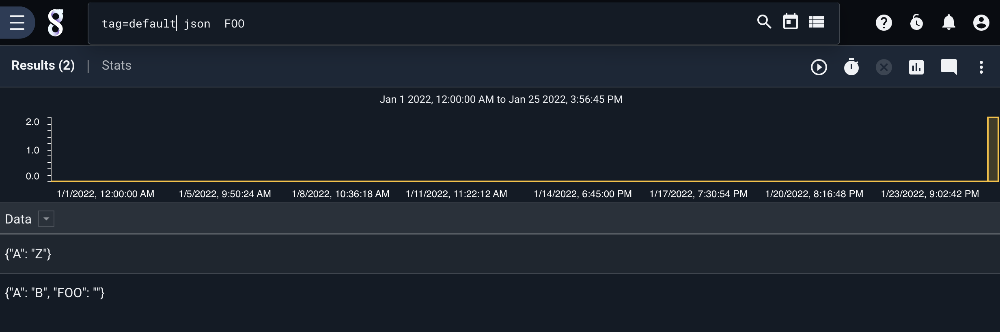

# JSON

The json module extracts fields from JSON data into enumerated values. It can rename extractions and filter on their values. Filtering inside the json module is fast and lets you select entries by the contents of a specific field.

```{note}
The `json` module does not unescape extracted fields that may have been escaped in order to adhere to the JSON specification. You can use the [unescape](/search/unescape/unescape) module to unescape extracted fields.
```

## Supported Options

- `-e <arg>`: Operate on an enumerated value instead of the entire entry. Entries without that enumerated value are dropped.
- `-s`: Strict mode. If any extraction fails, drop the entry. `json -s foo` drops any entry without a field named `foo`, while `json foo` extracts `foo` when present and drops nothing. `json -s foo bar` requires both `foo` and `bar`.
- `-x <arg>`: Expand a JSON array into multiple entries, one per array element. The argument is the output name of one of this module's extractions or an enumerated value produced earlier in the query, so both `tag=foo json -x bar foo.bar` and `tag=foo json foo.bar | json -x bar` are valid. Entries missing that enumerated value are dropped. If the value is not a JSON array, the entry passes through unchanged.

## Filtering Operators

The json module can filter on equality and substring matching. Entries that fail a filter are dropped.

| Operator | Name       | Description                      |
| -------- | ---------- | -------------------------------- |
| ==       | Equal      | Field must be equal              |
| !=       | Not equal  | Field must not be equal          |
| ~        | Subset     | Field contains the value         |
| !~       | Not Subset | Field does NOT contain the value |

```{note}
With `==` or `~`, entries that lack the field are dropped. With `!=` or `!~`, entries that lack the field are not dropped and nothing is extracted. To drop entries that don't contain the field at all, use the `-s` flag.
```

## Examples

To find the most prolific Reddit posters, extract the `Author` field from each post, then count each author and show the result in a table:

```gravwell
tag=reddit json Author | count by Author | table Author count
```

Use dots to descend into nested objects. This search extracts `location.region_code` from Shodan data to find which states have the most AT&T U-verse customers:

```gravwell
tag=shodan grep "AT&T U-verse" | json location.region_code | count by region_code | table region_code count
```

### Using Enumerated Values

The `-e` flag parses an enumerated value instead of the entry data. For example, this XML entry contains JSON:

```
<System><Data>{ "domain": "gravwell.io" }</Data></System>
```

This query extracts the JSON into an enumerated value named `Data` with the xml module, then uses the json module to extract `domain` from it:

```
xml System.Data | json -e Data domain
```

### Renaming Extractions

An extraction is named after the last element of its path, so `location.region_code` produces an enumerated value named `region_code`. Use `as` to choose a different name. This example extracts `domain` from the `Data` enumerated value into an enumerated value named `dd`:

```
json -e Data domain as dd
```

Filters can be combined with renaming. This extracts `domain` as `dd`, dropping entries where the domain is `google.com`:

```
json -e Data domain != "google.com" as dd
```

### Quoting Rules

JSON keys can contain characters Gravwell treats as separators, such as `.` and `-`. Wrap such a key in double quotes so it is parsed as a single name. For example, these keys contain dots:

```
{ "subfield.op": "stuff", "subfield.type": "int", "subfield.value": 99}
```

To extract the `subfield.op` member:

```
json "subfield.op" as sop
```

Similarly, consider the following nested structure:

```
{ "fields": { "search-id": 1234, "search-type": "background" } }
```

Because `search-id` and `search-type` contain dashes, quote them:

```
json fields."search-id" fields."search-type" as type | count by "search-id" type | table "search-id" type count
```

(search_json_arrays)=

### Arrays

The json module can extract elements from arrays. An array index is its own path element, written as `[N]` after a dot. Consider the following structure:

```
{ "uid": 1, "groups": [17,3] }
```

To extract the first element of `groups`:

```
json groups.[0] as gid
```

Without `as`, the enumerated value would be named `[0]`.

To expand an array, extract it and pass its output name to the `-x` flag:

```
json -x groups groups uid
```

This turns the single entry into two entries, one with `uid=1` and `groups=17`, and one with `uid=1` and `groups=3`.

```{note}
When expanding an array via the `-x` flag, the underlying Data field and all other enumerated values are duplicated intact; only the contents of the array enumerated value change.
```

To extract members of objects inside an array, put the index in the path:

```
{ "Metadata": [ {"Value": "john"}, {"Value": "Albuquerque"} ] }
```

```
json Metadata.[0].Value as Username
```

## Empty array indices

An empty index, `[]`, searches the array and uses the first element that contains the rest of the path. For example, given the input:

```
{ "Metadata": [ {"Value": "john"}, {"Value": "Albuquerque", "State": "NM"} ] }
```

This query walks the array until it finds an object with a `State` field and extracts that field:

```gravwell
json Metadata.[].State
```

Empty indices can be nested, as in `json foo.[].[].bar`. A path can't end with `[]`.

## Empty Fields and the Strict Flag

The module distinguishes between a missing field and a field containing the empty string. Consider these entries:

```
{"A": "B", "FOO": ""}
```

```
{"A": "Z"}
```

The first entry has a field `FOO` containing an empty string. The second has no `FOO` field.

This query drops the first entry but passes the second:

```
json FOO!=""
```



This query drops the second entry but passes the first, extracting an empty string into `FOO`:

```
json -s FOO
```



This query passes both entries, extracting `FOO` from the first:

```
json FOO
```



This query drops both entries: the `!=` filter excludes the first, and the strict flag excludes the second because it lacks `FOO`:

```
json -s FOO!=""
```
