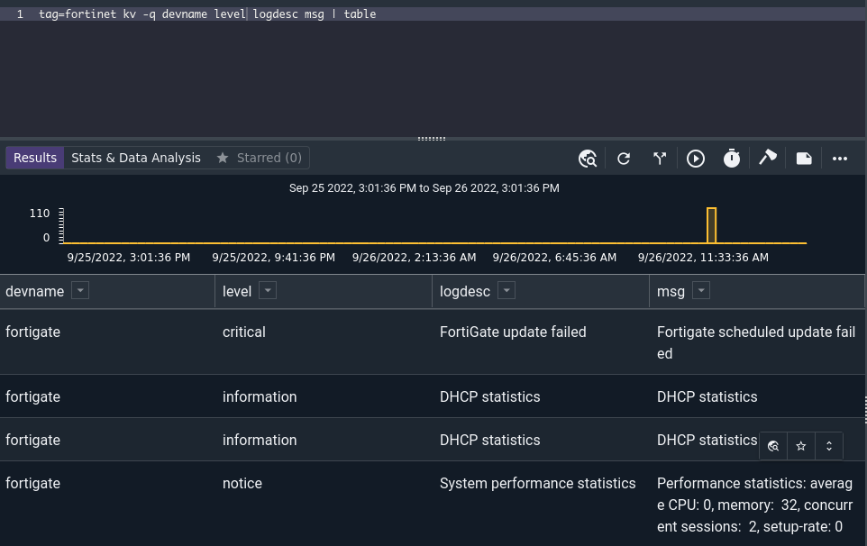
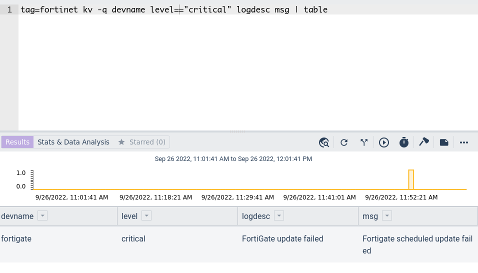

# KV

The kv module extracts and filters key-value data into enumerated values. Key-value data consists of one or more pairs, such as `a = 1` or `Name: Fred`.

## Key-Value Terminology

* Separator: The string that separates a key from its value, such as `=`.
* Delimiters: The characters that separate key-value pairs from each other.

Whitespace between a key and the separator, or between the separator and the value, is ignored unless `-noclean` is set.

For example, the following entry contains 4 key-value pairs, using `=` as the separator and spaces as the delimiters:

```
x=1 y=2 z=3 foo=bar
```

```{note}
When using a space as the separator, you must also set `-noclean`. By default the module strips whitespace around the separator, which removes a space separator and causes every extraction to fail.
```

This entry contains the same key-value pairs but uses `:` as the separator and `|` as the delimiter:

```
x:1|y:2|z:3|foo:bar
```

## Supported Options

* `-e <arg>`: Operate on an enumerated value instead of the entire entry. Entries without that enumerated value are dropped.
* `-sep <separator>`: The separator between key and value (default `=`). It can be more than one character, for example `-sep EQUALS`.
* `-d <delimiters>`: The delimiter characters between pairs (default space and tab). Any one of the characters acts as a delimiter; for example, to use double quote, tab, and space, set `-d "\" \t"`.
* `-dall <delimiter>`: Like `-d`, but the whole string is a single delimiter, for example `-dall ", "`. Can't be combined with `-d`.
* `-s`: Strict mode. Drop the entry unless *all* extractions succeed.
* `-q`: Strip surrounding double quotes from values, so `key="this is the value"` extracts `this is the value`. Quoted values may contain delimiters whether or not `-q` is set; without `-q` the quotes are kept in the extracted value.
* `-noclean`: Don't skip whitespace around the separator. By default, both of these lines extract the same values; with `-noclean`, `x` from the first line is extracted as ` 1` and `y` and `foo` are not found, because whitespace before the separator is no longer allowed.

```
x= 1 y = 2 z=3 foo    =  bar
x=1 y=2 z=3 foo=bar
```

A key only matches at the start of the data or right after a delimiter. An unquoted value that contains the separator is extracted as an empty string.

## Key renaming

By default, each enumerated value is named after its key. To rename one, put `as <name>` after the key: `kv foo as bar` extracts `foo` into an enumerated value named `bar`.

## Filtering

The kv module can filter on string equality and substring matching. Entries that fail any filter are dropped. With `==` or `~`, entries that lack the key are dropped. With `!=` or `!~`, entries that lack the key are kept (unless `-s` is set) and nothing is extracted.

| Operator | Name | Description |
|----------|------|-------------|
| == | Equal | Field must be equal
| != | Not equal | Field must not be equal
| ~ | Subset | Field contains the value
| !~ | Not Subset | Field does NOT contain the value

## Examples

Here's a sample of a log entry from a Fortigate firewall:

```
date=2022-09-26 time=10:57:08 devname="fortigate" devid="FGT60EABCDEF012" eventtime=1664215028981468505 tz="-0700" logid="0100041001" type="event" subtype="system" level="critical" vd="root" logdesc="FortiGate update failed" status="update" msg="Fortigate scheduled update failed"
```

It uses `=` as the separator and spaces as delimiters, the module defaults. Some values are quoted, so `-q` strips the quotes. This query extracts `devname`, `level`, `logdesc`, and `msg` and shows them in a table:

```gravwell
tag=syslog kv -q devname level logdesc msg | table
```



This query shows only `critical` entries:

```gravwell
tag=syslog kv -q devname level=="critical" logdesc msg | table
```



### Changing the separator

The separator can be any string. For example, key-value pairs might look like this:

```
x EQUALS 1 y EQUALS 2
```

To extract `y`:

```
kv -sep EQUALS y
```
