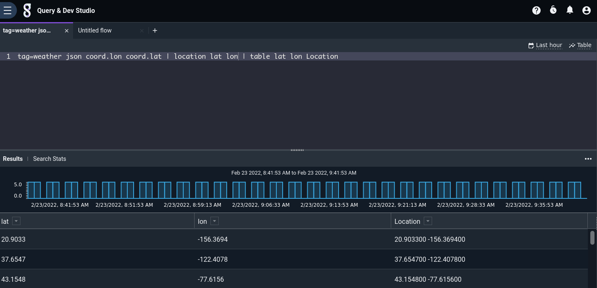
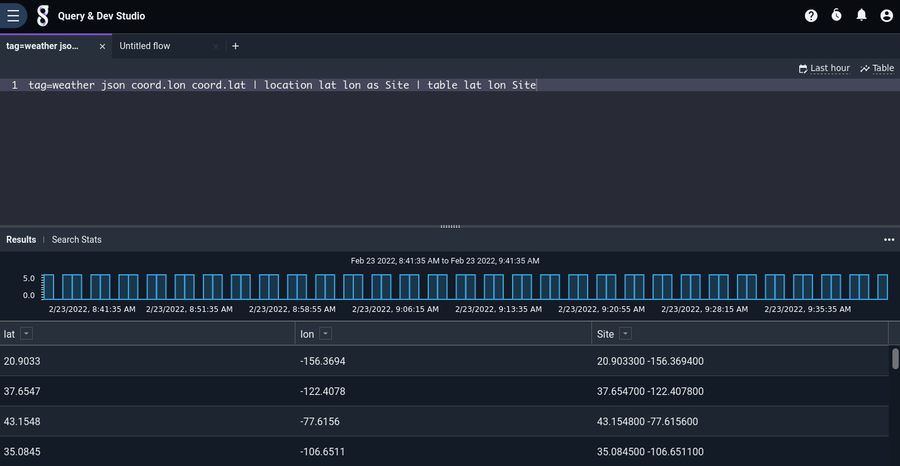

# Location

The location module combines separate latitude and longitude enumerated values into a single location enumerated value, which modules such as [geodist](/search/geodist/geodist) and the [map renderers](/search/map/map) use. Latitude and longitude can be numbers or strings that parse as numbers. By default, the output is named `Location`:

```gravwell
tag=weather json coord.lon coord.lat | location lat lon | table lat lon Location
```



The output can be renamed:

```gravwell
tag=weather json coord.lon coord.lat | location lat lon as Site | table lat lon Site
```



You can convert several latitude/longitude pairs in one invocation, as long as each pair has a unique output name:

```gravwell
location lat1 lon1 as Loc1 lat2 lon2 as Loc2
```

If either value in a pair is missing or not numeric, the entry passes through without that location.
