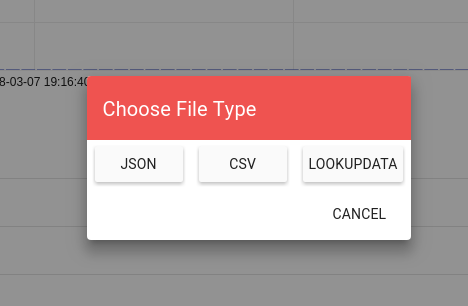
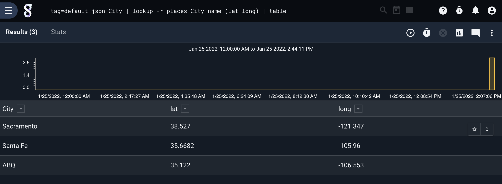
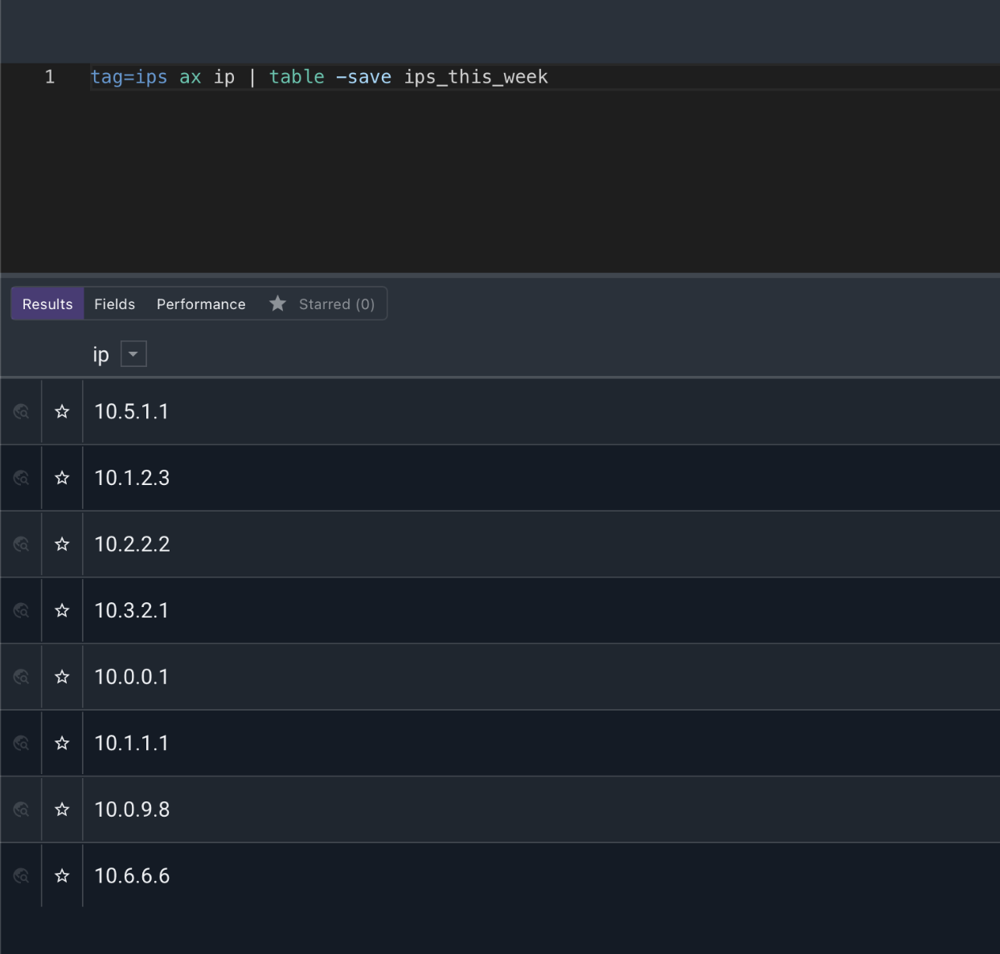
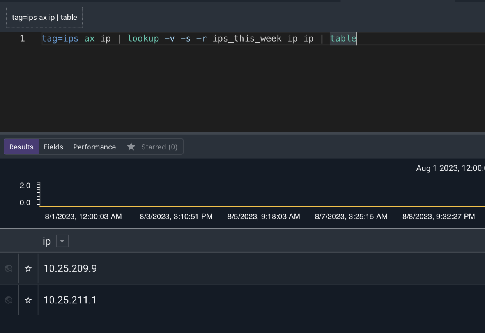

# Lookup

The lookup module enriches and translates data using a static lookup table stored in a resource. The contents of one or more *enumerated values* are compared against the values in one or more *match columns*. When a row matches, the value in that row's *extract column* is copied into an enumerated value:

```
lookup -r <resource name> <enumerated value> <column to match> <column to extract> as <valuename>
```

```{note}
Without `as <valuename>`, lookup creates an enumerated value named after the extract column. If no extract column is given at all (`lookup -r mytable A B` or `lookup -r mytable A B ()`), lookup extracts the match column itself into an enumerated value named after that column.
```

You can extract multiple columns for each match. The following example matches the contents of enumerated value A against column B; when a row matches, it extracts columns C and D:

```
lookup -r mytable A B (C as foo D as bar)
```

Lookup also supports vectored matches, where a set of enumerated values is matched against a set of columns. List the enumerated values in square brackets, followed by the match columns in square brackets. The number of enumerated values must equal the number of match columns; they are paired in order, and a row matches only if every pair matches.

```
lookup -r mytable [A B] [A B] (C as foo D as bar)
```

## Supported Options
* `-r <arg>`: The lookup resource to use. This can also be an inner query of a [compound query](/search/search), such as `@dns`. Required.
* `-s`: Strict mode. Drop entries that do not match a row in the table, including entries missing the source enumerated value. Without `-s`, unmatched entries pass through without enrichment.
* `-v`: Invert. Drop entries that match a row in the table and pass entries that don't. `-v` implies `-s`, so this passes only values that do not exist in the table, which is useful for basic allowlisting. Entries missing the source enumerated value are dropped.

```{note}
With `-s` or `-v`, the extraction list can be empty `()`, which is useful when you only want to filter.
```

Here is an example that drops entries whose enumerated values `A` and `B` match a row in columns `X` and `Y`:

```
lookup -v -r mytable [A B] [X Y] ()
```

## Setting up a lookupdata resource

Lookup data can be downloaded from compatible render modules (e.g. the table module) and stored in a resource. On the search results page, download a table of results in this format by selecting "LOOKUPDATA" from the menu.



The [table renderer](/search/table/table) also provides a `-save` option, which saves the result table as a resource for use by lookup:

```gravwell
tag=syslog regex "DHCPACK on (?P<ip>\S+) to (?P<mac>\S+)" | unique ip mac | table -save ip2mac ip mac
```

This creates a resource named `ip2mac` that maps IP addresses to MAC addresses, derived from DHCP logs.

### CSV tables

A CSV file can also be used as a lookup resource. The CSV must have a header row with unique column names.

## Examples

### Basic Extraction

In this example, we have a resource called "macresolution" which was created from the following csv:
```
mac,hostname
40:b0:fa:d7:af:01,mobile-device-1
64:bc:0c:87:bc:71,desktop-1
40:b0:fa:d7:ae:02,mobile-device-2
64:bc:0c:87:9a:11,desktop-2
```

This search over packet data uses lookup to add hostnames, assigning them to the `devicename` enumerated value:

```gravwell
tag=pcap packet eth.SrcMAC | count by SrcMAC | lookup -r macresolution SrcMAC mac hostname as devicename |  table SrcMAC devicename count
```

This results in a table containing the following:

```
64:bc:0c:87:bc:71	|	desktop-1       	|	52183
40:b0:fa:d7:ae:02	|	mobile-device-2 	|	21278
64:bc:0c:87:9a:11	|	desktop-2       	|	 2901
40:b0:fa:d7:af:01	|	mobile-device-1 	|	  927
```

### Whitelisting

Using the same "macresolution" table shown above:

```gravwell
tag=pcap packet eth.SrcMAC | count by SrcMAC | lookup -v -s -r macresolution SrcMAC mac hostname |  table SrcMAC count
```

This results in a table containing any MAC addresses that were **not** in the lookup table. The `-v` flag is useful for basic allowlisting and for spotting new devices on a network or new logs in an event stream.

```
64:bc:0c:87:bc:60	|	24382
40:b0:fa:d7:ae:13	|	93485
64:bc:0c:87:9a:02	|	11239
40:b0:fa:d7:af:fe	|	   21
```

### Multiple Extraction

Consider the following lookup table named "places":

```
name,lat,long
Albuquerque,35.122,-106.553
Santa Fe,35.6682,-105.96
Sacramento,38.527,-121.347
```

Given the name of a city, we want both the latitude and longitude. For JSON entries containing a "City" field, this query extracts both:

```gravwell
tag=default json City | lookup -r places City name (lat long) | table
```

It matches the enumerated value `City` against the table's `name` column, and on a match extracts both `lat` and `long`:



### Events that occurred last week but not this week

This example uses two searches. The first builds a resource of IP addresses seen this week. The second runs over last week and uses lookup with the invert flag to drop every IP that was also seen this week, leaving only IPs seen last week but not this week. This is useful for investigating behavior that "has gone away" over time.

First, run a search over this week, adding the `-save` option to the table renderer to turn the table into a resource:

```
tag=ips ax ip | table -save ips_this_week
```



This provides a list of IPs seen this week.

Next, run a query over last week and use lookup to _drop_ all entries that match the resource we just created. Only entries with IP addresses seen last week but not this week remain:

```
tag=ips ax ip | lookup -v -s -r ips_this_week ip ip | table
```



