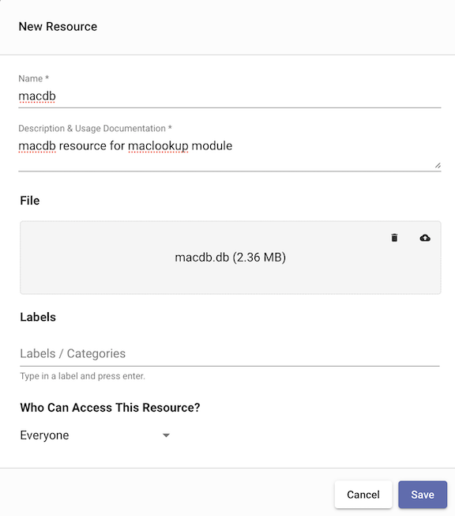
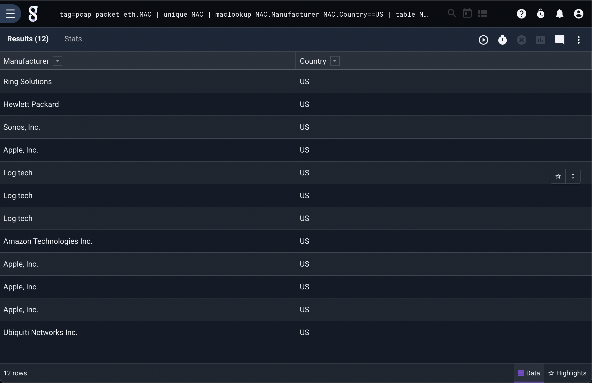
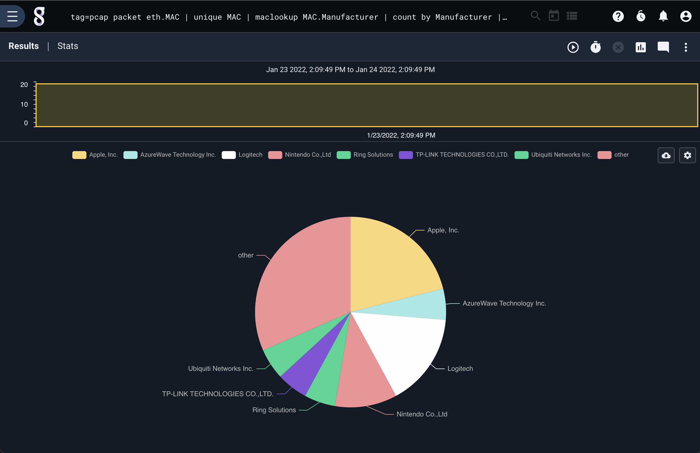

# Maclookup 

The maclookup module looks up the owner of a MAC address's prefix (the first three bytes, or OUI) and extracts the manufacturer, address, and country.

## Setting Up Databases

The maclookup module needs a database of MAC prefixes stored as a resource. By default it uses the resource named `mac_prefixes`, which is included in the Gravwell Network Enrichment Kit (see the Kits section of the UI). You can also upload the IEEE's OUI list from [http://standards-oui.ieee.org/oui.txt](http://standards-oui.ieee.org/oui.txt) as a resource.



## Supported Options

* `-r <resource>`: name or UUID of the resource containing the MAC prefix database. Defaults to `mac_prefixes`.

## Processing Operators

Each extraction can take a filter, so you can drop entries by manufacturer, address, or country without a separate filtering step. You can specify multiple extractions in one invocation. Each extraction is written to an enumerated value named after the extractor (for example, `Manufacturer`), or to the name given with `as`.

If the MAC address is missing or its prefix is not in the database, the extraction is skipped; the entry is dropped only if its filter is `==` or `~`.

| Operator | Name | Description
|----------|------|-------------
| == | Equal | Field must be equal
| != | Not equal | Field must not be equal
| ~ | Contains | Field must contain the value
| !~ | Not contains | Field must not contain the value

## Data Item Extractors

The following extractions are possible with the maclookup database:

| Extractor | Operators | Description | Example 
|-----------|-----------|-------------|----------
| Manufacturer | == != ~ !~ | Manufacturer name, such as "Apple Inc.", "IBM" | mac.Manufacturer~Apple
| Address | == != ~ !~ | Address; multiple address lines are separated by tabs | mac.Address~Cupertino as addr
| Country | == != ~ !~ | Country code | mac.Country == "US"

## Examples

### Listing US manufacturers from PCAP

```gravwell
tag=pcap packet eth.MAC | maclookup MAC.Manufacturer MAC.Country == US | table
```



### Pie chart of manufacturers from PCAP.

```gravwell
tag=pcap packet eth.MAC | maclookup MAC.Manufacturer | count by Manufacturer | chart count by Manufacturer
```




