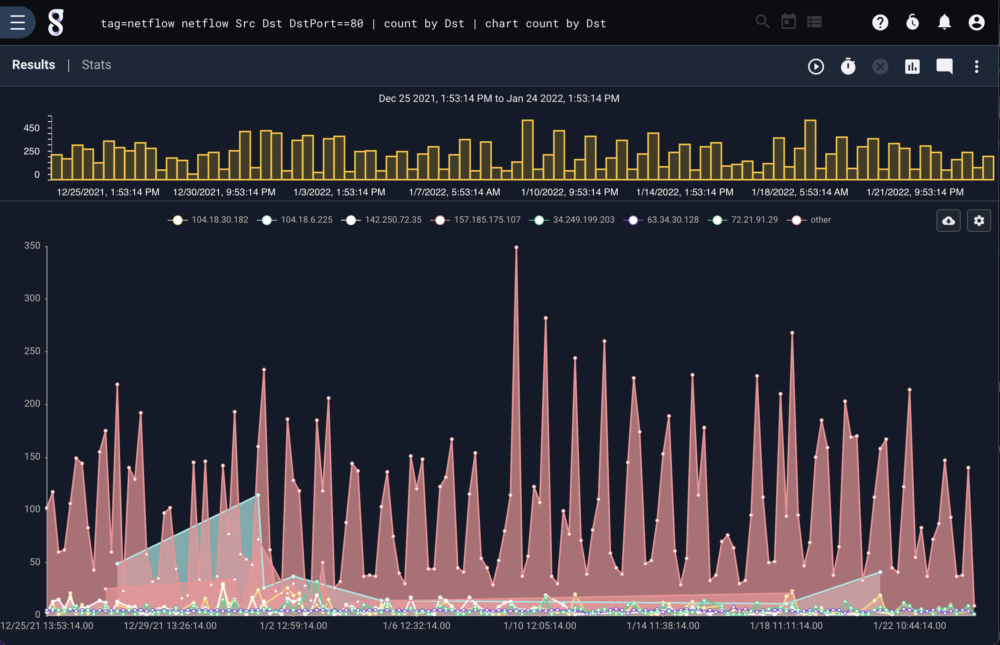
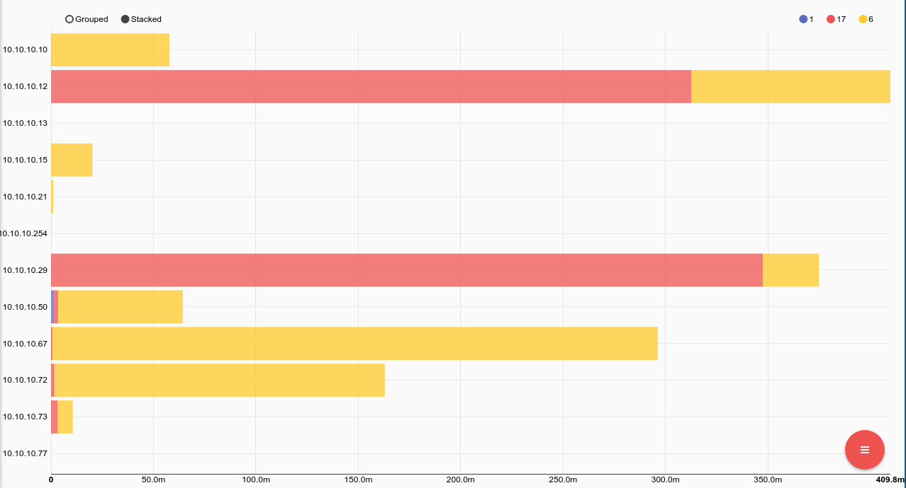

# Netflow

The netflow module extracts and filters fields from raw Netflow v5 frames. Use it to find specific flows, filter on ports, or monitor aggregate flow behavior. Gravwell has a native netflow ingester which is open source and available at https://github.com/gravwell/ingesters or as an installer in the [quickstart section](/quickstart/downloads).

## Supported Options

* `-e <name>`: Read the netflow frame from an enumerated value instead of the entry data. Useful when an upstream module has extracted the frame, for example from raw PCAP.

## Processing Operators

Each netflow field supports a set of operators that act as fast filters. The field's data type determines which operators it supports. Numeric fields support everything except the subset operators. IP address fields support `==`, `!=`, and the subset operators, which take a CIDR subnet or the keyword `PRIVATE` or `MULTICAST`.

| Operator | Name | Description |
|----------|------|-------------|
| == | Equal | Field must be equal
| != | Not equal | Field must not be equal
| < | Less than | Field must be less than
| > | Greater than | Field must be greater than
| <= | Less than or equal | Field must be less than or equal to
| >= | Greater than or equal | Field must be greater than or equal to
| ~ | Subset | Field must be a member of
| !~ | Not subset | Field must not be a member of


## Data Items

A Netflow v5 frame consists of a header and up to 30 records. Each data item can be extracted and used as a filter. A header filter applies to every record in the frame. Header items are processed first, and records are processed only if the header filters do not drop the frame.

When any record data item is extracted, the netflow module splits each frame into one entry per record, so more entries can come out of the module than went in. If only header items are extracted, each frame stays a single entry.

Use `as` to give an extracted item a different name, for example `netflow Bytes as traffic`.

### Netflow v5 Header Data Items

| Field |       Description        | Supported Operators | Example |
|-------|--------------------------|---------------------|---------|
| Count | The number of records in the netflow frame | > < <= >= == != | Count >= 10
| Version | The Netflow frame version | > < <= >= == != | Version == 5
| Uptime | Milliseconds since the netflow sensor started | > < <= >= == != | Uptime > 0x100000
| Sec | Current Unix timestamp of the sensing device | > < <= >= == != | Sec == 1526511023
| Nsec | Residual nanoseconds for the current time of the sensing device | > < <= >= == != | Nsec > 0x100101
| Sequence | Sequence counter of total flows on the sensing device | > < <= >= == != | Sequence == 1
| EngineType | The type of flow-switching engine | > < <= >= == != | EngineType == 0x1A
| EngineID | The ID for the flow sensing engine | > < <= >= == != | EngineID == 0x00
| SampleMode | 2 bit ID for the Sampling mode of the sensing engine | > < <= >= == != | SampleMode == 0x01
| SampleInterval | 14 bit value representing the sampling interval of the sensing engine | > < <= >= == != | SampleInterval > 0x100
| Timestamp | Sec and Nsec combined into a timestamp value. Filtering is not supported. | |

### Netflow v5 Record Data Items

| Field |       Description        | Supported Operators | Example |
|-------|--------------------------|---------------------|---------|
| IP | Whichever of Src or Dst matches the filter, checking Src first. With no filter, Src is used | ~ !~ == != | IP ~ 10.0.0.0/24 
| Port | Whichever of SrcPort or DstPort matches the filter, checking SrcPort first. With no filter, the lower of the two ports is used | > < <= >= == != | Port == 80
| Src | Source IPv4 address in the flow record | ~ !~ == != | Src !~ 192.168.1.0/24
| Dst | Destination IPv4 address in the flow record | ~ !~ == != | Dst ~ 10.0.0.0/16
| Next | Next hop address in the flow record | ~ !~ == != | Next == 1.2.3.4
| Input | SNMP index of the input interface | > < <= >= == != | Input == 1
| Output | SNMP index of the output interface | > < <= >= == != | Output != 1
| Pkts | Total number of packets in the flow | > < <= >= == != | Pkts > 10
| Bytes | Total number of bytes in the flow | > < <= >= == != | Bytes < 1400
| UptimeFirst | Uptime of the sensing engine, in milliseconds, when the first packet was seen | > < <= >= == != | UptimeFirst != 0
| UptimeLast | Uptime of the sensing engine, in milliseconds, when the last packet was seen | > < <= >= == != | UptimeLast > 0x10000
| SrcPort | Source port of the flow.  If the protocol does not have a port the value is zero | > < <= >= == != | SrcPort != 0
| DstPort | Destination port of the flow.  If the protocol does not have a port the value is zero | > < <= >= == != | DstPort == 0
| Flags | Cumulative OR of TCP flags for the flow | > < <= >= == != | Flags == 0x7
| Protocol | Protocol number of the flow (TCP = 6, UDP = 17) | > < <= >= == != | Protocol == 17
| ToS | IP type of service of the flow | > < <= >= == != | ToS == 19
| SrcAs | Source Autonomous System Number of the flow | > < <= >= == != | SrcAs == 15169
| DstAs | Destination Autonomous System Number of the flow | > < <= >= == != | DstAs != 15169
| SrcMask | Source IPv4 address mask bits | > < <= >= == != | SrcMask > 24
| DstMask | Destination IPv4 address mask bits | > < <= >= == != | DstMask <= 16
| Duration | Time between UptimeFirst and UptimeLast, as a duration | > < <= >= == != | Duration > 100ms

## Examples

### Number of HTTP flows by Destination IP over time

```gravwell
tag=netflow netflow Src Dst Port==80 | count by Dst | chart count by Dst
```



### Total traffic by IP and Protocol

```gravwell
tag=netflow netflow IP~192.168.0.0/16 Protocol Bytes as traffic | sum traffic by IP Protocol | stackgraph IP Protocol sum
```


