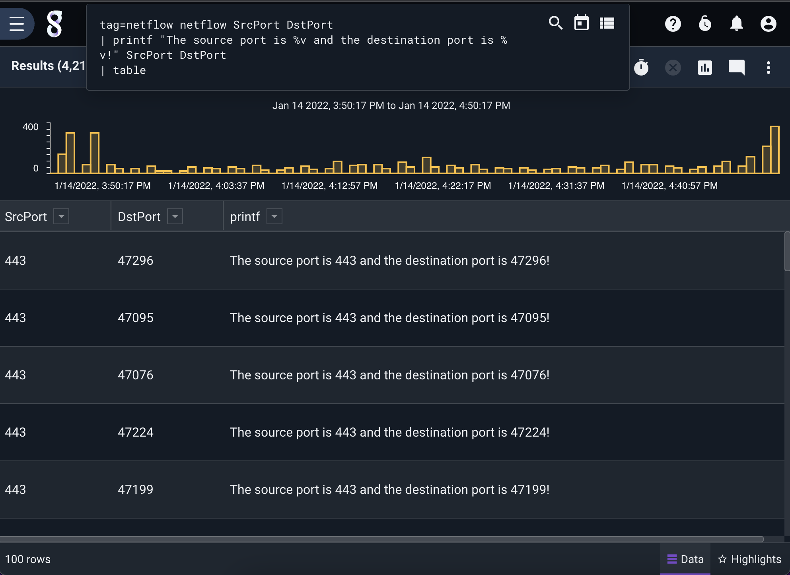

# Printf

The printf module formats enumerated values into a string using Go-style printf verbs. It takes a format string followed by one enumerated value argument for each verb. The format string must contain at least one verb, and the number of arguments must match the number of verbs. The result is stored in an enumerated value named `printf`.

```
printf [-e <output>] "<format>" <ev> [<ev> ...]
```

The printf module implements the following verbs:

```
'%v': The value in a default format
'%s': string
'%b': base2
'%c': a character represented by a Unicode code point
'%d': base 10
'%o': base 8
'%O': base 8 with 0o prefix
'%q': a single-quoted character literal, escaped when necessary
'%x': base 16, with lower-case letters for a-f
'%X': base 16, with upper-case letters for A-F
'%U': Unicode format: U+1234; same as "U+%04X"
'%e': scientific notation, with lower-case e
'%E': scientific notation, with upper-case E
'%f': decimal point
'%F': synonym for %f
'%g': %e for large exponents, %f otherwise
'%G': %E for large exponents, %F otherwise
'%%': A literal %.
```

`%v` and `%s` print any enumerated value as a string. The integer verbs (`%b` through `%U`) and float verbs (`%e` through `%G`) convert the argument to a number, including numeric strings. If an argument can't be converted, the entry passes through without the output enumerated value. A missing argument prints as `<nil>` with `%v` and `%s`.

A verb can take one of the following modifiers, plus an optional width and precision, such as `%08.2f` or `%-10s`:

```
+	always print a sign for numeric values;
	guarantee ASCII-only output for %q (%+q)
#	alternate format: add leading 0b for binary (%#b), 0 for octal (%#o),
	0x or 0X for hex (%#x or %#X);
	always print a decimal point for %e, %E, %f, %F, %g and %G;
	do not remove trailing zeros for %g and %G;
	write e.g. U+0078 'x' if the character is printable for %U (%#U).
' '	(space) leave a space for elided sign in numbers (% d)
0	pad with leading zeros rather than spaces;
	for numbers, this moves the padding after the sign
```

A negative width, such as `%-10s`, pads with spaces on the right instead of the left.

## Supported Options

* `-e <output>`: Store the result in the named enumerated value instead of `printf`.

## Example Usage

This example builds a sentence from the source and destination ports of each netflow record:

```gravwell
tag=netflow netflow SrcPort DstPort 
| printf "The source port is %v and the destination port is %v!" SrcPort DstPort 
| table
```



```{note}
Language describing the verbs and modifiers Copyright (c) 2009 The Go Authors. Obtained from [Go fmt documentation](https://pkg.go.dev/fmt#hdr-Printing)
```
