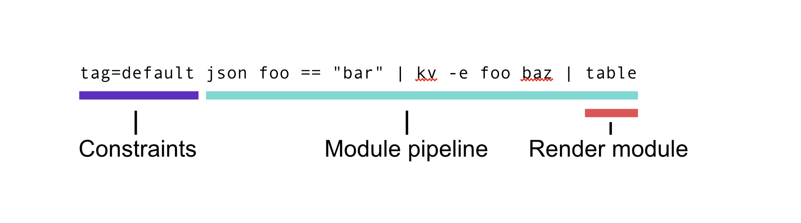

# Gravwell Query Specification

## Introduction

This is the reference specification for Gravwell query syntax. A query is made up of constraints, a pipeline of modules, and a renderer. This document describes how input text is interpreted and tokenized. Modules apply their own semantics to the tokens they receive (for example, some treat numbers as strings), so read each module's documentation for module-specific rules.

## Text Encoding 

**All** Gravwell input is Unicode text encoded in UTF-8. 

### Characters and digits 

A "character" is any of the Unicode points in the "General Category" of the Unicode specification, ([The Unicode Standard 8.0, Section 4.5](https://www.unicode.org/versions/Unicode8.0.0/)). This includes letters, numbers, marks, symbols, and punctuation. 

## Lexical grammar

This section defines the syntax of a Gravwell query. Token semantics are module-specific, so the user should read the search module documentation for more information on module-specific considerations.

```{note}
The grammar is specified using [pbpg](https://github.com/gravwell/pbpg), which is similar to Extended Backus–Naur form. pbpg is itself specified with pbpg and contains the following rules:
```

```
Production  = Name "=" [ Expression ] "." 
Expression  = Alternative { "|" Alternative } .	
Alternative = Term { Term } .		
Term        = Lex | Name | Literal | Group | Option | Repetition .
Group       = "(" Expression ")" .		
Option      = "[" Expression "]" .	
Repetition  = "{" Expression "}" .
Lex         = "lex" "(" LexFunction ")" .
Literal     = "\"" String "\"" .	
```

### Quotes

Many characters and keywords have special meaning in Gravwell syntax. To use one as a literal string, wrap it in double quotes `"`. For example,

```
json foo bar | table
```

extracts `foo` and `bar` from JSON input and passes them to the `table` renderer. Whitespace and `|` both have special meaning, so to use them in an argument to `json`, quote it:

```
{
	"TS":"2022-05-06T09:48:41.371259747-06:00",
	"foo bar | table":"data!"
}
```

```
json "foo bar | table"
```

This example will extract a field named `foo bar | table` from the above JSON. 

All other lexical definitions below apply outside of quoted strings, except escape sequences, which are interpreted inside them too.

Text between backticks (`` ` ``) is a raw string: it is used exactly as written, with no escape processing, and cannot contain a backtick.

A quoted string is defined as 

```
quoted_string = '"' { unicode_print | whitespace } '"' 
whitespace    = Characters from Unicode's whitespace category and Unicode category Z
unicode_print = Characters from Unicode categories L, M, N, P, and S
```

### Escaped input

Escaped text follows the same rules as described in the [Rune Literals](https://go.dev/ref/spec#Rune_literals) section of the Go programming language specification. See that document for more information.
 
### Whitespace

Whitespace is defined as all Unicode whitespace characters, which includes whitespace characters outside of the `Latin-1` category. Whitespace characters are folded, meaning multiple, continuous whitespace characters are interpreted as a single whitespace character. Whitespace delimits tokens when used outside of a quoted string.

For example, the input

```
json foo bar
```

is made up of three tokens `json`, `foo`, and `bar`. In the `json` module in Gravwell, this would extract two enumerated values `foo` and `bar`.

Quoted whitespace is treated as part of a single string. For example, the input

```
json "foo bar"
```

is made up of two tokens `json`, and `foo bar`. The `json` module in this case would extract a single enumerated value named `foo bar`.

Whitespace is defined as

```
whitespace = Characters from Unicode's whitespace category and Unicode category Z
```

### Comments

Gravwell supports two types of comments. 

1. Any input between ANSI-C style comment specifiers `/* */`.
2. Line comments, which begin with a double slash `//` and stop at the end of the line. 

Comments are not considered part of the input to Gravwell. 

For example,

```
kv myKey /* this is my key extraction */ | table // an end of line comment!
```

is implicitly reduced to

```
kv myKey | table
```

A comments is defined as

```
comment       = c_style | double_slash
c_style	      = '/' '*' { unicode_print | whitespace } '*' '/' 
double_slash  = '//' { any character except newline } ( '\n' | EOF )
whitespace    = Characters from Unicode's whitespace category and Unicode category Z
unicode_print = Characters from Unicode categories L, M, N, P, and S
```

### Module tokens

Tokens are groups of characters separated by whitespace (as defined above) and reserved characters (such as `|`), unless grouped in a quoted string. A token's meaning depends on where it appears. For example,

```gravwell
tag=default json tag
```

uses the `json` module to extract an enumerated value named `tag` from entries in the default tag. The first `tag` tells Gravwell which tag to pull data from; the second tells `json` which value to extract.

Tokens cannot contain the following reserved characters, unless quoted:

| Character | Description |
|-----------|-------------|
| &#124; |  Pipe: separates modules in the module pipeline |
| {} | Compound query block |
| ; | Compound query delimiter |
| = | Assignment operator |
| ==, <, >, <=, >=, ~, !=, !~ | Comparison operators |
| (, ), [, ], ., :, ,, /, !, %, ^, &, +, " | Other reserved characters |

Other punctuation, including `-`, `@`, `#`, `$`, `*`, and `?`, does not split tokens. For example, `foo-bar` and `@dns` are single tokens.

A few modules tokenize differently. `grep`, `words`, and `src` do not split on `.`, `:`, `,`, or `/`, so `grep 10.1.2.3` sees one token. `json` does not split on `[` or `]`, so `foo[0]` is one token.

### Tokenizing in the R-value of a filter

The R-value of a filter (the value after the operator) is tokenized differently: `.`, `:`, `,`, and `/` do not split it. So while `uint16(Data[2:5])` is split into 9 tokens, the filter value in `foo == a:b.c/d,e` is a single token, as is the subnet in `ip ~ 10.0.0.0/8`. The other reserved characters still split an R-value; quote the value if it contains them.

### Tokenizing in `eval` and code fragments

The `eval` module takes an inline code fragment for filtering and other operations. For example,

```gravwell
tag=default json foo-bar baz | eval baz > 10 | table
```

has the code fragment `baz > 10`. Code fragments support C-style notation for arithmetic, bitwise, and logical operations, so Gravwell tokenizes them differently from regular module arguments. For example, in

```gravwell
tag=default json foo-bar foo bar | eval ( foo-bar > 10 ) | table
```

the `json` module treats `foo-bar` as a single name, but in the code fragment `foo-bar > 10` means "foo minus bar is greater than 10".

Similarly,

```gravwell
tag=default json foo bar | eval ( baz = foo | bar ) | table
```

has an interior `|` character. Because it is inside parentheses, it is a bitwise OR of `foo` and `bar` rather than a module separator.

Code fragments follow these rules:

- Enumerated value names (identifiers in the grammar below) are limited to unquoted strings beginning with a non-number, and not containing any of the special characters in the grammar below.
- String literals must be quoted.
- Numeric literals are decimal integers (`10`), decimal floating point numbers (`1.5`), and hexadecimal integers (`0xfa`).
- `||` is logical OR. A single `|` is bitwise OR inside parentheses; outside parentheses it ends the `eval` module.

```{note}
Enumerated values containing reserved characters or whitespace cannot be used in code fragments. These variables must be renamed or aliased.
```


### Operators and filters

Operators are reserved characters that are used when applying filters in certain modules. Filters, and their operators, are always in the form of

```
<identifier> <operator> <value>
```

For example,

```
foo <= 1.5
```

applies a filter on the identifier `foo`, requiring that it is less than or equal to the floating point value 1.5. 

Individual modules specify the rules for what types and operators are allowed on given identifiers. See the module documentation for more information.

## Type inference

Modules individually specify how values are typed. For example, the `json` module extracts all values as strings, and using a filter `json foo == 1.5` will perform a string comparison on the value of foo with the _string_ `1.5`. 

## Query structure



A query is made up of any number of query constraints (such as which tags to pull data from), search modules (arranged in a pipeline), and a render module. Additionally, multiple queries can be packed into a _compound query_.

### Query constraints 

All input before the first module in a query represents the query constraints. Usually this is just the tag(s) to extract. Query constraints are a whitespace-delimited list of key=value pairs. The following constraints are supported.

| Constraint | Description | Example |
|------------|-------------|---------|
| tag | The tag(s) to extract. Supports comma separated lists and wildcards. Defaults to "tag=default" if omitted. | tag=dns,zeek* |
| start | Provide the query starting timeframe in the query. Supports concrete timestamps, relative offsets, and time arithmetic, as described in [Specifying the search timeframe in query](specify-search-timeframe-in-query). If "end" is omitted when "start" is used, "end" will be set to the current time. | start="2006-01-02T15:04:05Z", start=-1h |
| end | Provide the query ending timeframe in the query. Supports concrete timestamps, relative offsets, and time arithmetic, as described in [Specifying the search timeframe in query](specify-search-timeframe-in-query). If "start" is omitted when "end" is used, "start" will be set to the current time. | end="2006-01-02T15:04:05Z", end=-1h |


### Modules

Please see the list of modules in the [Search section](./search) for module specific documentation.

Modules are pipelined functions that extract, transform, and render data. Data flows left to right through the pipeline, and modules can drop, pass, modify, or inject entries. The last module is the render module (such as `table` or `chart`); if you don't specify one, Gravwell adds one. Modules are separated by `|`. A module invocation is the module name, optional flags, and optional arguments.

#### Module name

The first token of a module invocation is the module name. See the list of modules in the [Search section](./search) for the list of available modules.

#### Module flags

Flags are whitespace-delimited lists of module-specific configuration options. Some flags take arguments, and some modules support multiple invocations of the same flag. See the module documentation for more information on the specific flags for that module.

Flags take two forms. First is a flag with no arguments, such as

```
kv -q
```

The second form takes an argument, which must be quoted if it contains any reserved characters or whitespace.

```
kv -e "my enumerated value"
```

The first token that does not begin with a hyphen, and is not the argument to a flag, represents the first argument to the module.

#### Module arguments and semantics

Module arguments are module-specific lists of tokens containing identifiers, filters, and other keywords. Every token up to the end of the input or the `|` character is considered an argument to that module. Modules apply their own semantics to their argument tokens. For example, the `fields` module uses the special characters `[` and `]` to denote a column offset, while the `lookup` module uses `(` and `)` for groups of extractions. Refer to the module documentation for more information.

### Renderer

The last module in a query is always the renderer. Render modules take flags and arguments just like a search module, but must appear at the end of the pipeline.

If no renderer is specified, the `text` renderer is implied. Inner queries of a compound query default to `table` instead.

### Compound queries

Multiple queries can be grouped into a single _compound query_ using the [compound query notation](compound_queries). A compound query takes the form of

```gravwell
@foo{tag=default ...}; @bar{tag=default ...}; tag=default lookup -r @foo | ...
```

where `@foo` and `@bar` name the "inner" queries; the `@` is required. An inner query's body, enclosed in `{}`, can be any query whose renderer is `table`. You can define any number of inner queries. Inner queries and the main query (the final query, which is not wrapped in `@{}`) are separated by semicolons.

Queries run in order. Any later query, including another inner query, can use an earlier inner query's output anywhere a table resource is accepted (such as the `lookup` module) by referring to it by name with `@`.

## Query Grammar

Below is the pbpg representation of the query grammar. 

```
# Query and module grammar

Query             = CompoundQuery | QueryStructure
QueryStructure    = { Constraint } [ [ "|" ] Module { "|" Module } ]
CompoundQuery     = InnerQuery { InnerQuery } QueryStructure
InnerQuery        = Whitespace AT QueryName "{" QueryStructure "}" SEMICOLON
Constraint        = Whitespace CLvalue "=" CRvalue { "," CRvalue }
ModuleConstraint  = Whitespace MCLvalue "=" MCRvalue { "," MCRvalue }
Module            = { ModuleConstraint } Whitespace ( SpecialModule | JSONModule | Hoc | RegularModule ) Whitespace
JSONModule        = JSONModuleName { JSONToken }
SpecialModule     = SpecialModuleName { SpecialToken }
RegularModule     = ModuleName { Token }
JSONToken         = RawString | QuotedString | JSONString | ( Op ( RawString | QuotedString | RString ) ) | Special
SpecialToken      = RawString | QuotedString | RString | ( Op ( RawString | QuotedString | RString ) ) | Special
Token             = RawString | QuotedString | String | ( Op ( RawString | QuotedString | RString ) ) | Special

# Eval grammar

Hoc               = ( HocName HocFragment ) | ( HocName EvalFragment )
HocFragment       = { HocToken }
HocToken          = Whitespace EVLiteral | Identifier | Operator | QuotedString | Number | LPAREN | RPAREN | LCURLY | RCURLY | PIPE
EVLiteral         = "$(" EV ")"
EV                = ev
Identifier        = Letter { LetterDigit }
LetterDigit       = Letter | Digit
Letter            = letter
Digit             = digit
Operator          = "<<" | ">>" | "<=" | ">=" | "+=" | "-=" | "&&" | "||" | "++" | "--" | "==" | "!=" | "!~" | "~" | "+" | "-" | "*" | "/" | "%" | "&" | "^" | "<" | ">" | "=" | "!" | "[" | "]" | "," | ";" | "." | ":" | "?"
LPAREN            = lparen
RPAREN            = rparen
LCURLY            = lcurly
RCURLY            = rcurly
PIPE              = pipe
Number            = Hex | Decimal
Decimal           = Digit { Digit } [ Dot { Digit } ]
Hex               = hex
Dot               = dot
EvalFragment      = evalfragment

# Lexer invocations 

Special           = Whitespace "(" | ")" | ";" | "=" | "<" | "!" | ">" | "~" | "%" | "^" | "&" | "*" | "," | "+" | "." | ":" | "[" | "]" | "/"
Op                = Whitespace "<=" | ">=" | "==" | "!=" | "~" | "!~" | "<" | ">"
```
