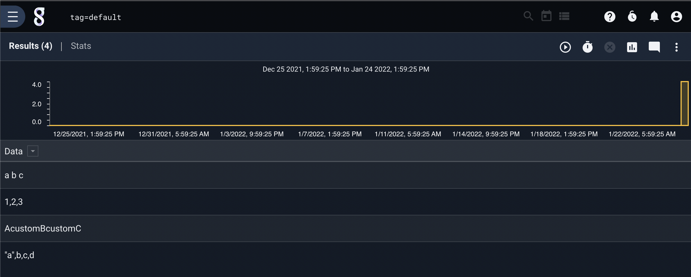
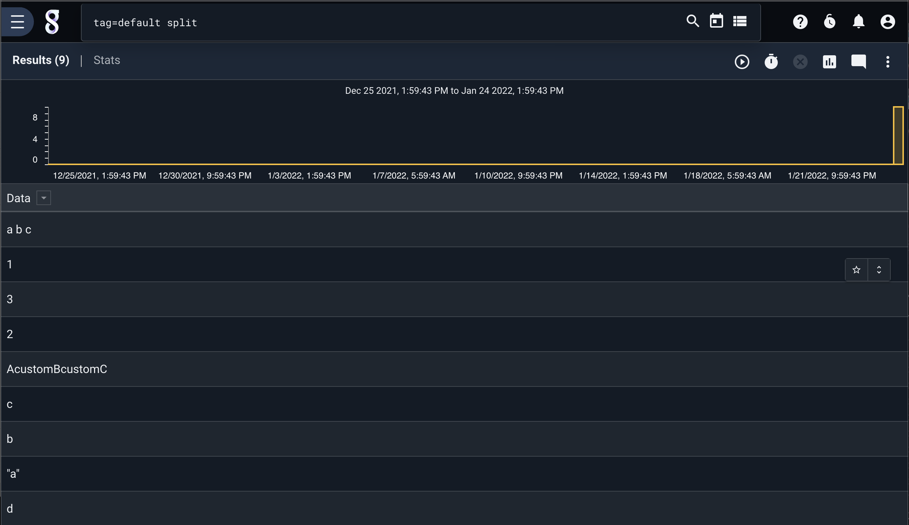
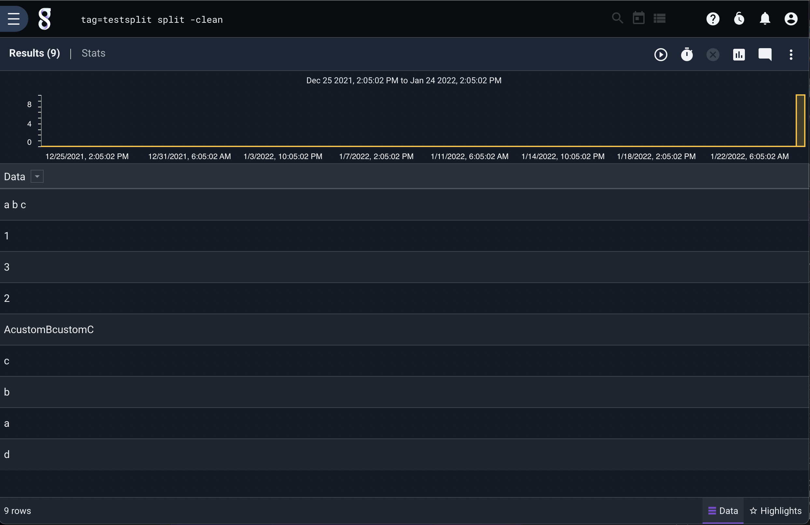
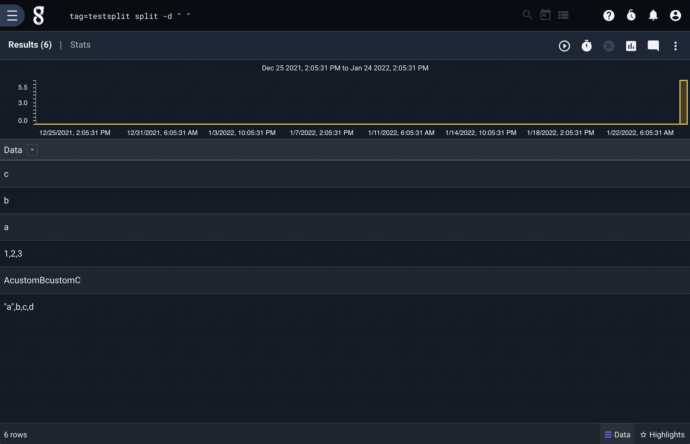
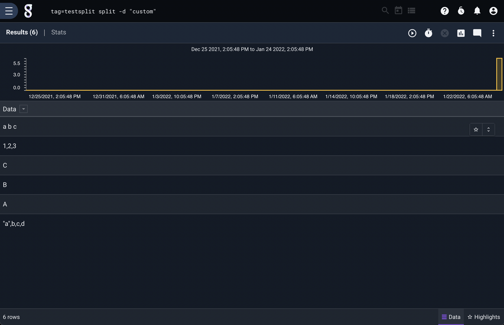
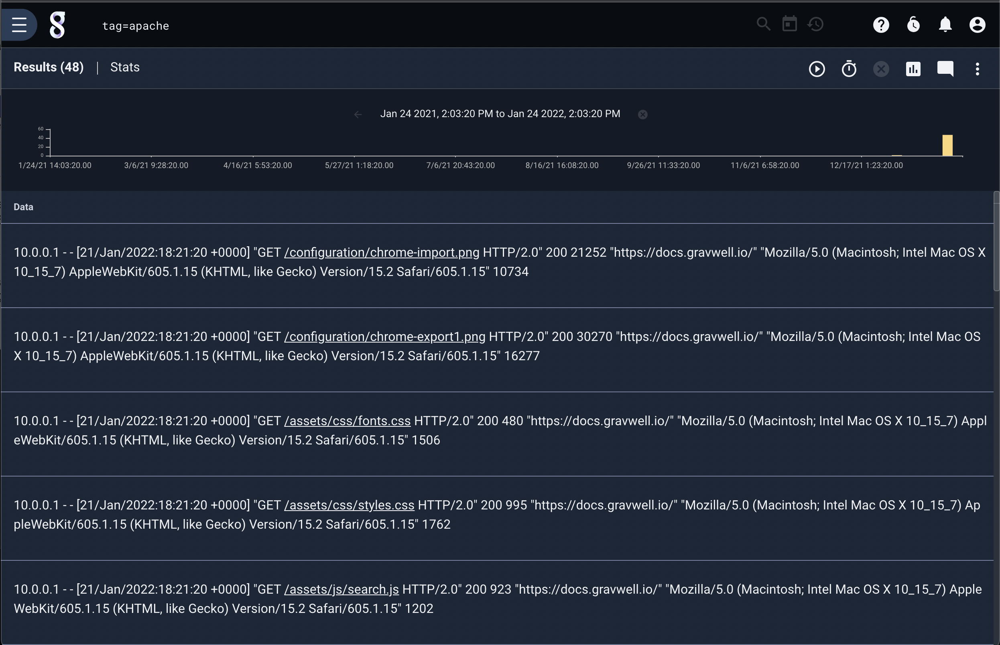
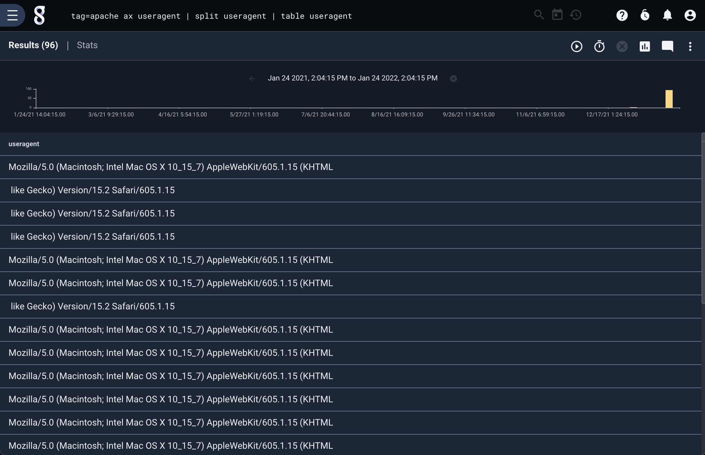
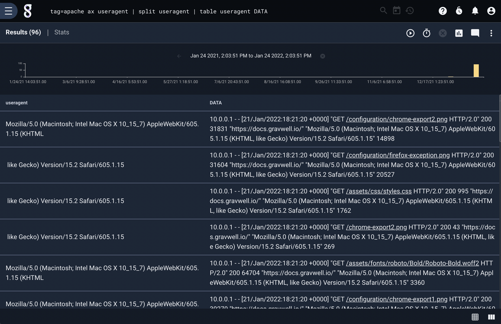

# Split

Split breaks the contents of an entry or enumerated value on a delimiter and emits one entry per piece. Each new entry keeps the original's timestamp, tag, and other enumerated values.

## Supported Options

```
split [-d <delim>] [-clean] [<ev> ...]
```

Without enumerated value names, split operates on the entry data. With one or more names, it splits those enumerated values and leaves the entry data alone. When you name several, the pieces are paired up by position: the first new entry gets the first piece of each, the second gets the second piece of each, and so on. If one value has fewer pieces than another, the extra entries don't have that enumerated value. Entries missing any of the named enumerated values are dropped.

* `-d <delim>`: The delimiter. The default is a comma. It can be a single character or a longer string; quote it if it contains spaces.
* `-clean`: After splitting, trim spaces, tabs, and single and double quotes from both ends of each piece. With this flag, `foo   ,'bar', baz` splits into `foo`, `bar`, and `baz`.

## Example Usage

These examples use the following entries:



### Basic splitting

With no arguments, split breaks entries on commas:

```gravwell
tag=default split
```



### Using the clean flag

With `-clean`, leading and trailing quotes and whitespace are removed:

```gravwell
tag=default split -clean
```



### Specifying a delimiter

To split on spaces instead, use `-d`:

```gravwell
tag=default split -d " "
```



The `a b c` entry splits into three entries. Entries with no space pass through unchanged as a single entry.

The delimiter can be any string:

```gravwell
tag=default split -d custom
```



## Example Usage with Enumerated Values

These examples use Apache webserver log entries.



Extract the `useragent` field, then split it on commas:

```gravwell
tag=apache ax useragent | split useragent | table useragent
```



The entry data is not modified:

```gravwell
tag=apache ax useragent | split useragent | table useragent DATA
```


