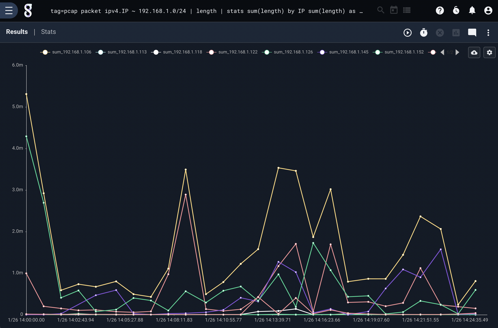
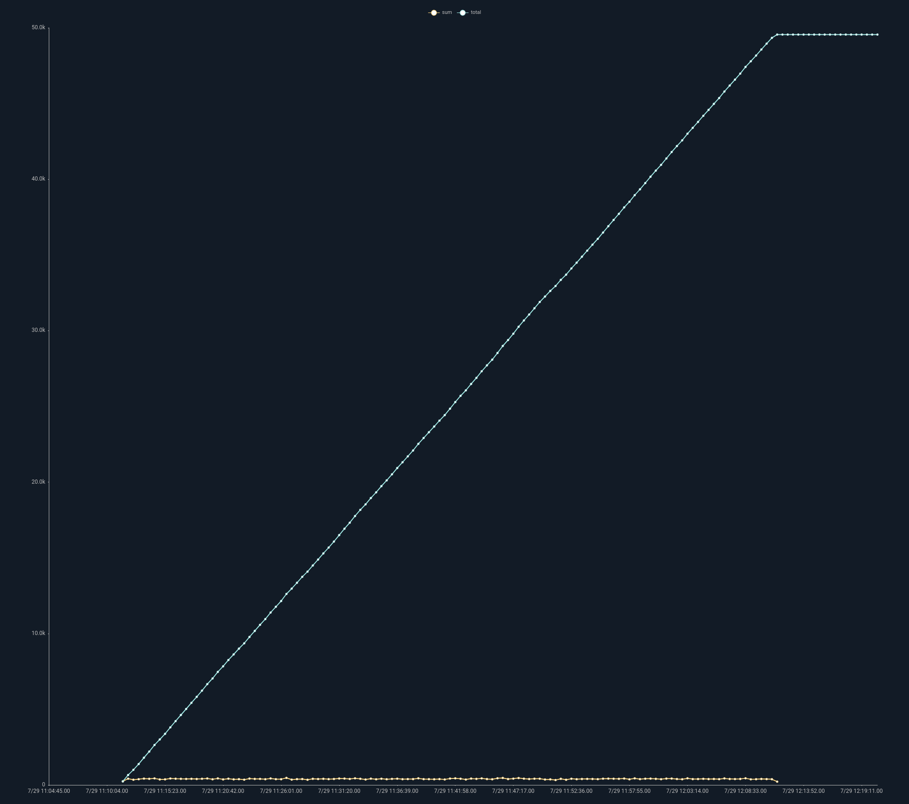
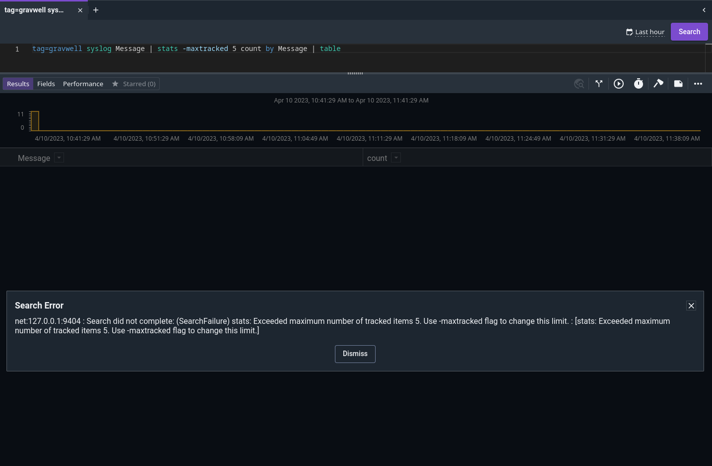

# Stats 

The stats module performs one or more statistical operations in a single pass, where the individual [math modules](/search/math/math) perform only one. A common use is computing the mean and standard deviation of a value to draw error bars on a chart.

## Syntax

An invocation of the stats module consists of:

* The module name (`stats`)
* Optional flags
* A list of operations, each naming the enumerated value to operate on and optionally a name for the output (`mean(length)`, `count as foo`)
* Optional "by" arguments, which perform the operations separately for each combination of by values (as in `mean(Length) by SrcIP`)
* An optional time window (`over 5m`)

These components are discussed below.

### Supported Flags

* `-b`: Always preserve the original body of the entry. Normally `tag=* length | stats max(length) | text` overwrites the output entry's body with the result (`max 1234`) for display with the text renderer. With `-b` (`tag=* length | stats -b max(length) | text`), the body is preserved, so the renderer shows the *contents* of the longest entry seen.
* `-maxtracked <n>`: Sets the maximum number of items to track, summed across all operations (one per key per operation, plus each unique value for `unique_count`). This guards against memory exhaustion from queries like `stats count by ipv6addr` over millions of IPv6 addresses. If the limit is exceeded, the search terminates with an error suggesting you increase it. Defaults to 1000000. See "The `-maxtracked` flag" below.
* `-maxsize <n>`: Sets the maximum amount of memory, in megabytes, that stats may use to track data. If exceeded, the search terminates with an error. Defaults to 1024 MB or 15% of system memory, whichever is larger. The value may not exceed 90% of system memory.

(math_operations_specification)=
## Math Operations Specification
 
An operation consists of the operation name, the "source" enumerated value in parentheses, and optionally a different name for the output enumerated value.

The following operation names are supported:

* `count`: count entries. With a source (`count(Bytes)`), only entries that have that enumerated value are counted.
* `sum`: sum the values
* `total`: sum the values, keeping a running total across time windows (see "sum() vs total()" below)
* `mean`: the average
* `stddev`: the standard deviation
* `variance`: the variance
* `min`: the minimum value seen
* `max`: the maximum value seen
* `unique_count`: the number of unique values of the source seen

For example, `stats sum(Bytes)` sums the `Bytes` enumerated values and outputs a single entry with an enumerated value named `sum` containing the result.

```{note}
If no source is specified, the operation is performed on the body of the entry: `stats sum` is equivalent to `stats sum(DATA)`. The exception is `count`, which counts entries.
```

Multiple operations can be specified:

```
stats sum(Bytes) mean(Bytes)
```

```
stats mean(Bytes) stddev(Bytes) min(Length)
```

By default, the output of an operation goes in an enumerated value named after the operation, so `stats sum(Bytes)` creates `sum`. Change this with `as`:

```
stats mean(Bytes) as BytesAvg
```

This is needed when performing the same operation on several enumerated values:

```
stats mean(Bytes) as BytesAvg mean(Length) as LengthAvg
```

## "By" Arguments Specification

To perform an operation separately for each value of a field, such as each IP, specify "by" arguments:

```
stats mean(Bytes) stddev(Bytes) by SrcIP
```

This calculates a separate mean and standard deviation for each unique SrcIP value. The result is one entry per SrcIP, each containing the SrcIP, mean, and stddev enumerated values.

When combining `as` and `by` on an operation, `as` must come first: `stats mean(Bytes) as BytesAvg by SrcIP`.

You can specify any number of by arguments:

```
stats mean(Bytes) stddev(Bytes) by SrcIP DstIP DstPort
```

This calculates a separate mean and standard deviation for *every combination of SrcIP, DstIP, and DstPort*.

```{attention}
When working with very large datasets on systems with limited memory, specifying too many by arguments can lead to memory exhaustion as the stats module attempts to keep millions of combinations in memory.
```

### Using complex "By" arguments

If only the last operation has a `by` clause, it applies to every operation. `stats mean(Bytes) stddev(Bytes) by SrcIP` keys both operations by SrcIP. If an earlier operation has a `by` clause that differs from the last operation's, each operation keeps its own keys, and operations without a `by` clause are computed across all entries.

For example, the following runs `mean` keyed by `SrcIP DstIP DstPort`, but computes `stddev` without keys:

```
stats mean(Bytes) by SrcIP DstIP DstPort stddev(Bytes)
```

This per-operation keying is useful for showing operations with different keys in a single table or chart. For example, this query sums packet sizes by IP and also provides a baseline sum across all packets:

```gravwell
tag=pcap packet ipv4.IP ~ 192.168.1.0/24 | length | stats sum(length) by IP sum(length) as total | chart total sum by IP 
```



## Time Window Specification

The stats module operates in one of two modes: temporal or condensed.

In condensed mode, it emits results only once. This happens automatically when using the text renderer or when the `-nt` flag is passed to the table renderer.

In temporal mode, it operates over time windows, by default 1 second, emitting a set of result entries for each window. This is used when sending data to the chart renderer.

Change the window size with `over`:

```
stats mean(Bytes) stddev(Bytes) by SrcIP over 5m
```

When sent to the chart renderer, the results are calculated over 5 minute windows rather than 1 second.

```{note}
Only one time window can be specified, and it applies to all operations. It must be the last argument to stats.
```

## sum() vs total()

The `sum` and `total` operations behave the same in every context except the chart renderer, where `total` does not reset across time buckets.

The difference is shown in this screenshot of the following query:

```gravwell
tag=zeekconn fields -d "\t" [8] as dur
| stats sum(dur) total(dur)
| chart sum total
```



The `sum` line shows the duration summed within each bucket. The `total` line shows a running total that accumulates across buckets.

## The `-maxtracked` flag

The `-maxtracked` flag is a safety rail against runaway queries. For instance, each Zeek entry includes a unique ID, so a query like `tag=zeekconn ax uid | stats count by uid` could exhaust memory. Most queries never need to change the default. If a query exceeds the limit, the search stops with an error, and you can either reformulate the query or raise the limit:


