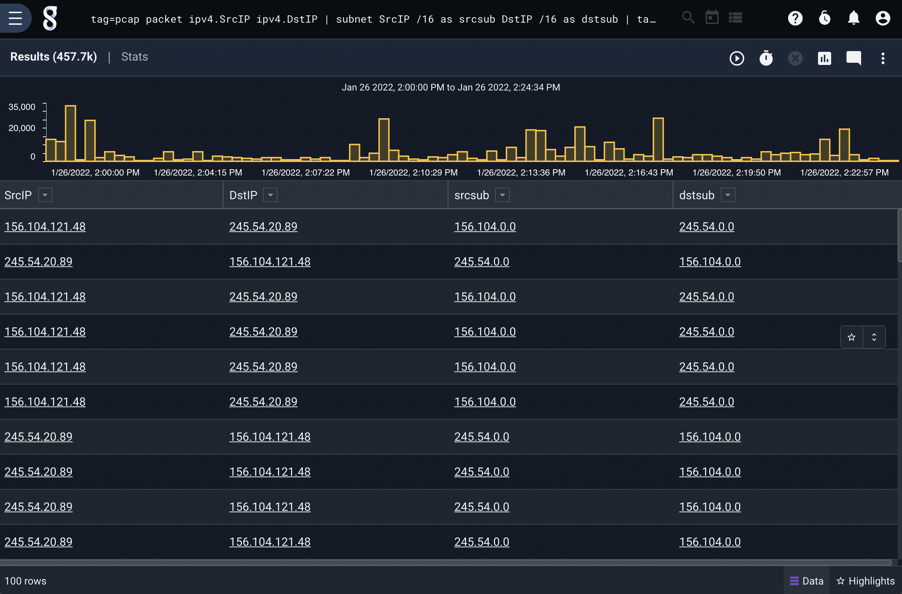

# Subnet

The subnet module masks an IP address down to its subnet, which is useful for grouping or filtering addresses by network, such as classifying attackers by origin. Specify an enumerated value followed by a prefix length, such as `ip /16`. The result is written to an enumerated value named `subnet` unless you rename it with `as`. You can process several IPs in one invocation, but each needs a unique output name.

The module assumes IPv4; use `-6` for IPv6 addresses. Prefix lengths must be 1-32 for IPv4 and 1-128 for IPv6. Entries where the enumerated value is missing or does not hold an IP address are dropped.

## Supported Options

* `-4`: treat addresses as IPv4. This is the default.
* `-6`: treat addresses as IPv6. Cannot be combined with `-4`.

## Example Usage

Chart failed SSH login attempts by origin subnet:

```gravwell
tag=syslog grep sshd | grep "Failed password for" | regex "\sfrom\s(?P<ip>\S+)\s" | subnet ip /16 | count by subnet | chart count by subnet limit 64
```

Show only failed SSH login attempts from the 34.22.1.0/24 subnet:

```gravwell
tag=syslog grep sshd | grep "Failed password for" | regex "\sfrom\s(?P<ip>\S+)\s" | subnet ip /24 as attackersub | ip attackersub == 34.22.1.0 | count by ip | sort by count desc | table ip count
```

Get the source and destination subnets from packets:

```gravwell
tag=pcap packet ipv4.SrcIP ipv4.DstIP | subnet SrcIP /16 as srcsub DstIP /16 as dstsub | table
```


