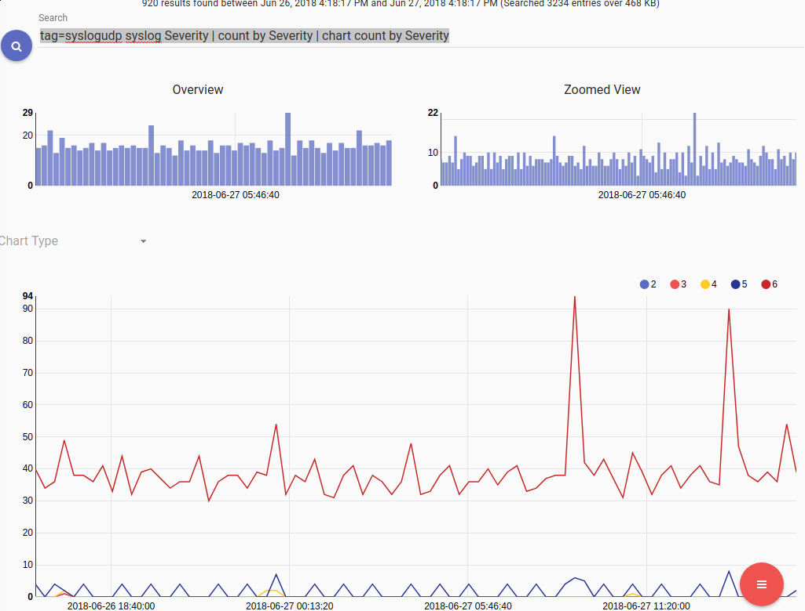
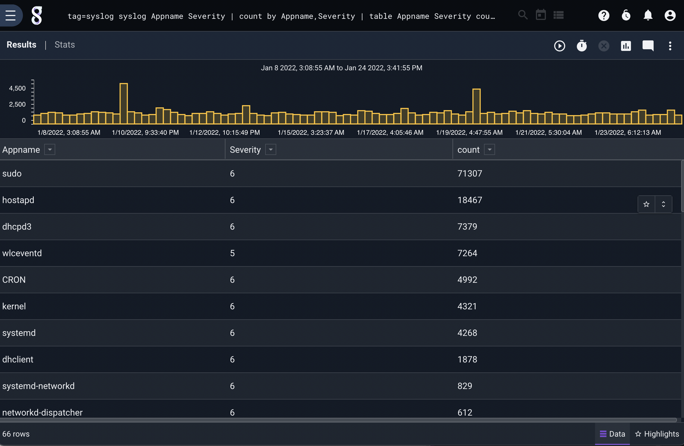

# Syslog

The `syslog` module extracts fields from [RFC 5424](https://tools.ietf.org/html/rfc5424) and [RFC 3164](https://tools.ietf.org/html/rfc3164) (BSD) syslog records, such as those ingested with the [Simple Relay ingester](/ingesters/simple_relay). RFC 5424 records must keep their leading `<nnn>` priority, so leave `Keep-Priority` enabled on the listener (it is on by default).

## Supported Options

* `-e <arg>`: Operate on the enumerated value `<arg>` instead of the entry data. This is useful when an upstream module has already extracted a syslog record, for example from raw PCAP. Entries without the enumerated value are dropped.
* `-s`: Strict mode. Drop entries that cannot be parsed as syslog, and entries missing a requested structured data field.

## Processing Operators

Each syslog field supports inline filters. Which operators are available depends on the field's type, as listed under Data Fields below.

| Operator | Name | Description |
|----------|------|-------------|
| == | Equal | Field must be equal
| != | Not equal | Field must not be equal
| < | Less than | Field must be less than
| > | Greater than | Field must be greater than
| <= | Less than or equal | Field must be less than or equal to
| >= | Greater than or equal | Field must be greater than or equal to
| ~ | Contains | Field must contain the value
| !~ | Not contains | Field must NOT contain the value

An entry that fails a filter is dropped. Entries that cannot be parsed as syslog are passed through with nothing extracted, unless `-s` is set or a filter that requires a value (`==`, `~`, `<`, `>`, `<=`, `>=`) is used.

## Data Fields

| Field | Description | Supported Operators | Example |
|-------|-------------|---------------------|---------|
| Facility | Numeric code indicating the facility from which the message originates | > < <= >= == != | Facility == 0
| Severity | Numeric code indicating the severity of the message, with 0 being the most severe and 7 the least | > < <= >= == != | Severity < 3
| Priority | The message priority, defined as (8*Facility)+Severity | > < <= >= == != | Priority >= 100
| Version | The version of the syslog protocol in use (RFC 5424 only) | > < <= >= == != | Version != 1
| Timestamp | A string representation of the timestamp provided in the log message | == != ~ !~ | Timestamp ~ "2018-10"
| Hostname | The hostname of the machine which originally sent the syslog message | == != ~ !~ | Hostname != "myhost"
| Appname | The application which originally sent the syslog message, e.g. `systemd` | == != ~ !~ | Appname != "dhclient"
| ProcID | A string representing the process which sent the message, often a PID | == != ~ !~ | ProcID != "7053"
| MsgID | A string representing the type of message (RFC 5424 only) | == != ~ !~ | MsgID == "TCPIN"
| Message | The log message itself | == != ~ !~ | Message ~ "error" |
| StructuredID | The structured data ID (see below) | == != ~ !~ | StructuredID == "ourSDID@32473"

Fields that are `-` (nil) in an RFC 5424 record are extracted as empty values. For RFC 3164 records, a tag of the form `appname[pid]:` is split into `Appname` and `ProcID`, `Version` is 0, and `MsgID` is empty. If an RFC 3164 record has no `<nnn>` priority, `Facility`, `Severity`, and `Priority` are 0.

Consider the following syslog record (sourced from [https://github.com/influxdata/go-syslog](https://github.com/influxdata/go-syslog)):

```
<165>4 2018-10-11T22:14:15.003Z mymach.it e - 1 [ex@32473 iut="3" foo="bar"] An application event log entry...
```

The `syslog` module extracts the following fields:

* Facility: 20
* Severity: 5
* Priority: 165
* Version: 4
* Timestamp: "2018-10-11T22:14:15.003Z"
* Hostname: "mymach.it"
* Appname: "e"
* ProcID: "" (empty, the record has `-`)
* MsgID: "1"
* Message: "An application event log entry..."

(syslog_structured_data)=
### Structured Data

In the example record above, the portion `[ex@32473 iut="3" foo="bar"]` is the *Structured Data* section. A Structured Data section contains an ID ("ex@32473", extracted with `StructuredID`) and any number of key-value pairs. To extract a value, specify `Structured.key`: `syslog Structured.iut` will extract an enumerated value named `iut` containing the value "3". Similarly, `syslog StructuredID Structured.foo` would extract `StructuredID` containing "ex@32473" and `foo` containing "bar".

A single syslog message may contain multiple structured data sections, each with its own ID. If more than one section defines the same key, specify the section ID: `syslog Structured[ex@32473].foo`. Without the ID, the value comes from one of the sections, with no guarantee which.

If a requested structured data key is missing, the entry passes unless `-s` is set or the key has an `==` or `~` filter.

```{note}
If multiple structured data sections exist, `StructuredID` filters are checked against the IDs of all sections. Without a filter, `StructuredID` holds the alphabetically first ID, not necessarily the first section in the record. For example, given an entry containing `[foo@bar a=b][baz@quux x=y]`, the entry will be dropped if you specify `StructuredID!="baz@quux"` *or* `StructuredID!="foo@bar"`. Specifying `StructuredID=="baz@quux"` will pass the example entry because *one* of the sections matches; it will only drop entries that don't have "baz@quux" as the ID of *any* section.
```

## Examples

### Number of events by severity

```gravwell
tag=syslog syslog Severity | count by Severity | chart count by Severity
```



### Number of events at each severity level by application

```gravwell
tag=syslog syslog Appname Severity | count by Appname Severity | table Appname Severity count
```


