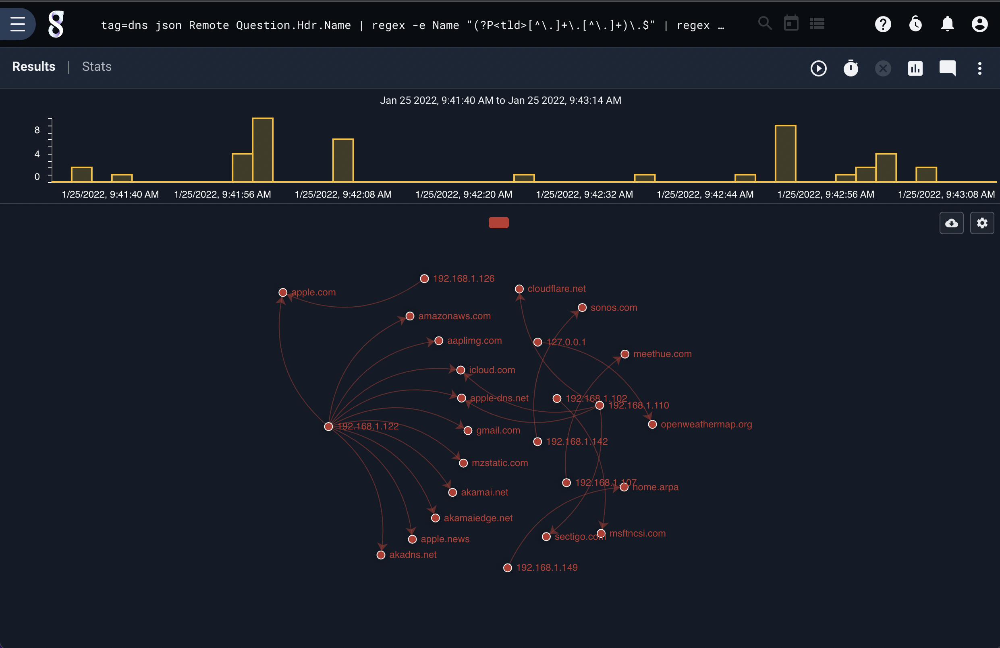
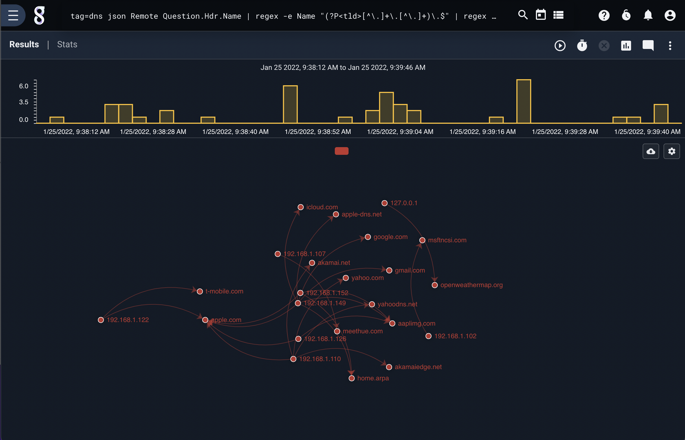

# Taint

Taint performs taint analysis and flow tracking. It can start from a known patient zero and propagate "infections" forward in time, or start from a known infection and work backwards to find where it came from. With a patient zero (`-pz`), taint makes the search run from the start of the time window forward. With a known infection (`-f`), the search runs in its normal direction, from the end of the time window backwards.

If A is tainted, and A touches B, and then B touches C, the taint propagates A->B->C. A, B, and C are all tainted and can taint other values. Use taint to track network flows, infections, or movement of physical systems. For example, to track ICMP propagation, the source enumerated value might be "SrcIP" and the destination "DstIP".

Taint takes two enumerated value names: a source and a destination. When moving forward in time with `-pz`, if an entry's source value is tainted (it is the patient zero, or was tainted earlier), its destination value becomes tainted too.

With `-f`, taint works backwards in time from a known infection. Give the source and destination in the same order as with `-pz` (`taint -f <value> src dst`); taint swaps them internally, so if an entry's destination value is tainted, its source value becomes tainted.

Gravwell presented research at the S4x18 conference in Miami which successfully tracked USB based infectors that [hopped air gaps](https://s4x18.com/sessions/using-force-directed-graphs-to-analyze-huge-event-datasets/).

```{attention}
Taint controls the direction of the search, so don't combine it with the sort module.
```

## Syntax

```
taint <-pz value | -f value> [-b] [-a] <src> <dst>
```

As with the [force directed graph renderer](/search/fdg/fdg), you give source and destination enumerated values, and `-b` makes the relationship bidirectional. Exactly one of `-pz` or `-f` is required. The source and destination must be different enumerated values.

Quote `-pz` and `-f` values that contain dots, such as IP addresses or domains (`-pz "10.0.0.1"`). Unquoted, the query parser splits them at the dot.

## Supported Options
* `-pz <arg>`: The patient zero value. Taint starts with this value marked as tainted and tracks infections forward in time.
* `-f <arg>`: A known-infected value. Taint starts with this value marked as tainted and tracks infections backwards in time.
* `-b`: Bidirectional. If either side of an entry is tainted, the taint transfers to the other side.
* `-a`: Pass more entries. By default, taint passes only entries that spread the taint to a new value. With `-a`, it also passes entries that lack the source or destination enumerated value, and entries where both values are already tainted. Entries that can't transfer taint (an untainted source, or with `-b`, neither side tainted) are still dropped.

## How Taint Tracking Works

To illustrate how taint tracking works, we'll consider an example of human beings spreading the flu by shaking hands (an inherently "bidirectional" process). Suppose the following handshakes occur in a day:

```
08:00 Alice shakes hands with Bob
09:00 Bob shakes hands with Dan
10:00 Erin shakes hands with Bob
11:00 Frank shakes hands with Alice
12:00 Erin shakes hands with Gerard
```

If we know Dan is the "patient zero", we can work forward and see that at 09:00, Dan infects Bob. From this point, anyone who shakes with Dan *or* Bob is infected. At 10:00, Erin shakes with Bob, meaning she gets added to the infected list: [Dan, Bob, Erin]. At 11:00, Frank shakes hands with Alice, but since neither of them is on the infected list, we ignore this event. At 12:00, Erin shakes hands with Gerard, putting him on the infected list too: [Dan, Bob, Erin, Gerard]. Thus, by the end of the day, we know that Dan, Bob, Erin, and Gerard are infected, but Alice and Frank (probably) aren't.

Tracking backwards from a known infection works similarly, but with less certainty: if we know Erin is infected at the end of the day, we can work our way backwards and find that Gerard, Bob, Dan, *and Alice* are all potential "patient zeroes".

## Examples

Suppose a new infection vector can infect DNS servers by embedding a payload in their lookup cache. Taint can identify which domains may have been attacked. This search starts with a known patient zero and draws a force directed graph of all later propagation of tainted domains in a small network.

```gravwell
tag=dns json Remote Answer.Hdr.Name |  regex -e Name "(?P<tld>[^\.]+\.[^\.]+)\.$" | regex -e Remote "(?P<ip>[\d\.]+):\d+" | taint -b -pz "192.168.1.122" ip tld | fdg -b ip tld
```



This search starts with a known infection and works backwards to a potential patient zero:

```gravwell
tag=dns json Remote Answer.Hdr.Name |  regex -e Name "(?P<tld>[^\.]+\.[^\.]+)\.$" | regex -e Remote "(?P<ip>[\d\.]+):\d+" | taint -b -f "apple.com" ip tld | fdg -b ip tld
```


