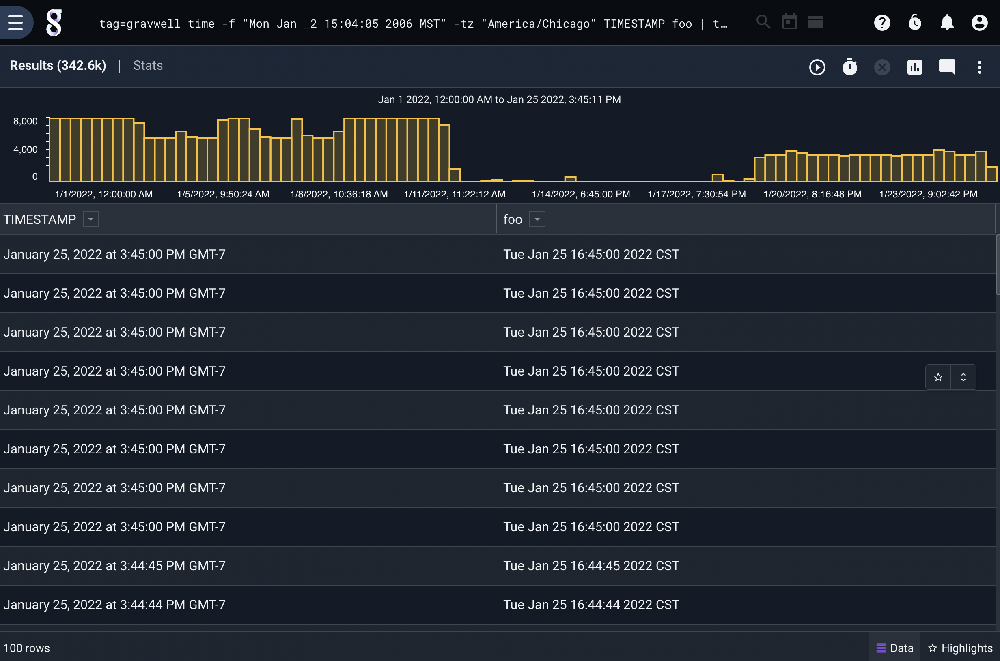
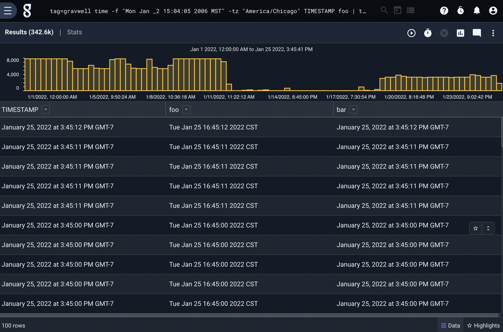

# Time

The time module converts timestamps into formatted strings, and strings into timestamps. It takes one or more pairs of enumerated values: a source and a destination. For example, the following formats each entry's timestamp and stores the result as a string in `formattedTS`:

```gravwell
time -oformat "Mon Jan _2 15:04:05 2006 MST" TIMESTAMP formattedTS
```

If the source is not a timestamp, the module parses it as a time. With no `-iformat`, it uses the `timegrinder` library to try many common formats. The following parses the string in `tsString` and stores the resulting timestamp in `extractedTS`:

```gravwell
time tsString extractedTS
```

Several pairs can be converted in one invocation: `time a b c d` converts `a` into `b` and `c` into `d`. If a source is missing or cannot be parsed, the destination is not set; the entry is not dropped.

## Supported Options

* `-iformat <format>`: The format used to parse strings. The format is a representation of the reference time "Mon Jan 2 15:04:05 MST 2006", as used by the [Go time library](https://golang.org/pkg/time/#pkg-constants). Ignored when the source is a timestamp.
* `-oformat <format>`: The format used to print timestamps, in the same Go reference-time style. For instance, `-oformat "Mon 3:04PM"` gives a very brief timestamp.
* `-tz <timezone>`: A time zone in [tz database format](https://en.wikipedia.org/wiki/List_of_tz_database_time_zones), e.g. "America/Denver", "UTC", or "Atlantic/Reykjavik". It is used when *printing* timestamps (which carry no time zone) and when *parsing* strings that contain no time zone. If omitted, the system's local time zone is used.
* `-f <format>`: Deprecated; use `-iformat` instead.

The output type depends on the source and on `-oformat`:

| Source | `-oformat` set | Output |
|--------|----------------|--------|
| Timestamp | yes | String in the given format |
| Timestamp | no | String in RFC 3339 format (`2006-01-02T15:04:05Z07:00`) |
| Other | yes | String in the given format |
| Other | no | Timestamp |

## Examples

To print entry timestamps in a specific format and time zone:

```gravwell
tag=json time -oformat "Mon Jan _2 15:04:05 2006 MST" -tz "America/Chicago" TIMESTAMP foo | table TIMESTAMP foo
```



The output can be fed back into the time module to convert it back into timestamps:

```gravwell
tag=json time -oformat "Mon Jan _2 15:04:05 2006 MST" -tz "America/Chicago" TIMESTAMP foo | time -iformat "Mon Jan _2 15:04:05 2006 MST" -tz "America/Chicago" foo bar | table TIMESTAMP foo bar
```



The fractional seconds are lost in the final output, because the intermediate format does not include them.
