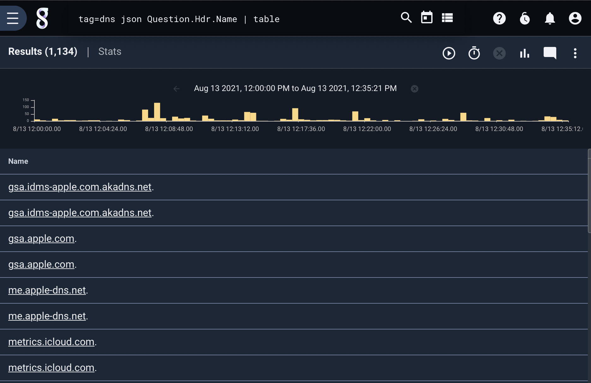
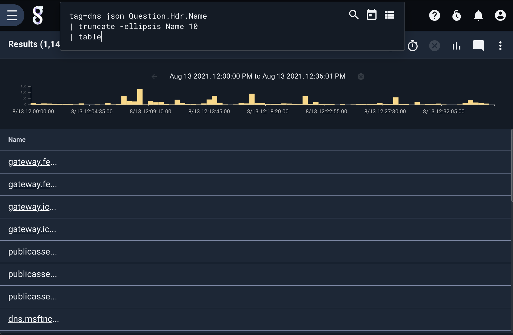

# Truncate

The `truncate` module keeps only the first N characters (or bytes, with `-binary`) of enumerated values. For example, to keep the first 20 characters of the EV `Message`:

```gravwell
tag=data json IP Message | truncate Message 20 | table
```

To truncate several enumerated values, list each name followed by its length:

```gravwell
tag=data json IP Message Path | truncate Message 20 Path 50 | table
```

Values at or under the limit, and entries missing the enumerated value, are unchanged.

`truncate` only operates on string and byte slice enumerated values. By default it counts UTF-8 characters; use `-binary` to count bytes instead.

## Supported Options

* `-ellipsis`: Optional. Append "..." to values that were truncated. The ellipsis is added *after* truncating, so truncated values are three characters longer than the given length.
* `-binary`: Optional. Count and cut by bytes instead of UTF-8 characters.

## Example

This query extracts the requested names from DNS records:

```gravwell
tag=dns json Question.Hdr.Name | table
```



Truncate them to 10 characters and mark the cut with an ellipsis:

```gravwell
tag=dns json Question.Hdr.Name 
| truncate -ellipsis Name 10 
| table
```



