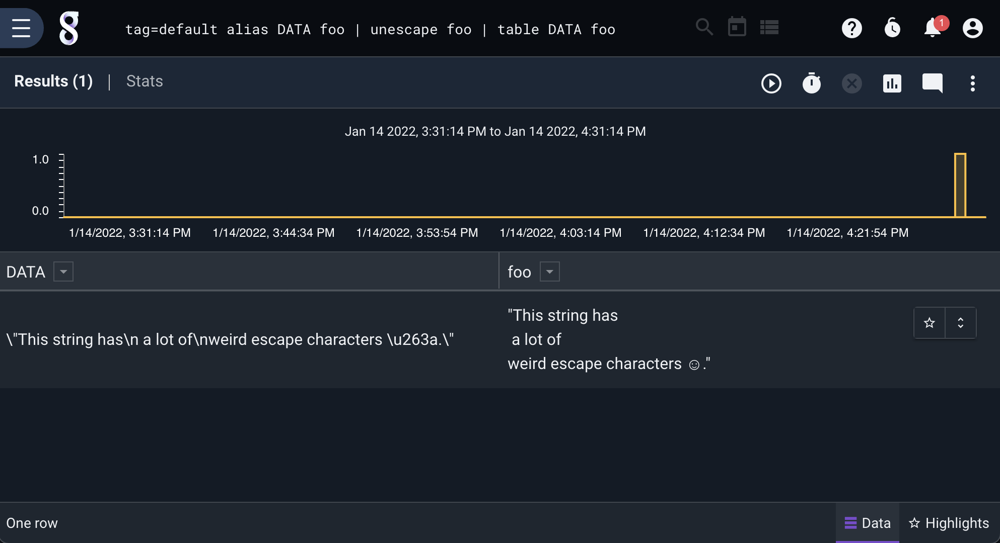

# Unescape

The `unescape` module decodes backslash escape sequences into the characters they represent. With no arguments, it processes the entry data. Given one or more enumerated value names, it processes those enumerated values instead; enumerated values that are missing or are not strings or byte slices are skipped.

Supported sequences:

* `\a`, `\b`, `\f`, `\n`, `\r`, `\t`, `\v`, and `\\`
* `\xHH`: a single byte, given as two hex digits
* `\uHHHH` and `\UHHHHHHHH`: a Unicode code point, given as four or eight hex digits
* `\OOO`: a single byte, given as three octal digits

A backslash before any other character yields that character, so `\"` becomes `"`. Entries containing a malformed sequence, such as a trailing backslash or a `\x` with too few hex digits, are dropped.

## Supported Options

* `-url`: Decode URL percent-encoding (for example, `%20` becomes a space) instead of backslash escapes. `+` is not converted to a space. Entries with invalid percent-encoding are dropped. This flag only applies to enumerated values given as arguments, not to entry data.

## Example Usage

This example unescapes a string `foo`:

```gravwell
tag=default alias DATA foo | unescape foo | table DATA foo
```


